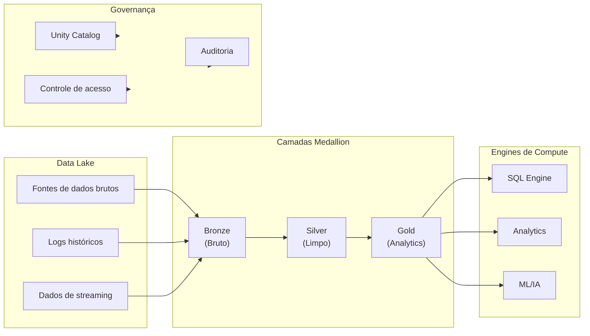
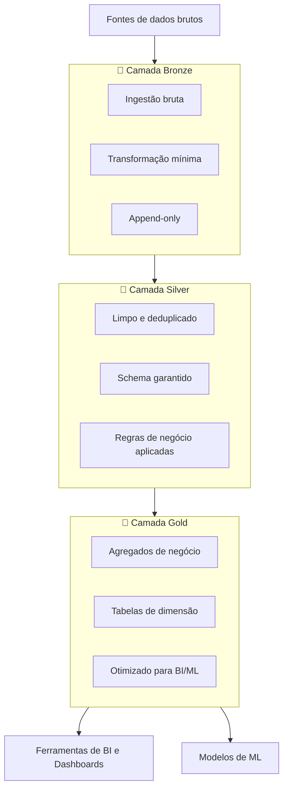

# Arquitetura Lakehouse

## Visão geral

O Databricks Lakehouse combina o melhor dos data warehouses e dos data lakes, permitindo analytics, IA e aplicações em tempo real sobre todos os seus dados. Na prova, este é o Domínio 1 (Databricks Intelligence Platform): os componentes centrais, ou seja, a arquitetura, o Delta Lake e o Unity Catalog.

> [!abstract] Resumo
>
> - Um lakehouse mantém uma única cópia dos dados em formatos abertos no object storage da nuvem e adiciona confiabilidade de nível warehouse com o Delta Lake
> - Camadas medallion: Bronze (bruto, como foi ingerido), Silver (limpo e padronizado), Gold (agregados de negócio para BI e analytics)
> - O Unity Catalog adiciona controle de acesso centralizado, linhagem e auditoria entre workspaces

> [!tip] O que a prova cobra
>
> - Habilidade do exam guide: entender os componentes centrais da plataforma (arquitetura, Delta Lake, Unity Catalog)
> - Por que uma única cópia governada dos dados dá a IA e BI uma única fonte da verdade, com rollback (time travel) e trilhas de auditoria
> - Em qual camada medallion uma transformação ou tabela se encaixa

---

## Arquitetura Lakehouse



## Data Warehouse vs Data Lake vs Lakehouse

| Aspecto | Data Warehouse | Data Lake | Lakehouse |
|--------|---|---|---|
| **Formato dos dados** | Apenas estruturado | Qualquer formato | Estruturado + não estruturado |
| **Custo** | Alto | Baixo | Baixo |
| **Velocidade** | Consultas muito rápidas | Consultas mais lentas | Consultas rápidas |
| **Governança** | Forte | Fraca | Forte |
| **Flexibilidade** | Schema fixo | Flexível | Ambos |
| **Casos de uso** | BI, Analytics | Data science, ML | Todos |

## Conceitos-chave do Lakehouse

### **Transações ACID**

- Garantem confiabilidade e consistência dos dados
- Suportam leituras e escritas concorrentes
- Permitem rollback e recuperação
- Embutidas no formato Delta Lake

### **Schema Enforcement e Schema Evolution**

```python
# Schema enforcement impede dados ruins

(df.write
    .mode("append")
    .saveAsTable("main.silver.orders"))   # falha se o schema do df não bater

# Schema evolution permite mudanças controladas

(df.write
    .mode("append")
    .option("mergeSchema", "true")
    .saveAsTable("main.silver.orders"))   # adiciona as novas colunas do df
```

### **Versionamento de dados e Time Travel**

- Acesse versões históricas dos dados
- Consulte os dados "as of" (como estavam em) um timestamp específico
- Sem git: os snapshots funcionam como controle de versão

```python
# Consulta com time travel

(spark.read
    .option("versionAsOf", 0)
    .table("main.silver.orders"))

# Ou por timestamp

(spark.read
    .option("timestampAsOf", "2025-01-15")
    .table("main.silver.orders"))
```

### **Linhagem de dados e logs de auditoria**

- Rastreiam mudanças nos dados ao longo do tempo
- Quem modificou os dados e quando
- Atendem requisitos de compliance
- Viabilizam a governança de dados

## A base: Delta Lake

O Delta Lake é o storage engine open source que dá suporte ao Lakehouse:

- **Compliance ACID**: controle de concorrência multiversão (MVCC)
- **Formato**: arquivos Parquet + transaction log
- **Confiabilidade**: trata incompatibilidades de schema e corrupção de dados
- **Performance**: suporte nativo a DELETE, UPDATE e MERGE

```python
# Criar uma tabela Delta

df.write.mode("overwrite").saveAsTable("main.bronze.my_table")   # Delta é o formato padrão

# Ou converter Parquet existente

from delta.tables import DeltaTable
DeltaTable.convertToDelta(spark, "parquet.`/path/to/data`")
```

## Arquitetura Medallion (Bronze/Silver/Gold)

Um padrão de boas práticas para organizar os dados:



### Camada Bronze

- **Propósito**: ingestão bruta a partir dos sistemas de origem
- **Schema**: igual ao da origem (pode ser não estruturado)
- **Retenção**: transformação mínima, mantém todos os dados brutos
- **Qualidade**: pode conter duplicatas, nulos e erros
- **Caso de uso**: preservar os dados originais para trilhas de auditoria

### Camada Silver

- **Propósito**: hub analítico limpo e deduplicado
- **Schema**: padronizado e garantido (enforced)
- **Retenção**: remove duplicatas, trata nulos
- **Qualidade**: segue as regras de negócio
- **Caso de uso**: juntar sistemas de origem, identificar dimensões

### Camada Gold

- **Propósito**: agregados prontos para o negócio, para BI/ML
- **Schema**: otimizado para casos de uso específicos
- **Retenção**: apenas o necessário para analytics
- **Qualidade**: totalmente validada, alta confiança
- **Caso de uso**: alimentar dashboards e features de ML

## Onde cada camada vive no Databricks

| Camada | Localização típica no Unity Catalog | Formato | Acesso |
|-------|---------|--------|--------|
| **Bronze** | Tabelas `main.bronze.*` (arquivos brutos em um volume UC como `/Volumes/main/raw/landing/`) | Delta | Engenheiros de dados |
| **Silver** | `main.silver.*` | Delta | Engenheiros de dados, analistas |
| **Gold** | Tabelas, views e materialized views `main.gold.*` | Delta | Analistas, ferramentas de BI, ML |

Muitas equipes usam um catálogo por ambiente (`dev`, `prod`) e um schema por camada. Outras usam um catálogo por camada. De qualquer forma, as camadas são securables do UC, não caminhos de mount do DBFS. Os mounts do DBFS estão depreciados em favor de volumes e external locations do Unity Catalog ([What is DBFS?](https://docs.databricks.com/aws/en/dbfs/)).

## Unity Catalog para governança

O Unity Catalog fornece uma solução de governança unificada:

- **Catalogs**: contêineres parecidos com bancos de dados para organizar tabelas
- **Schemas**: namespaces dentro dos catálogos
- **Tables/Volumes**: objetos de dados com controle de acesso granular
- **Segurança granular**: row filters, column masks e políticas ABAC (veja o [Domínio 7](../07-governance-and-security/04-row-filters-column-masks-abac.md))

```python
# Namespace de três níveis

spark.sql("SELECT * FROM main.default.my_table")

#                        ^    ^       ^
#                  catalog schema  table

```

## Casos de uso

1. **Analytics em tempo real**: dados em streaming pelas camadas medallion, consultados imediatamente
2. **Machine Learning**: conjuntos de features reprodutíveis na camada Gold, time travel para versionar dados
3. **Data Warehousing**: substituir o EDW tradicional com menor custo e mais flexibilidade
4. **Compliance**: trilhas de auditoria em todas as mudanças, mascaramento por coluna
5. **Compartilhamento de dados**: compartilhamento externo seguro sem duplicar dados

## Problemas e erros comuns

### Formatos de dados conflitantes

**Cenário:** consultas falham ao misturar arquivos Parquet, CSV e JSON no mesmo diretório.

**Correção:** converta todos os dados brutos para Delta cedo no pipeline medallion (camada Bronze) para que as camadas seguintes sempre leiam um formato consistente.

### Cache de metadados desatualizado

**Cenário:** dados recém-escritos não aparecem nas consultas.

**Correção:** rode `REFRESH TABLE <table_name>` ou use Delta Lake (que gerencia os metadados automaticamente) em vez de tabelas Parquet/CSV puras.

## Dicas para a prova

- Saiba as três camadas da arquitetura Medallion (Bronze, Silver, Gold) e o propósito de cada uma
- Entenda a diferença entre data warehouse, data lake e lakehouse — principalmente quanto a suporte ACID e flexibilidade de schema
- Lembre que Delta Lake = Parquet + transaction log; isso habilita ACID, time travel e operações DML
- Saiba identificar o namespace de três níveis do Unity Catalog: `catalog.schema.table`

## Pontos-chave

- **O lakehouse combina**: transações ACID e governança forte de um data warehouse com o baixo custo e a flexibilidade de schema de um data lake
- **Delta Lake**: a base do Lakehouse — arquivos Parquet mais um transaction log; habilita ACID, time travel e MERGE/UPDATE/DELETE
- **Camadas medallion**: Bronze (ingestão bruta, append-only) → Silver (limpo, deduplicado, schema garantido) → Gold (agregados de negócio, prontos para BI/ML)
- **Schema enforcement**: comportamento padrão; impede escritas de dados ruins. Habilite evolução com `.option("mergeSchema", "true")`
- **Time travel**: consulte por versão (`versionAsOf`) ou timestamp (`timestampAsOf`) — sem ferramenta externa
- **Namespace do Unity Catalog**: três níveis — `catalog.schema.table`; oferece segurança por coluna, linhagem e auditoria
- **ACID via MVCC**: o controle de concorrência multiversão permite leitores e escritores concorrentes sem locks

## Tópicos relacionados

- [Fundamentos do Delta Lake](04-delta-lake-fundamentals.md)
- [Unity Catalog básico](../07-governance-and-security/01-unity-catalog-basics.md)

## Documentação oficial

- [What is a data lakehouse?](https://docs.databricks.com/aws/en/lakehouse/)
- [What is Delta Lake?](https://docs.databricks.com/aws/en/delta/)
- [What is Unity Catalog?](https://docs.databricks.com/aws/en/data-governance/unity-catalog/)

---

**[↑ Voltar para Databricks Intelligence Platform](./README.md) | [Próximo: Databricks Workspace →](./02-databricks-workspace.md)**
