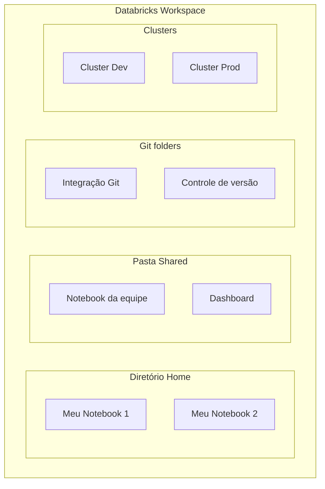

# Databricks Workspace

## Visão geral

O workspace do Databricks é o ambiente colaborativo para desenvolver, testar e implantar soluções de engenharia de dados. Ele oferece ferramentas unificadas para desenvolvimento em SQL, Python, R e Scala.

> [!abstract] Resumo
>
> - O workspace reúne notebooks, arquivos, Git folders, jobs e objetos de dados em uma única interface no navegador
> - Magic commands (`%sql`, `%python`, `%md`, `%run`, `%pip`) mudam a linguagem ou o comportamento de uma única célula
> - `dbutils.widgets` parametrizam notebooks para que os Lakeflow Jobs possam passar valores

> [!tip] O que a prova cobra
>
> - Apoia a habilidade de componentes centrais do Domínio 1: workspace, notebooks e colaboração
> - Misturar linguagens em um notebook, e `%run` vs `dbutils.notebook.run()`
> - A integração com Git (Git folders) é cobrada no Domínio 5. Veja [Git Folders](../05-implementing-cicd/01-git-folders.md)

---

## Arquitetura do Workspace



## Organização do Workspace

### Estrutura de diretórios

| Caminho | Propósito | Acesso |
|------|---------|--------|
| `/Users/{email}/` | Diretório pessoal (home) | Só você |
| `/Shared/` | Pasta acessível pela equipe | Todos os usuários do workspace |
| Git folder (antigo Repo) | Uma pasta do workspace ligada a um repositório Git remoto | Usuários com acesso à pasta |

### Boas práticas

```text
Workspace Root/
├── /Shared/
│   ├── /datasets/               # Referências de dados compartilhadas
│   ├── /dashboards/             # Dashboards de BI
│   ├── /team-notebooks/         # Notebooks colaborativos
│   └── /production-jobs/        # Definições de jobs
├── /Shared/git/
│   └── /data-platform/          # Git folder (antigo Repo) com código de pipeline
└── /Users/
    └── {seu-email}/
        ├── /dev/                # Desenvolvimento pessoal
        ├── /experiments/        # Análises ad hoc
        └── /dashboards/         # Dashboards pessoais
```

## Notebooks

Notebooks são a principal ferramenta de desenvolvimento no Databricks.

### Recursos dos notebooks

- **Múltiplas linguagens**: SQL, Python, R e Scala no mesmo notebook
- **Magic commands**: controlam o comportamento do notebook
- **Colaborativo**: edição multiusuário em tempo real
- **Histórico de versões**: snapshots automáticos de revisões do notebook
- **Publicação**: compartilhar como HTML ou embutir dashboards

### Magic commands de linguagem

```markdown
%python  # Muda para Python
%sql     # Muda para SQL
%r       # Muda para R
%scala   # Muda para Scala
%md      # Formatação Markdown
%sh      # Comandos de shell
```

### Recursos-chave dos notebooks

```python
# Exibir saída formatada

display(df)  # Melhor que df.show()

# Widgets do Databricks para dashboards interativos

dbutils.widgets.text("param_name", "default_value")
dbutils.widgets.dropdown("env", "dev", ["dev", "prod"])

# Ler parâmetros no código

env = dbutils.widgets.get("env")

# Operações de sistema de arquivos

dbutils.fs.ls("/Volumes/main/raw/landing/")  # Listar arquivos em um volume UC
dbutils.fs.mv("/path/src", "/path/dst")  # Mover arquivos
dbutils.fs.cp("/path/src", "/path/dst", True)  # Copiar recursivamente
```

## Git Folders (antigo Repos)

**Databricks Git folders** (antigo Databricks Repos) são pastas do workspace ligadas a um repositório Git remoto. Funcionam como um cliente Git visual para criar branches, fazer commit e push, pull, merge e resolver conflitos pela interface do workspace. A prova cobra esse fluxo no **Domínio 5 — Implementing CI/CD**. Veja [Git Folders](../05-implementing-cicd/01-git-folders.md) para o fluxo completo branch → commit & push → pull request.

### Estratégia de branches para engenharia de dados

```text
main (produção)
├── dev
│   ├── feature/new-pipeline
│   └── feature/optimization
├── staging
└── hotfix/urgent-fix
```

## Clusters

Clusters fornecem o compute para executar notebooks e jobs.

### Tipos de cluster

| Tipo | Caso de uso | Duração |
|------|----------|----------|
| **All-Purpose** | Desenvolvimento interativo | Horas a dias |
| **Jobs** | Batch/streaming automatizado | Minutos a horas |
| **SQL Warehouse** | Consultas SQL e ferramentas de BI | Sempre ligado |

### Personal Compute (cluster de usuário único)

```text
# Inicialização mais rápida para uso pessoal

Configuração:
- Um único nó worker
- Bibliotecas pré-instaladas
- Não compartilhado com ninguém
```

### Cluster compartilhado

```text
# Para colaboração em equipe

Configuração:
- Vários workers
- Bibliotecas compartilhadas
- Audit logging habilitado
```

## Recursos de colaboração

### Colaboração em tempo real

```text
Alice abre o notebook → Bob abre o mesmo notebook
→ Ambos veem as posições do cursor
→ Edições aparecem em tempo real
→ Mudanças compatíveis são mescladas automaticamente
```

### Comentários e discussão

```markdown
<!-- Comentários inline nas células -->
Clique na célula → ícone de Comentários → Adicionar comentário
@mencione membros da equipe para notificá-los
Resolva os comentários quando tratados
```

### Compartilhamento de notebooks

- **Somente leitura**: link para acesso de leitura
- **Permissão de edição**: concede direito de edição
- **Compartilhamento de pasta**: herança de permissões

## Administração e segurança

### Controle de acesso

```text
Admins podem controlar:
- Gestão de usuários e grupos
- Recursos do workspace (notebooks, clusters, jobs)
- Acesso a dados via UC (Unity Catalog)
- Conectividade externa
```

### Autenticação multifator (MFA)

```text
Admin console → Security
→ Exigir MFA para todos os usuários
→ Suporte a provisionamento SCIM
```

### Logs de auditoria

```text
Workspace Admin Console → Audit log
Registra:
- Quem acessou o quê, e quando
- Atividades de login/logout
- Criação/exclusão de recursos
- Mudanças de configuração
```

## Tarefas comuns no workspace

1. **Criar um notebook**: `Workspace > Create > Notebook`
2. **Executar um notebook**: `Run all` ou `Ctrl+Alt+Enter`
3. **Exportar notebook**: baixar como DBC, PDF ou HTML
4. **Mover notebook**: arrastar para a pasta ou usar `Move`
5. **Clonar notebook**: botão direito > `Clone`
6. **Publicar notebook**: compartilhar como dashboard HTML

## Casos de uso

- **Desenvolvimento colaborativo em notebooks**: vários engenheiros trabalham ao mesmo tempo em notebooks compartilhados durante a sprint, usando coedição em tempo real e comentários inline para code review.
- **Pipelines de CI/CD integrados ao Git**: uso de Git folders (antigo Repos) para conectar notebooks ao GitHub/GitLab, permitindo fluxos de pull request, desenvolvimento por branch e testes automatizados antes de promover o código para produção.

## Problemas e erros comuns

### Valor padrão do widget usado em vez do valor do job

**Cenário:** um notebook executado por um Lakeflow Job continua processando a data padrão do widget em vez da data passada pelo job.
**Correção:** o nome do parâmetro da task precisa ser exatamente igual ao nome do widget (`dbutils.widgets.get("run_date")` lê um parâmetro `run_date`). Confira os parâmetros da task nos detalhes da execução.

### Timeout da sessão do notebook

**Cenário:** a sessão do notebook expira após inatividade e o trabalho não salvo nas células é perdido.
**Correção:** mantenha o código em um Git folder (antigo Repos) e faça commits frequentes, para que as mudanças estejam sempre salvas no Git ([Git Folders](../05-implementing-cicd/01-git-folders.md)).

## Dicas para a prova

- Saiba a diferença entre o diretório Home (`/Users/{email}/`), a pasta Shared e os Git folders (antigo Repos)
- Entenda os magic commands (`%python`, `%sql`, `%md` etc.) para trocar de linguagem dentro de um notebook
- Global temporary views usam o banco `global_temp` e persistem entre sessões (no mesmo cluster); temp views comuns têm escopo de sessão

## Pontos-chave

- **Isolamento de workspace**: cada workspace é independente
- **Permissões de objetos do workspace** (notebooks, pastas) são separadas dos privilégios de dados do Unity Catalog
- **Versões de notebook**: o histórico de revisões é salvo automaticamente
- **Git folders** (antigo Repos): integração Git para código de produção. Cobrado no Domínio 5
- **Suporte multilinguagem**: SQL + Python no mesmo notebook

## Tópicos relacionados

- [Arquitetura Lakehouse](./01-lakehouse-architecture.md)
- [Compute e Clusters](./03-compute-clusters.md)

## Documentação oficial

- [Navigate the workspace](https://docs.databricks.com/aws/en/workspace/)
- [Databricks notebooks](https://docs.databricks.com/aws/en/notebooks/)
- [Databricks Git folders](https://docs.databricks.com/aws/en/repos/)

---

**[← Anterior: Arquitetura Lakehouse](./01-lakehouse-architecture.md) | [↑ Voltar para Databricks Intelligence Platform](./README.md) | [Próximo: Compute e Clusters →](./03-compute-clusters.md)**
