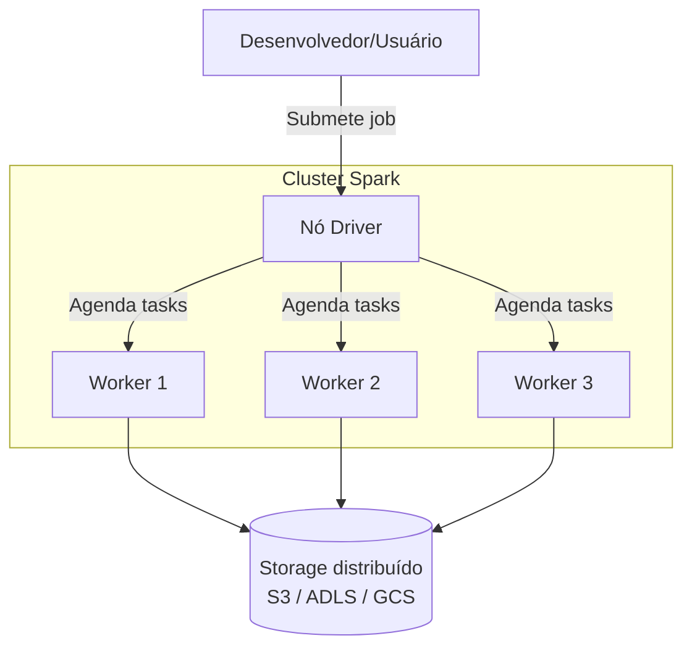
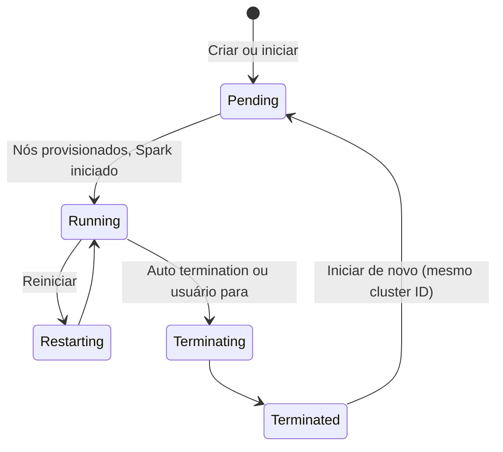

# Compute e Clusters

## Visão geral

Clusters de compute fornecem poder de processamento escalável para notebooks e jobs. Entender os tipos de cluster, a configuração e os custos é essencial para engenheiros de dados.

> [!abstract] Resumo
>
> - **All-purpose compute** é interativo e compartilhável. **Jobs compute** é criado por execução e encerrado ao final
> - **Serverless compute** (notebooks, jobs, pipelines) é gerenciado pela Databricks, inicia rápido e sempre roda o runtime mais recente
> - **SQL warehouses**: serverless (início em ~2–6 s, recomendado), pro e classic. Escalam adicionando clusters para atender concorrência

> [!tip] O que a prova cobra
>
> - Habilidade do exam guide: entender os serviços de compute, suas características, limitações e modelos de custo, e escolher a melhor opção para um workload
> - Cenário clássico: muitos usuários concorrentes rodando SQL ad hoc em tabelas curadas → **serverless SQL warehouse** com autoscaling
> - Alavancas de custo: job vs all-purpose compute, auto termination, pools, instâncias spot, serverless pay-per-use

---

## Arquitetura do cluster

## Serviços de compute em resumo

| Compute | Quem gerencia | Inicialização | Workload típico | Modelo de custo |
| :--- | :--- | :--- | :--- | :--- |
| **Serverless compute** (notebooks, jobs, Lakeflow pipelines) | A Databricks. Os recursos não são provisionados na sua conta de nuvem | Rápida | A maioria dos novos notebooks, jobs e pipelines | DBUs pelo trabalho feito, com tempo ocioso minimizado. Acompanhe em `system.billing.usage` |
| **All-purpose compute** (classic) | Você: tipos de nó, workers, runtime, políticas | Minutos | Desenvolvimento interativo, exploração compartilhada | DBUs mais custo de VM na nuvem enquanto roda, incluindo o tempo ocioso até o auto termination |
| **Jobs compute** (classic) | Você define no job; é criado para a execução e encerrado no fim | Minutos (mais rápido a partir de um pool) | Jobs de produção agendados | Paga só enquanto a execução roda. Tem SKU de jobs separado (mais barato) do all-purpose ([preços](https://www.databricks.com/product/pricing)) |
| **SQL warehouse** — serverless / pro / classic | Serverless: Databricks. Pro/classic: sua conta de nuvem | Serverless ~2–6 s; pro/classic ~4 min | Dashboards de BI, SQL ad hoc, muitos usuários concorrentes | DBUs por tamanho de warehouse enquanto roda; auto stop encerra a cobrança ociosa |
| **Instance pool** | Você | Segundos para clusters que usam instâncias já aquecidas | Clusters classic que precisam iniciar rápido | Você paga ao provedor de nuvem pelas instâncias ociosas no pool |

Uma **DBU** (Databricks Unit) "é uma unidade normalizada de poder de processamento" usada para medição e precificação, cobrada com granularidade por segundo ([Databricks pricing](https://www.databricks.com/product/pricing)). Ela **não** é "uma hora em um worker". A taxa de DBU depende do tipo de compute e do tamanho da instância.

### Serverless compute

- "Serverless compute está disponível por padrão na maioria dos workspaces e não requer habilitação". Workspaces sem Unity Catalog precisam ser atualizados antes
- **Versionless**: "workloads serverless sempre rodam na versão mais recente do runtime"
- Bibliotecas são gerenciadas com **environments**, não com bibliotecas de cluster. A maioria das propriedades Spark não pode ser definida (veja [Spark Tuning Parameters](../03-data-transformation-and-modeling/07-spark-tuning-parameters.md))
- Estime o custo fazendo benchmark de um workload representativo e consultando `system.billing.usage`. As cobranças podem levar até 24 horas para aparecer

Fonte: [Connect to serverless compute](https://docs.databricks.com/aws/en/compute/serverless/).

### Configuração de classic compute

| Configuração | O que a documentação diz |
| :--- | :--- |
| **Access mode** | **Auto** (padrão) escolhe **Standard**, a menos que você escolha runtime ML, GPU ou DBR abaixo de 14.3 — nesse caso escolhe **Dedicated**. Standard = vários usuários com isolamento (Python, SQL, Scala). Dedicated = um usuário ou grupo (adiciona R) |
| **Runtime** | Versão mais recente para all-purpose. Uma versão **LTS** para jobs operacionais. O runtime **ML** para data science |
| **Photon** | Habilitado por padrão a partir do DBR 9.1 LTS |
| **Autoscaling** | Mínimo e máximo de workers. Não habilite também `spark.dynamicAllocation.enabled` |
| **Auto termination** | Período de inatividade de 10–10.000 minutos (0 desativa) |
| **Instâncias spot** | O driver é sempre on-demand. Workers podem usar spot |
| **Single node** | Sem workers. O Spark roda localmente no driver, para dados pequenos e bibliotecas de máquina única |

Fonte: [Compute configuration reference](https://docs.databricks.com/aws/en/compute/configure), [Manage classic compute](https://docs.databricks.com/aws/en/compute/clusters-manage).

### Tipos de SQL warehouse

| Tipo | Photon | Predictive I/O | Intelligent Workload Management | Inicialização |
| :--- | :---: | :---: | :---: | :--- |
| **Serverless** | Sim | Sim | Sim | ~2–6 segundos |
| **Pro** | Sim | Sim | Não | ~4 minutos |
| **Classic** | Sim | Não | Não | ~4 minutos |

- A Databricks recomenda **serverless** para ETL, BI e análise exploratória, "especialmente quando a demanda de consultas varia muito"
- **Escala**: o padrão é mínimo e máximo de um cluster. Aumente o máximo para atender mais usuários concorrentes
- **Auto stop** padrão: 10 minutos (serverless), 45 minutos (pro e classic)

Fontes: [SQL warehouse types](https://docs.databricks.com/aws/en/compute/sql-warehouse/warehouse-types), [Create a SQL warehouse](https://docs.databricks.com/aws/en/compute/sql-warehouse/create).

## Escolhendo o compute para um workload

| Cenário | Melhor escolha | Por que não as outras |
| :--- | :--- | :--- |
| Muitos analistas rodando SQL ad hoc em tabelas Delta curadas o dia todo | **Serverless SQL warehouse** com autoscaling (aumente o max clusters) | Job compute é para ETL agendado. Um cluster all-purpose fixo não equilibra concorrência e custo |
| Notebook de ETL noturno sem ninguém acompanhando | **Serverless jobs** ou **jobs compute** | All-purpose continua cobrando entre comandos e é feito para uso interativo |
| Exploração interativa e debugging | **Serverless notebook** ou **all-purpose compute** | Jobs compute só existe durante uma execução |
| Dataset pequeno, pandas ou scikit-learn | Compute **single-node** | Workers adicionam custo sem benefício |
| Job classic que precisa iniciar em segundos | **Instance pool** (ou serverless) | Um cluster classic "frio" leva minutos para provisionar |
| Código precisa de R, GPU ou init script customizado | Compute **classic** (access mode dedicated quando necessário) | Serverless não expõe esses controles |

## Ciclo de vida do cluster

- "Quando você inicia um compute encerrado, a Databricks recria o compute com o mesmo ID", reinstala as bibliotecas e reanexa os notebooks
- O **event log** do compute mantém eventos de ciclo de vida por 60 dias. Falhas de inicialização são tratadas em [Compute Troubleshooting](../06-troubleshooting-monitoring-and-optimization/05-compute-troubleshooting.md)

## Otimização de custo

| Alavanca | Efeito |
| :--- | :--- |
| Jobs compute ou serverless para trabalho agendado | Não paga por clusters interativos ociosos |
| Auto termination no all-purpose | Impede que clusters esquecidos rodem a noite toda |
| Auto stop nos SQL warehouses | Encerra a cobrança após o período ocioso |
| Workers spot | Capacidade mais barata e interrompível para trabalho tolerante a falhas. O driver fica on-demand |
| Pools | Inicialização mais rápida. Instâncias ociosas do pool ainda custam VM na nuvem |
| Compute policies | Admins limitam tipos de nó, quantidade de workers e configurações |
| `system.billing.usage` | Descobre quais jobs, warehouses e usuários geram gasto |

## Casos de uso

- **Dimensionamento correto para otimizar custo**: escolher tipos de nó e faixas de autoscaling adequados, com base no perfil do workload, equilibrando performance e custo para desenvolvimento interativo e jobs de produção.
- **Pools para inicialização rápida**: pré-provisionar instâncias ociosas em pools para que job clusters subam em menos de um minuto, cumprindo SLAs apertados.

## Problemas e erros comuns

### Jobs agendados rodando em all-purpose compute

**Cenário:** jobs noturnos estão anexados a um cluster all-purpose compartilhado que fica ligado o dia inteiro, e a conta mensal é alta.
**Correção:** rode trabalho agendado em serverless jobs ou jobs compute, que só existem durante a execução. Mantenha all-purpose para trabalho interativo e configure auto termination.

### Auto termination derruba jobs longos

**Cenário:** a configuração de auto termination de um cluster o desliga enquanto um job longo ainda roda, fazendo o job falhar.
**Correção:** aumente o timeout de auto termination dos clusters interativos que rodam workloads longos, ou use job clusters dedicados, que só encerram quando o job termina.

### Atraso na inicialização do cluster

**Cenário:** job clusters levam 5–10 minutos para provisionar, gerando latência inaceitável para pipelines sensíveis a tempo.
**Correção:** use serverless jobs compute, ou um instance pool para que clusters classic usem instâncias pré-aquecidas.

## Dicas para a prova

- Muitos usuários concorrentes de SQL ad hoc → **serverless SQL warehouse** com autoscaling. ETL agendado → serverless jobs ou jobs compute
- Jobs compute é criado para uma execução e encerrado depois, então você nunca paga por tempo interativo ocioso
- Uma DBU é uma unidade normalizada de poder de processamento, cobrada por segundo. Não é "uma hora em um worker"
- Serverless SQL warehouses iniciam em segundos. Pro e classic levam minutos
- Instâncias spot se aplicam aos workers. O driver é sempre on-demand

## Pontos-chave

- **Serverless** (notebooks, jobs, pipelines, SQL warehouses) é gerenciado pela Databricks, inicia rápido e sempre roda o runtime mais recente
- **All-purpose** é para trabalho interativo. **Jobs compute** é para execuções agendadas
- **SQL warehouses**: serverless é o recomendado. Escale com max clusters para concorrência
- **Alavancas de custo**: auto termination, auto stop, workers spot, pools, policies e `system.billing.usage`

## Tópicos relacionados

- [Databricks Workspace](./02-databricks-workspace.md)
- [Spark Tuning Parameters](../03-data-transformation-and-modeling/07-spark-tuning-parameters.md)

## Documentação oficial

- [Compute configuration reference](https://docs.databricks.com/aws/en/compute/configure)
- [Connect to serverless compute](https://docs.databricks.com/aws/en/compute/serverless/)
- [SQL warehouse types](https://docs.databricks.com/aws/en/compute/sql-warehouse/warehouse-types)
- [Databricks pricing](https://www.databricks.com/product/pricing)

---

**[← Anterior: Databricks Workspace](./02-databricks-workspace.md) | [↑ Voltar para Databricks Intelligence Platform](./README.md) | [Próximo: Fundamentos do Delta Lake →](./04-delta-lake-fundamentals.md)**
