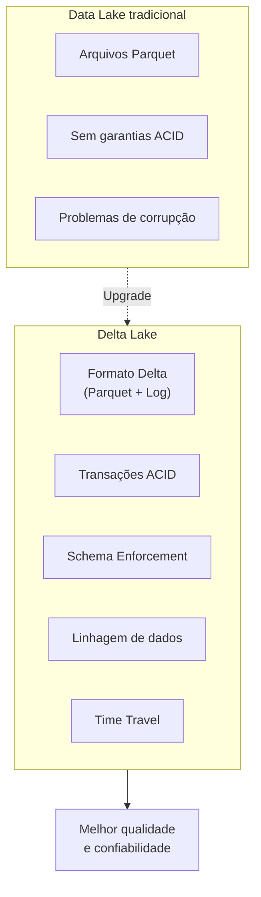
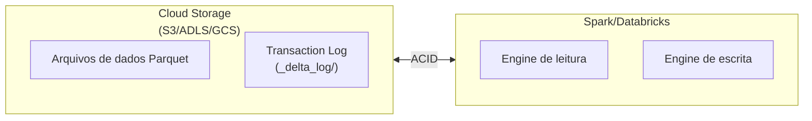

# Fundamentos do Delta Lake

## Visão geral

O Delta Lake é uma camada de armazenamento open source que traz transações ACID, linhagem de dados e processamento unificado de streaming/batch para data lakes. Ele fica sobre o cloud storage (S3, ADLS, GCS) e complementa o Apache Spark.

> [!abstract] Resumo
>
> - Uma tabela Delta é composta por arquivos de dados Parquet mais um transaction log `_delta_log`, o que dá transações ACID sobre object storage
> - Schema enforcement rejeita escritas com schema incompatível. Schema evolution (`mergeSchema`) adiciona colunas de forma intencional
> - DML completo: `INSERT`, `UPDATE`, `DELETE` e `MERGE INTO` para upserts

> [!tip] O que a prova cobra
>
> - Apoia a habilidade do Domínio 1 sobre componentes centrais (Delta Lake)
> - Ler a sintaxe de `MERGE` e escolher `MERGE` em vez de `INSERT` para evitar duplicatas
> - Managed vs external tables são cobradas no Domínio 7. Veja [Managed and External Tables](../07-governance-and-security/02-managed-and-external-tables.md)

---

## O que é o Delta Lake?



## Por que o Delta Lake importa

| Desafio | Data Lake legado | Delta Lake |
|-----------|---|---|
| **Atualizações concorrentes** | Falham, corrompem dados | ACID garante consistência |
| **Evolução de schema** | Versionamento manual | Schema enforcement/evolution embutidos |
| **Debugging** | Dados perdidos, sem histórico | Trilha de auditoria completa via log |
| **Dados atrasados (late data)** | Reescreve a tabela inteira | UPSERT eficiente via MERGE |
| **Exclusões acidentais** | Perda permanente | Time travel para recuperar |
| **Performance** | Variável, consultas lentas | Otimizado com estatísticas |

## Arquitetura do Delta Lake



A tabela Delta é composta por:

- **Arquivos de dados**: formato Parquet (em `/path/to/table/`)
- **Transaction log**: arquivos JSON que registram todas as mudanças (em `/path/to/table/_delta_log/`)

## Transações ACID

### Garantias ACID

- **Atomicidade**: escritas tudo-ou-nada; sem commits parciais
- **Consistência**: restrições de schema e de dados garantidas
- **Isolamento**: vários leitores e escritores não interferem entre si
- **Durabilidade**: escritas confirmadas nunca são perdidas

### Exemplo: proteção ACID

```python

# Parquet tradicional - sem ACID
# Se a escrita falhar no meio, os dados ficam corrompidos

df.write.format("parquet").mode("overwrite").save("/path")

# Delta Lake - protegido por ACID
# Se a escrita falhar, a tabela volta ao estado anterior automaticamente

df.write.format("delta").mode("overwrite").save("/path")
```

## Formatos de tabela Delta

### Managed tables (padrão)

```python
# Dados armazenados em diretório gerenciado pela Databricks

spark.sql("""
CREATE TABLE employees (
    id INT,
    name STRING,
    salary DECIMAL(10, 2)
)
USING DELTA
""")

# Remover a tabela também apaga os dados

spark.sql("DROP TABLE employees")  # Dados apagados
```

### External tables

```python
# Dados armazenados em um local externo que você controla

spark.sql("""
CREATE TABLE employees_external (
    id INT,
    name STRING,
    salary DECIMAL(10, 2)
)
USING DELTA
LOCATION '/mnt/data/employees'
""")

# Remover a tabela NÃO apaga os dados

spark.sql("DROP TABLE employees_external")  # Dados permanecem
```

## Criando tabelas Delta

### A partir de um DataFrame

```python
employees_df = spark.createDataFrame([
    (1, "Alice", 85000),
    (2, "Bob", 75000)
], ["id", "name", "salary"])

(employees_df.write
    .format("delta")
    .mode("overwrite")
    .save("/mnt/data/employees"))

# Ou criar uma managed table

(employees_df.write
    .format("delta")
    .mode("overwrite")
    .saveAsTable("employees"))
```

### Converter Parquet existente

```python
from delta.tables import DeltaTable

DeltaTable.convertToDelta(
    spark,
    "parquet.`/path/to/parquet/data`"
)

# A tabela agora tem transaction log e garantias ACID
```

### Usando SQL

```sql
-- Criar nova tabela Delta
CREATE TABLE products (
    product_id INT,
    name STRING,
    price DECIMAL(10, 2),
    category STRING
)
USING DELTA;

-- Criar a partir do resultado de uma consulta (CTAS)
CREATE TABLE high_earners AS
SELECT name, salary
FROM employees
WHERE salary > 100000;

-- Criar tabela Delta externa
CREATE TABLE orders (
    order_id INT,
    customer_id INT,
    amount DECIMAL(10, 2)
)
USING DELTA
LOCATION '/mnt/data/orders';
```

## Metadados da tabela

### Inspecionando informações

```python
spark.sql("DESCRIBE TABLE employees").show()           # colunas
spark.sql("DESCRIBE TABLE EXTENDED employees").show()  # detalhes (local, tipo, provider)
spark.sql("SHOW TABLES").show()                        # listar tabelas
spark.sql("SHOW TBLPROPERTIES employees").show()       # propriedades
```

### Propriedades de tabela Delta

```python
spark.sql("""
ALTER TABLE employees
SET TBLPROPERTIES (
    'delta.dataSkippingNumIndexedCols' = '32',
    'delta.columnMapping.mode' = 'name'
)
""")
```

## Append vs Overwrite

### Modo append

```python
# Adiciona novas linhas à tabela existente
(new_employees.write
    .format("delta")
    .mode("append")
    .save("/mnt/data/employees"))
```

### Modos de overwrite

```python
# Sobrescreve todos os dados
(updated_data.write.format("delta").mode("overwrite").save("/mnt/data/employees"))

# Erro se o schema não bater
(updated_data.write.format("delta").mode("append").save("/mnt/data/employees"))

# Mescla schemas (adiciona novas colunas)
(updated_data.write
    .format("delta")
    .mode("append")
    .option("mergeSchema", "true")
    .save("/mnt/data/employees"))
```

## Schema enforcement e evolution

### Schema enforcement (impedir dados ruins)

```python
# Schema da tabela: id INT, name STRING, salary DECIMAL
# Tentar escrever schema errado -> ERRO

bad_data = spark.createDataFrame([
    ("Alice", "Not a number", 85000)  # Tipos errados
], ["name", "salary", "bonus"])

(bad_data.write
    .format("delta")
    .mode("append")
    .save("/mnt/data/employees"))  # Falha!
```

### Schema evolution (adicionar colunas)

```python
# Tabela tem: id, name, salary
# Novos dados trazem a coluna department

new_schema_data = spark.createDataFrame([
    (1, "Alice", 85000, "Engineering")
], ["id", "name", "salary", "department"])

(new_schema_data.write
    .format("delta")
    .mode("append")
    .option("mergeSchema", "true")
    .save("/mnt/data/employees"))

# A tabela agora tem: id, name, salary, department
```

## Operações de modificação (DML)

### INSERT

```sql
INSERT INTO employees VALUES (4, "David", 80000);

INSERT INTO employees
SELECT id, name, salary FROM new_hires;
```

### UPDATE

```sql
UPDATE employees
SET salary = salary * 1.1
WHERE department = 'Engineering';
```

### DELETE

```sql
DELETE FROM employees
WHERE salary < 30000;
```

### MERGE (upsert)

```sql
MERGE INTO employees t
USING new_employees s
ON t.id = s.id
WHEN MATCHED THEN UPDATE SET *
WHEN NOT MATCHED THEN INSERT *;
```

## Comparação: Delta vs Parquet vs Iceberg

| Recurso | Delta Lake | Parquet | Apache Iceberg |
|---------|-----------|---------|---|
| **ACID** | Sim | Não | Sim |
| **Evolução de schema** | Sim | Limitada | Sim |
| **Time Travel** | Sim | Não | Sim |
| **Governança** | Forte | Fraca | Forte |
| **Performance** | Otimizada | Boa | Boa |
| **Adoção** | Muito alta | A mais alta | Crescendo |

## Detalhes do transaction log

O diretório `_delta_log/` contém arquivos JSON que registram cada transação:

```json
{
  "add": {
    "path": "part-00000-abc123.parquet",
    "size": 1024000,
    "modificationTime": 1684756800000,
    "dataChange": true
  }
}
```

Cada arquivo JSON representa uma transação confirmada (commit), permitindo:

- Atomicidade (tudo-ou-nada)
- Consistência (validação de schema)
- Isolamento (concorrência multiversão)
- Durabilidade (registro permanente)

## Casos de uso

- **Transações ACID para pipelines concorrentes**: vários jobs de ETL escrevem com segurança na mesma tabela Delta ao mesmo tempo, contando com o ACID para evitar corrupção e escritas parciais.
- **Schema enforcement na ingestão**: usar o schema enforcement do Delta para rejeitar registros malformados na escrita, impedindo que dados ruins entrem no lakehouse e detectando cedo mudanças de schema na origem.

## Problemas e erros comuns

### Problema de arquivos pequenos (small files)

**Cenário:** escritas frequentes em micro-batch deixam as leituras lentas.
**Correção:** rode `OPTIMIZE` regularmente (com Z-ORDER ou, de preferência, Liquid Clustering).

### Acúmulo de arquivos pequenos por escritas frequentes

**Cenário:** streaming em micro-batch ou appends frequentes criam milhares de arquivos Parquet pequenos, degradando muito a leitura.
**Correção:** habilite `spark.databricks.delta.optimizeWrite.enabled = true` para agrupar arquivos na escrita e rode `OPTIMIZE` periodicamente para compactar arquivos pequenos.

### VACUUM apagando arquivos usados por consultas ativas

**Cenário:** rodar `VACUUM` com retenção curta remove arquivos ainda lidos por consultas longas, que falham com `FileNotFoundException`.
**Correção:** garanta que a retenção do VACUUM seja maior que a duração da consulta ativa mais longa. A retenção padrão de 7 dias é segura para a maioria dos workloads.

## Dicas para a prova

- Delta Lake = arquivos Parquet + transaction log `_delta_log/` — saiba essa estrutura
- Managed tables: `DROP TABLE` apaga metadados e dados; External tables: `DROP TABLE` apaga apenas os metadados
- Schema enforcement é o comportamento padrão; `.option("mergeSchema", "true")` habilita schema evolution
- MERGE (upsert) é um recurso-chave do Delta Lake — entenda a sintaxe `WHEN MATCHED` / `WHEN NOT MATCHED`

## Pontos-chave

- **Delta Lake**: camada de armazenamento que adiciona ACID, governança e performance a data lakes
- **Managed tables**: dados em diretório gerenciado, apagados junto com a tabela
- **External tables**: dados em local externo, persistem após o DROP da tabela
- **mergeSchema**: permite novas colunas durante o append
- **Garantias ACID**: Atomicidade, Consistência, Isolamento, Durabilidade
- **Transaction log**: `_delta_log/` mantém o histórico completo
- **Schema enforcement**: impede dados ruins, garante tipos
- **Schema evolution**: adição controlada de colunas via mergeSchema

## Tópicos relacionados

- [Time Travel e Versionamento](./05-time-travel-versioning.md)
- [Otimização do Delta Lake](../06-troubleshooting-monitoring-and-optimization/03-delta-optimization.md)

## Documentação oficial

- [Delta Lake Documentation](https://docs.databricks.com/en/delta/index.html)
- [Delta Lake Table Properties](https://docs.databricks.com/en/delta/table-properties.html)

---

**[← Anterior: Compute e Clusters](./03-compute-clusters.md) | [↑ Voltar para Databricks Intelligence Platform](./README.md) | [Próximo: Time Travel e Versionamento →](./05-time-travel-versioning.md)**
