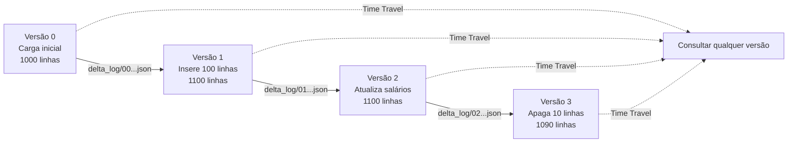

# Time Travel e Versionamento

## Visão geral

O Delta Lake mantém o histórico completo de todas as mudanças no seu transaction log. Isso habilita time travel (consultar dados históricos), versionamento, rollback e operações de clone — recursos que os formatos de dados tradicionais não têm.

> [!abstract] Resumo
>
> - Cada commit cria uma nova versão da tabela. `DESCRIBE HISTORY` lista as versões
> - `VERSION AS OF` / `TIMESTAMP AS OF` consultam uma versão antiga, e `RESTORE TABLE` faz a tabela voltar
> - `VACUUM` apaga arquivos não referenciados e limita até onde o time travel consegue voltar

> [!tip] O que a prova cobra
>
> - Apoia a habilidade de componentes centrais do Domínio 1: rollback confiável após uma ingestão ruim e trilha de auditoria das mudanças
> - `VERSION AS OF 7` (número da versão) vs `TIMESTAMP AS OF` (ponto no tempo)
> - Shallow vs deep clone, e por que o `VACUUM` quebra o time travel

---

## Transaction log e versionamento



## Vendo o histórico de versões

### DESCRIBE HISTORY

```sql
DESCRIBE HISTORY employees

-- Saída: version, timestamp, userId, userName, operation, operationParameters, cluster_id
```

```python
history_df = spark.sql("DESCRIBE HISTORY employees")
history_df.show()
```

### Detalhes das versões

```sql
SELECT version, timestamp, operation, operationParameters
FROM (DESCRIBE HISTORY employees)
ORDER BY version DESC
LIMIT 10;
```

## Consultas com time travel

### Por número de versão

```python
df_v0 = (spark.read
    .format("delta")
    .option("versionAsOf", 0)
    .load("/mnt/data/employees"))

df_v5 = (spark.read
    .format("delta")
    .option("versionAsOf", 5)
    .load("/mnt/data/employees"))

df_v0.count()  # 1000 linhas
df_v5.count()  # 1150 linhas
```

### Por timestamp

```python
df_past = (spark.read
    .format("delta")
    .option("timestampAsOf", "2025-01-15T10:30:00Z")
    .load("/mnt/data/employees"))
```

### Time travel em SQL

```sql
-- Por versão
SELECT * FROM employees VERSION AS OF 5;
SELECT * FROM employees@v5;

-- Por timestamp
SELECT * FROM employees TIMESTAMP AS OF '2025-01-15T10:30:00Z';
SELECT * FROM employees@'2025-01-15';
```

## Recuperação de dados e rollback

### Restaurar para uma versão anterior

```sql
-- Restaurar a tabela para a versão 5
RESTORE TABLE employees TO VERSION AS OF 5;

-- Restaurar para um timestamp
RESTORE TABLE employees TO TIMESTAMP AS OF '2025-01-15';
```

```python
from delta.tables import DeltaTable

delta_table = DeltaTable.forPath(spark, "/mnt/data/employees")
delta_table.restoreToVersion(5)
```

### Exemplo completo de rollback

```python
# Cenário: DELETE acidental de 100 linhas

spark.sql("SELECT COUNT(*) FROM employees").show()  # 900 linhas (ops!)

# Encontrar a versão antes do delete
spark.sql("DESCRIBE HISTORY employees").show(20)  # Versão 10 tinha 1000 linhas

# Restaurar
spark.sql("RESTORE TABLE employees TO VERSION AS OF 10")

spark.sql("SELECT COUNT(*) FROM employees").show()  # 1000 linhas (recuperado!)
```

## Operações de clone

### Shallow clone

Um shallow clone copia os metadados Delta e **referencia os mesmos arquivos de dados**. É rápido e barato, mas compartilha os dados com a origem:

```sql
CREATE TABLE employees_clone SHALLOW CLONE employees;
```

Benefícios do shallow clone:

- Quase instantâneo (copia só metadados)
- Armazenamento mínimo (referencia os arquivos existentes)
- Mudanças afetam apenas o clone

### Deep clone

Um deep clone copia os metadados **E** os arquivos de dados. Mudanças no clone não afetam a origem:

```sql
CREATE TABLE employees_backup DEEP CLONE employees;
```

Benefícios do deep clone:

- Independência total (dados separados)
- Seguro para testes/experimentos
- Ocupa mais armazenamento

### Casos de uso de clone

```python
# Caso 1: cópia de teste antes de experimentar
spark.sql("CREATE TABLE test_df DEEP CLONE production_table")

# Caso 2: backup de um ponto no tempo
spark.sql("CREATE TABLE backup_20250115 DEEP CLONE employees")

# Caso 3: referência zero-copy para acesso de leitura
spark.sql("CREATE TABLE read_only SHALLOW CLONE sensitive_data")
```

## Comparando versões

```python
v3 = spark.read.format("delta").option("versionAsOf", 3).load("/mnt/data/employees")
v5 = spark.read.format("delta").option("versionAsOf", 5).load("/mnt/data/employees")

# Linhas que estão na v5 e não na v3 (SQL EXCEPT ALL)
new_rows = v5.exceptAll(v3)
new_rows.show()
```

## Políticas de retenção

Existem **duas** retenções diferentes — não confunda:

| Propriedade | Padrão | Controla |
| :--- | :--- | :--- |
| `delta.logRetentionDuration` | 30 dias | Por quanto tempo as entradas do transaction log (histórico) são mantidas |
| `delta.deletedFileRetentionDuration` | 7 dias | Por quanto tempo arquivos de dados não referenciados sobrevivem antes que o `VACUUM` possa apagá-los |

```sql
ALTER TABLE employees
SET TBLPROPERTIES (
    'delta.logRetentionDuration' = 'interval 30 days',
    'delta.deletedFileRetentionDuration' = 'interval 30 days'
);

-- Remover arquivos antigos não referenciados (respeita a retenção)
VACUUM employees;
```

> [!warning] Atenção
> Na prática, o time travel só funciona enquanto os **arquivos de dados** da versão ainda existem. Depois de um `VACUUM`, versões mais antigas que a retenção de arquivos (7 dias por padrão) deixam de ser consultáveis, mesmo que ainda apareçam no `DESCRIBE HISTORY`.

## Boas práticas de versionamento

- Sempre confira o histórico (`DESCRIBE HISTORY`) antes de modificar ou restaurar
- Isole mudanças de teste/staging usando clones (`DEEP CLONE production`)
- Arquive pontos importantes com deep clones (`CREATE TABLE archive_2024_12_31 DEEP CLONE employees`)

## Limitações do time travel

| Limitação | Detalhes | Impacto |
|-----------|---------|--------|
| **Retenção** | Log: 30 dias; arquivos: 7 dias (após VACUUM) | Versões antigas deixam de existir |
| **Tamanho do log** | Cresce com a atividade | Custo de armazenamento |
| **Performance** | Versões antigas podem ser mais lentas | I/O de rede até a nuvem |

## Delta Lake vs outros formatos — time travel

| Formato | Histórico de versões | Time Travel | Recuperação | Linhagem |
|--------|---|---|---|---|
| **Delta Lake** | Transaction log completo | Sim | Rollback completo | Sim |
| **Parquet** | Nenhum | Não | Backups manuais | Não |
| **Iceberg** | Histórico completo | Sim | Rollback completo | Sim |
| **Hudi** | Histórico limitado | Sim | Restauração de snapshot | Limitada |

## Casos de uso

- **Recuperação de dados acidental**: restaurar uma tabela Delta para uma versão anterior após um `DELETE` ou `UPDATE` errado, usando `RESTORE TABLE ... TO VERSION AS OF n` para recuperar os dados em minutos.
- **Auditoria regulatória e compliance**: consultar versões históricas para reproduzir relatórios como eram em uma data específica, sem manter cópias de snapshot separadas.

## Problemas e erros comuns

### Time travel falha depois que o predictive optimization roda VACUUM

**Cenário:** uma consulta `VERSION AS OF` de uma versão de duas semanas falha em uma managed table do UC, embora ninguém tenha rodado `VACUUM` manualmente.
**Correção:** o predictive optimization roda `VACUUM` automaticamente em managed tables do UC, com retenção padrão de 7 dias (`delta.deletedFileRetentionDuration`). Aumente essa propriedade se precisar de uma janela de time travel maior ([predictive optimization](https://docs.databricks.com/aws/en/optimizations/predictive-optimization)).

### VersionNotFoundException depois do VACUUM

**Cenário:** uma consulta como `SELECT * FROM table VERSION AS OF 5` falha com `VersionNotFoundException` porque o `VACUUM` já removeu os arquivos daquela versão.
**Correção:** o time travel só está disponível dentro do período de retenção (padrão 7 dias). Planeje a retenção do VACUUM de acordo com seus requisitos de auditoria e recuperação, e use `DESCRIBE HISTORY` para ver quais versões ainda existem.

### Restaurar para a versão errada por engano

**Cenário:** um engenheiro roda `RESTORE TABLE ... TO VERSION AS OF n` com o número errado, sobrescrevendo o estado atual com dados incorretos.
**Correção:** rode sempre `DESCRIBE HISTORY` antes para verificar cada versão. Como o RESTORE cria uma **nova** versão, dá para restaurar de novo e desfazer o erro.

## Dicas para a prova

- Saiba as duas sintaxes: `VERSION AS OF n` e `TIMESTAMP AS OF 'data'` em SQL; opções `versionAsOf` e `timestampAsOf` em PySpark
- `RESTORE TABLE ... TO VERSION AS OF n` faz rollback — isso **cria uma nova versão** (não apaga versões)
- Shallow clone copia só metadados (rápido, pequeno); deep clone copia dados e metadados (lento, independente)
- VACUUM remove arquivos antigos e quebra o time travel para versões mais antigas que o período de retenção

## Pontos-chave

- **Histórico de versões**: registrado nos arquivos JSON do `_delta_log/`
- **Time travel**: consulte qualquer versão histórica por número ou timestamp
- **Restore**: volta a tabela a um estado anterior (criando nova versão)
- **Shallow clone**: cópia de metadados, arquivos compartilhados, instantâneo
- **Deep clone**: cópia completa, dados independentes, mais armazenamento
- **Retenção**: log 30 dias; arquivos removidos pelo VACUUM após 7 dias (padrões)
- **Trilha de auditoria**: histórico completo de todas as operações
- **Recuperação point-in-time**: essencial para compliance e debugging

## Tópicos relacionados

- [Fundamentos do Delta Lake](./04-delta-lake-fundamentals.md)
- [Otimização do Delta Lake](../06-troubleshooting-monitoring-and-optimization/03-delta-optimization.md)

## Documentação oficial

- [Delta Lake Time Travel](https://docs.databricks.com/en/delta/history.html)
- [Clone a Table on Databricks](https://docs.databricks.com/en/delta/clone.html)

---

**[← Anterior: Fundamentos do Delta Lake](./04-delta-lake-fundamentals.md) | [↑ Voltar para Databricks Intelligence Platform](./README.md)**
