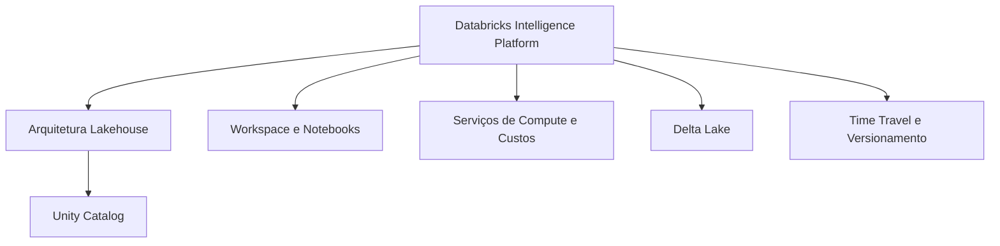

# Databricks Intelligence Platform (6 % da prova)

O Domínio 1 do blueprint de agosto de 2026 cobre duas habilidades. A primeira é conhecer os componentes centrais da plataforma: a arquitetura lakehouse, o Delta Lake e o Unity Catalog. A segunda é escolher o serviço de compute certo para cada workload, com base em suas características, limitações e modelo de custo. O peso é pequeno, mas todos os outros domínios dependem desse vocabulário.

> [!note] Atualização da plataforma (out/2026)
> A página da certificação agora chama a plataforma de **Databricks Data + AI Platform**. O nome do domínio na prova continua "Databricks Intelligence Platform", então espere esse termo nos enunciados ([página da certificação](https://www.databricks.com/learn/certification/data-engineer-associate)).

## Visão geral dos tópicos

## Conteúdo da seção

| Arquivo | Tópico | Prioridade |
| :--- | :--- | :--- |
| [01-lakehouse-architecture.md](./01-lakehouse-architecture.md) | Conceito de lakehouse, camadas medallion, papel do Unity Catalog | Alta |
| [02-databricks-workspace.md](./02-databricks-workspace.md) | Organização do workspace, notebooks, magic commands, widgets | Média |
| [03-compute-clusters.md](./03-compute-clusters.md) | Compute all-purpose, job, serverless e SQL warehouse; modelos de custo | Alta |
| [04-delta-lake-fundamentals.md](./04-delta-lake-fundamentals.md) | Transações ACID, transaction log, DML, schema enforcement | Alta |
| [05-time-travel-versioning.md](./05-time-travel-versioning.md) | `DESCRIBE HISTORY`, `VERSION AS OF`, `RESTORE`, clones | Alta |

## Cobertura das habilidades oficiais (agosto de 2026)

| Habilidade do exam guide (parafraseada) | Onde é coberta |
| :--- | :--- |
| Componentes centrais: arquitetura, Delta Lake, Unity Catalog | [01](./01-lakehouse-architecture.md), [04](./04-delta-lake-fundamentals.md), [05](./05-time-travel-versioning.md), [UC básico](../07-governance-and-security/01-unity-catalog-basics.md) |
| Serviços de compute: características, limitações, custos, escolha por workload | [03](./03-compute-clusters.md) |

## Conceitos-chave

- **Lakehouse**: uma única plataforma que combina o armazenamento de um data lake com a confiabilidade de um data warehouse, servindo BI e IA a partir de uma única fonte da verdade
- **Delta Lake**: o formato de tabela padrão. Fornece transações ACID, schema enforcement e time travel sobre object storage na nuvem
- **Unity Catalog**: a camada de governança para ativos de dados e IA: controle de acesso, linhagem (lineage) e auditoria
- **Escolha de compute**: all-purpose para trabalho interativo, jobs compute ou serverless jobs para pipelines agendados, SQL warehouses (serverless recomendado) para BI e SQL ad hoc

## Próximos passos

Siga para [02 — Data Ingestion and Loading](../02-data-ingestion-and-loading/README.md) para aprender como os dados chegam às tabelas do Unity Catalog.

---

**[← Voltar à Certificação](../README.md) | [Próximo: Data Ingestion and Loading →](../02-data-ingestion-and-loading/README.md)**
