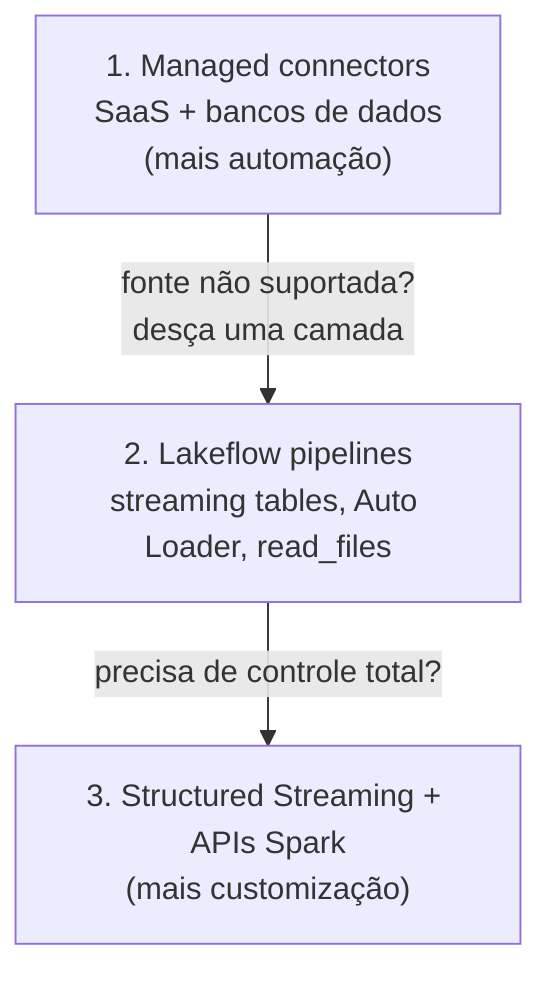
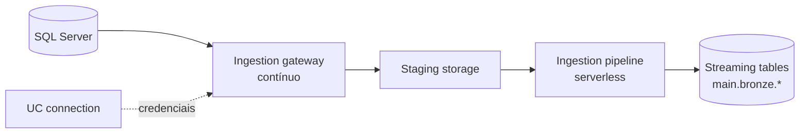

# Padrões de Ingestão e Lakeflow Connect

## Visão geral

Todo pipeline começa colocando dados em uma tabela governada pelo Unity Catalog. Este arquivo cobre os três **padrões** de ingestão (batch, streaming, incremental) e as **fontes** que a prova cita: arquivos locais, standard connectors e managed connectors do Lakeflow Connect. Também mostra como **escolher** entre Auto Loader, Lakeflow Connect, partner connectors e código escrito à mão.

> [!abstract] Resumo
>
> - **Batch** carrega um conjunto limitado de dados por execução. **Streaming** processa registros continuamente conforme chegam. **Incremental** processa só o que é novo desde a última execução, seja como micro-batches disparados ou um `COPY INTO` agendado
> - **Arquivos locais** entram pela UI **Add or upload data**, seja em um volume UC ou direto em uma nova managed table
> - **Standard connectors** (object storage, Kafka, Kinesis, Pub/Sub, SFTP) são customizáveis e rodam com Auto Loader, `read_files`, streaming tables ou Structured Streaming. **Managed connectors** (apps SaaS e bancos de dados) são ingestion pipelines totalmente gerenciados em compute serverless
> - A Databricks recomenda **começar pela camada mais gerenciada** e descer uma camada só quando ela não atender ao requisito

> [!tip] O que a prova cobra
>
> - Habilidades do exam guide: padrões e fontes de ingestão (arquivos locais, standard e managed connectors), configurar o Lakeflow Connect e escolher o método de ingestão por volume, frequência, tipo de dado e governança
> - Reconhecer qual camada de conector se encaixa no cenário: fonte SaaS → managed connector; arquivos em cloud storage → Auto Loader; banco sem conector suportado → JDBC
> - Os componentes de um managed connector de banco de dados: connection, ingestion gateway e ingestion pipeline

---

## Os três padrões de ingestão

| Padrão | O que roda | Ferramenta típica no Databricks | Latência vs custo |
| :--- | :--- | :--- | :--- |
| **Batch (completo)** | Lê a fonte inteira a cada execução e sobrescreve/substitui o destino | `CREATE OR REPLACE TABLE ... AS SELECT`, `spark.read` + `mode("overwrite")` | Simples, mas o custo cresce com o tamanho da fonte |
| **Batch incremental** | Cada execução agendada processa só os dados que chegaram desde a última, e para | `COPY INTO`, Auto Loader com `trigger(availableNow=True)`, streaming tables atualizadas por agenda | Custo baixo, latência igual ao intervalo da agenda |
| **Streaming** | Uma consulta de longa duração processa novos registros continuamente | Auto Loader ou Kafka com trigger `processingTime`, pipelines contínuos | Menor latência, compute sempre ligado |

A diferença entre "incremental" e "streaming" é **com que frequência o trabalho roda**, não qual API você usa. O mesmo stream do Auto Loader vira um job de batch incremental quando você o roda com `availableNow` a partir de um Lakeflow Job agendado.

```python
# Mesma fonte, dois padrões — só o trigger muda
stream = (spark.readStream.format("cloudFiles")
    .option("cloudFiles.format", "json")
    .option("cloudFiles.schemaLocation", "/Volumes/main/raw/_schemas/orders")
    .load("/Volumes/main/raw/landing/orders"))

# Batch incremental: processa tudo que é novo e para (agende com Lakeflow Jobs)
(stream.writeStream
    .option("checkpointLocation", "/Volumes/main/raw/_checkpoints/orders")
    .trigger(availableNow=True)
    .toTable("main.bronze.orders"))

# Streaming: verifica novos arquivos a cada minuto até ser parado
# (stream.writeStream ... .trigger(processingTime="1 minute") ...)
```

> [!note]
> `Trigger.Once` está depreciado a partir do Databricks Runtime 11.3 LTS. Use `availableNow` para workloads de batch incremental ([trigger intervals](https://docs.databricks.com/aws/en/structured-streaming/triggers)).

## Importando arquivos locais

O exam guide lista arquivos locais como fonte. A UI do Databricks oferece dois caminhos:

| Caminho | Resultado | Requisitos |
| :--- | :--- | :--- |
| **New → Add or upload data → Upload files to a volume** | Os arquivos vão para um volume do Unity Catalog (`/Volumes/<catalog>/<schema>/<volume>/...`) | `WRITE VOLUME` no volume; `USE CATALOG` e `USE SCHEMA` nos pais |
| **Create table** a partir de arquivos enviados, no Catalog Explorer | Uma **managed table** do Unity Catalog criada a partir dos arquivos | `CREATE TABLE` no schema de destino e um SQL warehouse rodando |

- Uploads pela UI têm **limite de 5 GB por arquivo**. Use o Databricks SDK for Python para arquivos maiores
- Notebooks também oferecem **File → Upload files to volume**
- Depois que os arquivos estão num volume, qualquer leitor pode carregá-los: `read_files`, `COPY INTO` ou Auto Loader

```sql
-- Ler um CSV enviado para um volume
SELECT * FROM read_files(
  '/Volumes/main/raw/uploads/customers.csv',
  format => 'csv',
  header => true
);
```

## Lakeflow Connect: três camadas

O Lakeflow Connect oferece conectores para arquivos locais, aplicações corporativas, bancos de dados, cloud storage e message buses. Todos são governados pelo Unity Catalog e orquestrados com Lakeflow Jobs ([What is Lakeflow Connect?](https://docs.databricks.com/aws/en/ingestion/overview)).



### Standard connectors (customizáveis)

Standard connectors são os caminhos de ingestão customizáveis em SQL e Spark para:

- **Cloud object storage** (S3, ADLS, GCS, volumes UC): Auto Loader, `read_files`, streaming tables, `COPY INTO`
- **Message buses**: Apache Kafka, Amazon Kinesis, Google Pub/Sub (Structured Streaming e Lakeflow pipelines)
- **Servidores SFTP**

Você mesmo escreve a lógica de ingestão, o que dá controle total sobre transformações, tratamento de schema e triggers.

Exemplo de standard connector para um message bus:

```python
from pyspark.sql.functions import col

events = (spark.readStream
    .format("kafka")
    .option("kafka.bootstrap.servers", "broker1:9092")
    .option("subscribe", "orders")
    .option("startingOffsets", "latest")
    .load()
    # key e value sempre chegam como binário — faça cast ou desserialize
    .select(col("key").cast("string"), col("value").cast("string").alias("json"),
            "topic", "partition", "offset", "timestamp"))

(events.writeStream
    .option("checkpointLocation", "/Volumes/main/raw/_checkpoints/kafka_orders")
    .trigger(processingTime="30 seconds")
    .toTable("main.bronze.kafka_orders"))
```

A fonte Kafka retorna `key`, `value` (ambos binários), `topic`, `partition`, `offset`, `timestamp` e `timestampType` ([Connect to Apache Kafka](https://docs.databricks.com/aws/en/connect/streaming/kafka)).

### Managed connectors (totalmente gerenciados)

Managed connectors "são construídos sobre Lakeflow pipelines, oferecendo ainda mais automação para as fontes de dados mais populares" ([Lakeflow Connect overview](https://docs.databricks.com/aws/en/ingestion/overview)). Categorias:

| Categoria | Exemplos da documentação |
| :--- | :--- |
| SaaS | Salesforce, HubSpot, Jira, Workday, Microsoft Dynamics 365 |
| Banco de dados (CDC) | MySQL, PostgreSQL, SQL Server, Oracle |
| Query-based | Consulta a fonte diretamente, sem configurar CDC |
| Fonte de arquivos | Google Drive, SharePoint |
| Streaming | RabbitMQ |

Novos conectores chegam com frequência, muitos primeiro em Beta. Confira a [lista de conectores do Lakeflow Connect](https://docs.databricks.com/aws/en/ingestion/lakeflow-connect/) antes de assumir que uma fonte é ou não suportada.

## Configurando um managed connector

Um managed connector produz um ingestion pipeline governado pelo Unity Catalog ([connector concepts](https://docs.databricks.com/aws/en/ingestion/lakeflow-connect/)). Seus componentes:

| Componente | O que é |
| :--- | :--- |
| **Connection** | Um securable do Unity Catalog que guarda os dados de autenticação da fonte |
| **Ingestion gateway** *(só conectores de banco de dados)* | Roda como task contínua no seu próprio job e prepara (stage) os dados de mudança para captura contínua |
| **Ingestion pipeline** | Lê a fonte (ou as mudanças preparadas) e escreve no destino; pipelines query-based rodam em serverless por padrão |
| **Tabelas de destino** | **Streaming tables** no catálogo e schema que você escolher |



Passos típicos de configuração:

1. **Criar a connection** no Catalog Explorer, ou programaticamente com a Connections API ou `databricks connections create --json ...`. Conectores cuja única autenticação é OAuth pelo navegador (OAuth U2M) não podem ser criados programaticamente
2. **Criar o ingestion pipeline**: escolha a connection, os objetos de origem (tabelas ou relatórios) e o catálogo/schema de destino
3. **Adicionar uma agenda**: "Para cada agenda adicionada a um pipeline, o Lakeflow Connect cria automaticamente um job", com o ingestion pipeline como task. Você pode adicionar tasks downstream a esse job
4. **Implantar como código** (opcional): ingestion pipelines podem ser implantados com Declarative Automation Bundles (veja o [Domínio 5](../05-implementing-cicd/02-declarative-automation-bundles.md))

A primeira execução ingere tudo que você selecionou. As seguintes usam change tracking para ingerir só o que mudou, quando a fonte suporta. Monitore o custo com a system table `system.billing.usage`.

### Escritas diretas de aplicações (Zerobus Ingest)

O Lakeflow Connect também tem um caminho push. A API **Zerobus Ingest** permite que aplicações escrevam registros diretamente em streaming tables, sem landing zone de arquivos ou message bus no meio. Não é citada no exam guide, mas é um contexto útil quando um cenário descreve uma aplicação que deve enviar eventos direto para uma tabela.

## Partner connectors

Quando nem um managed connector nem um standard connector servem, a Databricks lista **parceiros de ingestão validados**, alguns disponíveis via **Partner Connect**. Escolha uma ferramenta parceira quando sua organização já a licencia para uma fonte que a Databricks não cobre nativamente. O custo: mais um fornecedor para gerenciar, e governança que só começa quando os dados chegam ao Unity Catalog.

## Escolhendo o método de ingestão

| Requisito do cenário | Melhor opção | Por quê |
| :--- | :--- | :--- |
| Arquivos chegam continuamente em S3/ADLS/GCS, schema pode mudar, milhares a bilhões de arquivos | **Auto Loader** (ou streaming table com `STREAM read_files`) | Descoberta de arquivos escalável, checkpoint exactly-once, evolução de schema |
| Equipe só de SQL, cargas periódicas de um conjunto modesto e conhecido de arquivos | **`COPY INTO`** | Comando SQL idempotente, sem conceitos de streaming |
| Objetos do Salesforce ou Workday | **Managed connector** | Sem código. Incremental, serverless, governado |
| Banco operacional com suporte a CDC | **Managed database connector** (gateway + pipeline) | Captura contínua de mudanças sem código customizado |
| Eventos de Kafka, Kinesis ou Pub/Sub | **Standard connector** (Structured Streaming ou Lakeflow pipeline) | Streaming de baixa latência com seu próprio parsing |
| Fonte só com driver JDBC ou API REST | **Código em notebook** agendado por Lakeflow Jobs | Veja [03-jdbc-rest-and-semi-structured-ingestion.md](./03-jdbc-rest-and-semi-structured-ingestion.md) |
| Planilha avulsa de um usuário de negócio | **Upload para volume / UI Create table** | Caminho mais rápido para arquivos locais pequenos |
| Os dados **não podem** ser copiados | **Lakehouse Federation** ou **OpenSharing** | Consultar ou compartilhar no lugar, em vez de ingerir |

Dimensões de decisão que o exam guide destaca: **volume de dados, frequência de ingestão, tipos de dados e necessidades de governança com Unity Catalog**. Todas as opções acima levam os dados para tabelas governadas pelo UC. Managed connectors também guardam as credenciais da fonte em uma UC connection, então o acesso à fonte também é governado.

## Landing zones no Unity Catalog

Toda fonte no exam guide termina em "tabelas governadas pelo Unity Catalog". Os arquivos brutos que alimentam essas tabelas também devem ser governados:

| Opção de landing | Formato do caminho | Privilégio | Observações |
| :--- | :--- | :--- | :--- |
| **Managed volume** | `/Volumes/<catalog>/<schema>/<volume>/...` | `READ VOLUME` / `WRITE VOLUME` | O UC gerencia o local de armazenamento |
| **External volume** | `/Volumes/<catalog>/<schema>/<volume>/...` sobre uma external location | `READ VOLUME` / `WRITE VOLUME` | Aponta para cloud storage existente |
| **External location** (caminho direto) | `s3://...`, `abfss://...`, `gs://...` | `READ FILES` / `WRITE FILES` | A Databricks recomenda volumes em vez de acesso por caminho direto |
| DBFS root / mounts DBFS | `dbfs:/...`, `/mnt/...` | Nenhum (legado) | **Depreciado.** Prefira volumes UC, external locations ou workspace files |

```sql
-- Volume de landing para arquivos brutos, legível pelo service principal de ingestão
CREATE VOLUME IF NOT EXISTS main.raw.landing;
GRANT READ VOLUME, WRITE VOLUME ON VOLUME main.raw.landing TO `ingest-sp`;
```

Fontes: [UC privileges reference](https://docs.databricks.com/aws/en/data-governance/unity-catalog/manage-privileges/privileges), [What is DBFS?](https://docs.databricks.com/aws/en/dbfs/).

## Cenários resolvidos

**Cenário 1: arquivos noturnos de parceiro.** Um parceiro escreve ~200 arquivos CSV em um prefixo S3 toda noite. O schema às vezes ganha uma coluna. O time de analytics quer os dados até as 6h e nenhum compute ligado durante o dia.

- Use Auto Loader com `availableNow` (batch incremental), agendado por um Lakeflow Job ou disparado por file arrival trigger
- Não é managed connector, porque a fonte são arquivos, não um app SaaS ou banco
- Não só `COPY INTO`. Funciona, mas o tratamento de schema drift e grandes quantidades de arquivos favorecem o Auto Loader

**Cenário 2: objetos do CRM para relatórios de vendas.** A liderança de vendas quer contas e oportunidades do Salesforce atualizadas de hora em hora, e a equipe não tem engenheiros sobrando.

- Use o **managed connector do Salesforce** com agenda horária. O Lakeflow Connect cria o job e grava streaming tables
- Código REST customizado funcionaria, mas falha no requisito de "menor overhead operacional"

**Cenário 3: banco legado on-premises sem managed connector.** A fonte é acessível pela rede e tem driver JDBC.

- Use **leitura JDBC em um notebook**, paralelizada com `partitionColumn` e limites, gravando numa tabela UC e agendada com Lakeflow Jobs
- Se o banco é suportado pelo Lakehouse Federation e os dados não podem ser copiados, federe em vez de ingerir

## Casos de uso

- **Replicação de CRM SaaS**: um managed connector do Salesforce grava objetos como streaming tables em `main.bronze`, atualizados de hora em hora pelo job que o Lakeflow Connect cria
- **Offload de CDC de banco**: um managed connector do SQL Server mantém tabelas Bronze quase em tempo real sem código de change tracking
- **Onboarding de planilhas**: um usuário de negócio envia um CSV para um volume e cria uma managed table pelo Catalog Explorer, sem código
- **Arquivos de IoT**: dispositivos escrevem JSON em cloud storage e o Auto Loader ingere incrementalmente na Bronze

## Problemas e erros comuns

### Escrever um poller customizado para uma fonte SaaS suportada

**Cenário:** uma equipe escreve um notebook que pagina uma API REST SaaS a cada hora e vive esbarrando em rate limits e mudanças de schema.
**Correção:** confira primeiro a lista de managed connectors. A Databricks recomenda começar pela camada mais gerenciada; um managed connector cuida das leituras incrementais e do schema para você.

### Conector não pode ser criado a partir do CI

**Cenário:** um deploy de bundle falha ao criar uma connection para uma fonte que só autentica via OAuth no navegador.
**Correção:** conectores que só suportam OAuth U2M precisam ser criados interativamente, por exemplo no Catalog Explorer. Crie a connection uma vez e referencie-a na definição do pipeline.

### Upload rejeitado para arquivo grande

**Cenário:** o upload de um CSV de 9 GB pela UI falha.
**Correção:** o limite da UI é 5 GB por arquivo. Use o Databricks SDK for Python, ou coloque o arquivo em cloud storage e ingira com Auto Loader.

### Reingerir tudo em toda execução

**Cenário:** um notebook noturno lê todo o diretório de landing com `spark.read` e sobrescreve a tabela Bronze. O tempo de execução cresce toda semana conforme os arquivos se acumulam.
**Correção:** mude para um padrão incremental: Auto Loader com `availableNow`, ou `COPY INTO`. Ambos rastreiam quais arquivos já processaram, então cada execução trata só os novos.

### Arquivos brutos gravados em mounts DBFS

**Cenário:** um novo pipeline grava arquivos em `/mnt/vendor/` porque um notebook antigo fazia isso, e os auditores perguntam quem pode lê-los.
**Correção:** mounts DBFS estão depreciados e não são governados pelo Unity Catalog. Grave em um volume UC ou external location e conceda `READ VOLUME` ou `READ FILES` a quem precisa.

## Dicas para a prova

> [!tip] Dicas para a prova
>
> - A expressão "mais gerenciado" ou "menor overhead operacional" geralmente aponta para um **managed connector** (SaaS ou banco) ou para o **Auto Loader** (arquivos)
> - Managed connectors gravam em **streaming tables**, rodam em compute **serverless** e são agendados por um **Lakeflow Job** criado automaticamente
> - O **ingestion gateway** existe apenas para conectores de **banco de dados**
> - `availableNow` transforma um stream em uma execução de batch incremental. `Trigger.Once` está depreciado
> - Se o cenário diz que os dados **não** podem ser copiados, ingestão é a resposta errada. Use Lakehouse Federation ou compartilhamento

## Pontos-chave

- Batch, incremental e streaming diferem em com que frequência o trabalho roda e quanto ele processa
- Arquivos locais entram por upload para volume ou pela UI Create table, com limite de 5 GB por arquivo na UI
- Standard connectors são caminhos de código customizáveis. Managed connectors são pipelines totalmente gerenciados
- Um managed connector é formado por UC connection, gateway (só bancos), ingestion pipeline e streaming tables
- Escolha por volume, frequência, tipo de dado e governança, começando pela camada mais gerenciada

## Tópicos relacionados

- [COPY INTO e Auto Loader](./02-copy-into-and-auto-loader.md)
- [JDBC, REST e ingestão semiestruturada](./03-jdbc-rest-and-semi-structured-ingestion.md)
- [Objetos da camada Gold (streaming tables)](../03-data-transformation-and-modeling/06-gold-layer-objects.md)

## Documentação oficial

- [What is Lakeflow Connect?](https://docs.databricks.com/aws/en/ingestion/overview)
- [Lakeflow Connect connector concepts](https://docs.databricks.com/aws/en/ingestion/lakeflow-connect/)
- [Ingest with SQL and Spark APIs (standard connectors)](https://docs.databricks.com/aws/en/ingestion/)
- [Work with files in Unity Catalog volumes](https://docs.databricks.com/aws/en/volumes/volume-files)
- [Configure Structured Streaming trigger intervals](https://docs.databricks.com/aws/en/structured-streaming/triggers)

---

**[↑ Voltar para Data Ingestion and Loading](./README.md) | [Próximo: COPY INTO e Auto Loader →](./02-copy-into-and-auto-loader.md)**
