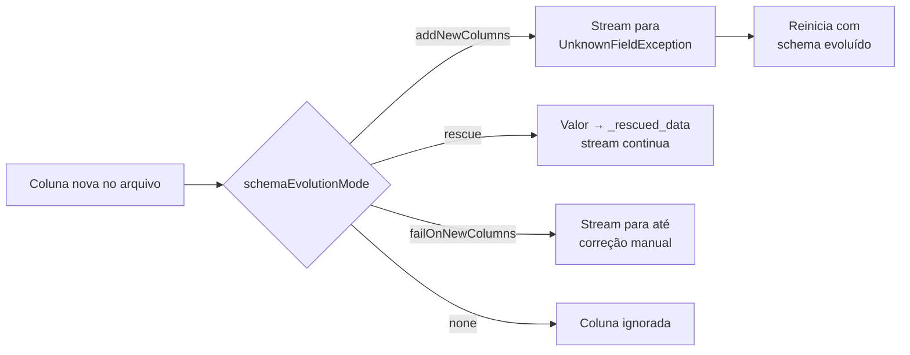

# COPY INTO e Auto Loader

## Visão geral

O Databricks tem duas ferramentas de ingestão de arquivos para cloud object storage (S3, ADLS, GCS) e volumes do Unity Catalog. **`COPY INTO`** é um comando SQL idempotente. **Auto Loader** é uma fonte de Structured Streaming chamada `cloudFiles`. Ambos carregam arquivos incrementalmente em tabelas Delta governadas pelo Unity Catalog. Eles diferem em escala, tratamento de schema e forma de descobrir arquivos.

> [!abstract] Resumo
>
> - **`COPY INTO`** pode ser reexecutado e é idempotente: arquivos já carregados são ignorados nas execuções seguintes. `COPY_OPTIONS ('mergeSchema' = 'true')` evolui o schema do destino
> - **Auto Loader** registra os arquivos descobertos em um store RocksDB dentro do checkpoint, garantindo processamento exactly-once. Consegue processar bilhões de arquivos
> - **Schema**: `cloudFiles.schemaLocation` habilita inferência e evolução. `cloudFiles.schemaEvolutionMode` controla o que acontece quando aparecem colunas novas. `_rescued_data` captura valores que não cabem no schema
> - **Detecção de arquivos**: directory listing (padrão) ou file notification. A Databricks recomenda file notification com **file events** para a maioria dos workloads

> [!tip] O que a prova cobra
>
> - Habilidades do exam guide: `COPY INTO` para cargas incrementais em tabelas UC, e Auto Loader com schema enforcement e evolution em modo directory listing ou file notification
> - Por que reexecutar o `COPY INTO` carrega zero linhas novas, e como forçar a recarga
> - Cada valor de `schemaEvolutionMode` e seu comportamento quando chega uma coluna nova
> - Quando o Auto Loader é melhor que o `COPY INTO`: escala, chegada contínua e schema drift

---

## COPY INTO

### Sintaxe

```sql
COPY INTO target_table
FROM 'source_path_or_volume'
FILEFORMAT = JSON | CSV | XML | AVRO | ORC | PARQUET | TEXT | BINARYFILE
[ VALIDATE [ ALL | num_rows ROWS ] ]
[ FILES = ('f1.json', 'f2.json') | PATTERN = 'glob' ]
[ FORMAT_OPTIONS ( 'option' = 'value', ... ) ]
[ COPY_OPTIONS ( 'mergeSchema' = 'true', 'force' = 'false' ) ]
```

### Carregando em uma tabela do Unity Catalog

```sql
-- 1. Criar uma tabela vazia (placeholder); o COPY INTO infere o schema na primeira carga
CREATE TABLE IF NOT EXISTS main.bronze.booking_updates;

-- 2. Carregar JSON de um volume UC, inferindo e evoluindo o schema
COPY INTO main.bronze.booking_updates
FROM '/Volumes/main/raw/landing/booking_updates'
FILEFORMAT = JSON
FORMAT_OPTIONS ('mergeSchema' = 'true', 'multiLine' = 'true')
COPY_OPTIONS ('mergeSchema' = 'true');

-- 3. Reexecutar amanhã: só os arquivos que chegaram desde a última execução são carregados
```

Comportamentos-chave ([Get started with COPY INTO](https://docs.databricks.com/aws/en/ingestion/cloud-object-storage/copy-into/), [COPY INTO reference](https://docs.databricks.com/aws/en/sql/language-manual/delta-copy-into)):

| Comportamento | Detalhe |
| :--- | :--- |
| **Idempotente** | "Arquivos no local de origem que já foram carregados são ignorados", mesmo que tenham sido modificados depois |
| **Placeholder sem schema** | No DBR 11.3 LTS+, crie uma tabela vazia e defina `mergeSchema` em `COPY_OPTIONS` para inferir o schema durante a carga |
| **`force`** | `'force' = 'true'` desativa a idempotência e recarrega os arquivos, já carregados ou não |
| **`FILES`** | Lista explícita de até **1.000** arquivos. Não pode ser combinada com `PATTERN` |
| **`VALIDATE`** | Verifica os dados sem carregá-los — útil como dry run |
| **Formatos** | CSV, JSON, XML, Avro, ORC, Parquet, texto, binário |
| **Acesso no UC** | Lê de um volume UC ou external location. O destino precisa de `CREATE TABLE` (primeira carga) ou `MODIFY` |

> [!note] Recomendação da documentação
> "Para uma ingestão de arquivos mais escalável e robusta, a Databricks recomenda que usuários de SQL usem streaming tables" (`CREATE STREAMING TABLE ... AS SELECT * FROM STREAM read_files(...)`), que usam o Auto Loader por baixo ([COPY INTO](https://docs.databricks.com/aws/en/ingestion/cloud-object-storage/copy-into/)).

### Mais padrões de COPY INTO

```sql
-- Dry run: verifica se as 10 primeiras linhas são lidas corretamente, sem carregar nada
COPY INTO main.bronze.orders
FROM '/Volumes/main/raw/landing/orders'
FILEFORMAT = CSV
VALIDATE 10 ROWS
FORMAT_OPTIONS ('header' = 'true');

-- Carregar só os arquivos de um fornecedor com um padrão glob
COPY INTO main.bronze.orders
FROM '/Volumes/main/raw/landing/orders'
FILEFORMAT = CSV
PATTERN = 'vendor_a_*.csv'
FORMAT_OPTIONS ('header' = 'true', 'inferSchema' = 'true');
```

## Auto Loader

### O que é

O Auto Loader "processa novos arquivos de dados de forma incremental e eficiente conforme chegam ao cloud storage" ([Auto Loader overview](https://docs.databricks.com/aws/en/ingestion/cloud-object-storage/auto-loader/)). Fatos-chave:

- É uma **fonte de Structured Streaming** chamada `cloudFiles`
- Fontes: S3, ADLS, GCS, volumes UC e Azure Blob Storage
- Formatos: JSON, CSV, XML, Parquet, Avro, ORC, texto, binary file
- Os arquivos descobertos são registrados em um store chave-valor **RocksDB** dentro do **checkpoint**, o que "garante que os dados sejam processados exatamente uma vez". Após uma falha, retoma a partir do checkpoint
- Funciona como stream contínuo ou como **batch incremental** com `trigger(availableNow=True)`

### Padrão em Python

```python
bronze = (spark.readStream
    .format("cloudFiles")
    .option("cloudFiles.format", "json")
    .option("cloudFiles.schemaLocation", "/Volumes/main/raw/_meta/events/schema")
    .option("cloudFiles.inferColumnTypes", "true")
    .option("cloudFiles.schemaHints", "event_ts TIMESTAMP, amount DECIMAL(10,2)")
    .load("/Volumes/main/raw/landing/events"))

(bronze.writeStream
    .option("checkpointLocation", "/Volumes/main/raw/_meta/events/checkpoint")
    .trigger(availableNow=True)            # batch incremental, depois para
    .toTable("main.bronze.events"))
```

### Padrão em SQL (streaming table)

```sql
CREATE OR REFRESH STREAMING TABLE main.bronze.events
AS SELECT * FROM STREAM read_files(
  '/Volumes/main/raw/landing/events',
  format => 'json'
);
```

Dentro de um Lakeflow pipeline, o próprio pipeline gerencia o schema location e o checkpoint.

### Padrão em Python dentro de um Lakeflow pipeline

```python
from pyspark import pipelines as dp

@dp.table(name="bronze_events", comment="Eventos brutos gravados pelo Auto Loader")
def bronze_events():
    return (spark.readStream
        .format("cloudFiles")
        .option("cloudFiles.format", "json")
        .load("/Volumes/main/raw/landing/events"))
```

Uma leitura streaming sob `@dp.table` define uma **streaming table**. Uma leitura batch sob `@dp.materialized_view` define uma materialized view. Não é preciso `schemaLocation` nem `checkpointLocation`, porque o pipeline gerencia ambos.

> [!note] Atualização da plataforma (out/2026)
> "O módulo `dlt` foi substituído pelo módulo `pyspark.pipelines`." Código com `import dlt` e `@dlt.table` ainda roda, mas a Databricks recomenda `from pyspark import pipelines as dp` ([Python reference](https://docs.databricks.com/aws/en/ldp/developer/python-ref)). O produto que a prova chama de **Lakeflow Declarative Pipelines** (antigo DLT / Delta Live Tables) foi renomeado para **Lakeflow Spark Declarative Pipelines** em 12/11/2025.

### Opções comuns

| Opção | Padrão | Propósito |
| :--- | :--- | :--- |
| `cloudFiles.format` | *(obrigatória)* | Formato dos arquivos de origem |
| `cloudFiles.schemaLocation` | Nenhum (obrigatório para inferência) | Onde o schema inferido e seu histórico (`_schemas`) são guardados |
| `cloudFiles.inferColumnTypes` | `false` | Inferir tipos reais para JSON/CSV/XML. Sem isso, essas colunas são lidas como **strings** |
| `cloudFiles.schemaHints` | Nenhum | Sobrescrever tipos inferidos, ou adicionar colunas esperadas, com sintaxe DDL |
| `cloudFiles.schemaEvolutionMode` | `addNewColumns` (sem schema fornecido) / `none` (com schema fornecido) | O que fazer quando aparecem colunas novas |
| `cloudFiles.includeExistingFiles` | `true` | Também processar arquivos que já estavam no diretório na primeira execução |
| `cloudFiles.maxFilesPerTrigger` | `1000` | Limite de arquivos novos por micro-batch |
| `cloudFiles.allowOverwrites` | `false` | Se mudanças em arquivos do diretório podem sobrescrever dados existentes |

Fonte: [Auto Loader options](https://docs.databricks.com/aws/en/ingestion/cloud-object-storage/auto-loader/options).

## Schema enforcement e evolution

O Auto Loader amostra **os primeiros 50 GB ou 1.000 arquivos** (o limite que for atingido primeiro) para inferir o schema, e o guarda em `cloudFiles.schemaLocation`. Colunas de JSON, CSV e XML são inferidas como strings, a menos que `cloudFiles.inferColumnTypes` seja `true`. Avro e Parquet usam os tipos gravados nos arquivos ([schema inference and evolution](https://docs.databricks.com/aws/en/ingestion/cloud-object-storage/auto-loader/schema)).

### `cloudFiles.schemaEvolutionMode`

| Modo | Chega uma coluna nova | O stream falha? | Uso típico |
| :--- | :--- | :--- | :--- |
| `addNewColumns` *(padrão sem schema fornecido)* | Schema atualizado; colunas adicionadas no fim | **Sim**, com `UnknownFieldException`. Ao reiniciar, usa o novo schema | Tabelas Bronze que devem acompanhar a fonte |
| `addNewColumnsWithTypeWidening` *(Public Preview, DBR 16.4+)* | Como acima, mais alargamento de tipo suportado, ex. `int` → `long` | Sim | Fontes cujos tipos numéricos crescem |
| `rescue` | O schema **nunca** evolui; colunas novas vão para `_rescued_data` | Não | Contratos downstream rígidos |
| `failOnNewColumns` | Schema não é atualizado | **Sim, e continua falhando** até você atualizar o schema ou remover o arquivo | Controle de mudanças de schema |
| `none` *(padrão com schema fornecido)* | Colunas novas ignoradas; sem rescue a menos que `rescuedDataColumn` esteja definido | Não | Schemas fixos |



> [!tip] Dica
> Como o `addNewColumns` para o stream de propósito, a Databricks recomenda rodar streams do Auto Loader em **Lakeflow Jobs** com retries, para que o reinício aconteça automaticamente.

### A coluna `_rescued_data`

Quando o Auto Loader infere o schema, ele adiciona por padrão uma coluna `_rescued_data`. Ela guarda um JSON com os valores que não couberam no schema: colunas desconhecidas, tipos incompatíveis e diferenças de maiúsculas/minúsculas, além do caminho do arquivo de origem. Com schema fornecido, habilite com `rescuedDataColumn`. Consulte essa coluna para encontrar drift sem perder registros.

**Schema enforcement** é a outra metade: valores que não batem com o tipo esperado nunca são convertidos silenciosamente para a coluna errada. Eles são resgatados, ignorados ou causam falha, conforme o modo escolhido.

## Modos de detecção de arquivos

| Modo | Como encontra arquivos novos | Configuração | Recomendação |
| :--- | :--- | :--- | :--- |
| **Directory listing** *(padrão)* | Lista o diretório de entrada a cada micro-batch | Só acesso de leitura aos dados | Rápido de começar; bom para diretórios pequenos |
| **File notification** (clássico) | Serviços de notificação e fila na sua conta de nuvem, que o Auto Loader pode criar | Permissões na nuvem para criar esses recursos | Ainda suportado; file events é o preferido |
| **File notification com file events** | File events habilitados na **external location do UC** que contém os arquivos | Sem permissões extras ao configurar o stream (DBR 14.3 LTS+) | **Recomendado para a maioria dos workloads** ("mais performático e escalável") |

- Dá para trocar de modo entre reinícios do stream mantendo exactly-once
- A ordem de descoberta não é garantida em nenhum modo, então não dependa da ordem de chegada
- `cloudFiles.useIncrementalListing` está **depreciado**. Use file notification com file events

Fonte: [file detection modes](https://docs.databricks.com/aws/en/ingestion/cloud-object-storage/auto-loader/file-detection-modes).

> [!note] Linguagem da prova
> O exam guide fala em usar o Auto Loader "em modos batch (por exemplo, directory listing ou file notification)". Leia como: rodar o Auto Loader como batch incremental (`availableNow`) com qualquer um dos modos de descoberta.

## COPY INTO vs Auto Loader

| Dimensão | `COPY INTO` | Auto Loader |
| :--- | :--- | :--- |
| Interface | Comando SQL | Fonte de Structured Streaming (Python/Scala/SQL via `read_files`) |
| Rastreamento de arquivos | Interno; arquivos carregados são ignorados nas reexecuções | Store RocksDB no checkpoint |
| Escala | Cargas periódicas de um conjunto modesto e conhecido de arquivos | Feito para chegada contínua; "consegue lidar com bilhões de arquivos" |
| Evolução de schema | `mergeSchema` em `COPY_OPTIONS` | `schemaLocation` + `schemaEvolutionMode` + `_rescued_data` |
| Ingestão contínua | Não (reexecuta por agenda) | Sim (ou batch `availableNow`) |
| Recomendado para usuários SQL | Streaming tables são recomendadas no lugar | Sim (streaming tables usam o Auto Loader) |

### Checklist rápido de decisão

1. A equipe é só SQL, com cargas periódicas de um conjunto modesto e conhecido de arquivos? `COPY INTO`, ou streaming table com `read_files`
2. Os arquivos chegam continuamente, em grande volume ou com schema mudando? **Auto Loader**
3. Precisa dos valores brutos que não cabem no schema? `_rescued_data` do Auto Loader
4. O job precisa parar quando o schema muda? `failOnNewColumns`
5. Deve continuar rodando com schema congelado? `rescue` ou `none`

## Casos de uso

- **Analistas só de SQL carregando exportações mensais**: `COPY INTO` de um volume para uma tabela Bronze, reexecutado com segurança todo mês
- **Clickstream de alto volume**: Auto Loader com file events processa milhares de pequenos JSONs por hora em `main.bronze.clicks`
- **Feed de fornecedor tolerante a drift**: `schemaEvolutionMode = rescue` mantém o contrato da Silver estável enquanto `_rescued_data` captura campos inesperados para revisão
- **Batch incremental agendado**: Auto Loader com `availableNow` disparado por file arrival trigger, sem compute ocioso entre as cargas

## Problemas e erros comuns

### COPY INTO carrega zero linhas ao reexecutar

**Cenário:** um engenheiro reexecuta o `COPY INTO` depois de corrigir um bug na tabela de destino, e nenhuma linha é carregada.
**Correção:** é a idempotência funcionando. Arquivos já carregados são ignorados. Para recarregar de propósito, use `COPY_OPTIONS ('force' = 'true')`, ou faça truncate e recarregue, garantindo que duplicatas sejam tratadas.

### Stream do Auto Loader para com UnknownFieldException

**Cenário:** um stream noturno falha depois que a fonte adiciona uma coluna.
**Correção:** com o padrão `addNewColumns`, a falha é esperada. O schema já foi atualizado no schema location, então reiniciar o stream resolve. Rode como Lakeflow Job com retries para o reinício ser automático.

### Todas as colunas são string

**Cenário:** uma tabela Bronze de JSON criada com Auto Loader tem `amount` e `is_active` como `STRING`.
**Correção:** JSON, CSV e XML são inferidos como strings por padrão. Defina `cloudFiles.inferColumnTypes = true` ou fixe os tipos com `cloudFiles.schemaHints`.

### Reusar um checkpoint para dois streams

**Cenário:** dois streams do Auto Loader compartilham o caminho de checkpoint e pulam os arquivos um do outro.
**Correção:** cada workload de ingestão precisa do seu próprio checkpoint e schema location.

## Dicas para a prova

> [!tip] Dicas para a prova
>
> - "Reexecução não carregou linhas novas" → idempotência do `COPY INTO`. "Recarregar mesmo assim" → `'force' = 'true'`
> - "Detectar automaticamente novos arquivos e evoluir schema em escala" → **Auto Loader**
> - `addNewColumns` **para** o stream e evolui no reinício. `rescue` nunca para e nunca evolui. `failOnNewColumns` para até ser corrigido
> - JSON/CSV viram strings a menos que você defina `cloudFiles.inferColumnTypes`
> - File notification com **file events** em uma external location do UC é o modo de descoberta recomendado

## Pontos-chave

- `COPY INTO` é uma carga SQL idempotente com opções `mergeSchema` e `force`
- Auto Loader é a fonte streaming `cloudFiles` com rastreamento de arquivos exactly-once via checkpoint
- A inferência de schema amostra até 50 GB ou 1.000 arquivos e é guardada em `cloudFiles.schemaLocation`
- Cinco valores de `schemaEvolutionMode` controlam o drift, e `_rescued_data` guarda o que não coube
- Directory listing é o modo padrão de descoberta. File notification com file events é o recomendado

## Tópicos relacionados

- [Padrões de Ingestão e Lakeflow Connect](./01-ingestion-patterns-and-lakeflow-connect.md)
- [JDBC, REST e ingestão semiestruturada](./03-jdbc-rest-and-semi-structured-ingestion.md)
- [Fundamentos do Delta Lake (schema enforcement)](../01-databricks-intelligence-platform/04-delta-lake-fundamentals.md)

## Documentação oficial

- [Get started with COPY INTO](https://docs.databricks.com/aws/en/ingestion/cloud-object-storage/copy-into/)
- [COPY INTO SQL reference](https://docs.databricks.com/aws/en/sql/language-manual/delta-copy-into)
- [What is Auto Loader?](https://docs.databricks.com/aws/en/ingestion/cloud-object-storage/auto-loader/)
- [Auto Loader schema inference and evolution](https://docs.databricks.com/aws/en/ingestion/cloud-object-storage/auto-loader/schema)
- [Auto Loader file detection modes](https://docs.databricks.com/aws/en/ingestion/cloud-object-storage/auto-loader/file-detection-modes)
- [Auto Loader options](https://docs.databricks.com/aws/en/ingestion/cloud-object-storage/auto-loader/options)

---

**[← Anterior: Padrões de Ingestão e Lakeflow Connect](./01-ingestion-patterns-and-lakeflow-connect.md) | [↑ Voltar para Data Ingestion and Loading](./README.md) | [Próximo: JDBC, REST e ingestão semiestruturada →](./03-jdbc-rest-and-semi-structured-ingestion.md)**
