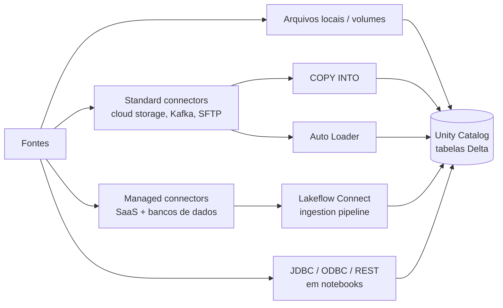

# Data Ingestion and Loading (21 % da prova)

O Domínio 2 é o segundo maior bloco da prova de agosto de 2026. Ele trata de colocar dados em tabelas governadas pelo Unity Catalog. Você precisa conhecer os padrões de ingestão (batch, streaming, incremental), de onde os dados vêm (arquivos locais, conectores standard e managed do Lakeflow Connect, clientes JDBC/ODBC e REST) e as ferramentas que fazem a carga (`COPY INTO`, Auto Loader, Lakeflow Connect). Também precisa escolher a ferramenta certa para um dado volume, frequência, tipo de dado e requisito de governança.

> [!note] Atualização da plataforma (out/2026)
> O exam guide fala em **Lakeflow Connect standard connectors**. A documentação atual descreve a mesma camada como "Ingest with SQL and Spark APIs": Auto Loader, `read_files`, streaming tables e fontes de Structured Streaming como Kafka. Os managed connectors não mudaram ([What is Lakeflow Connect?](https://docs.databricks.com/aws/en/ingestion/overview), [Ingest with SQL and Spark APIs](https://docs.databricks.com/aws/en/ingestion/)).

## Visão geral dos tópicos

## Conteúdo da seção

| Arquivo | Tópico | Prioridade |
| :--- | :--- | :--- |
| [01-ingestion-patterns-and-lakeflow-connect.md](./01-ingestion-patterns-and-lakeflow-connect.md) | Batch vs streaming vs incremental, upload de arquivos locais, standard vs managed connectors, como escolher | Alta |
| [02-copy-into-and-auto-loader.md](./02-copy-into-and-auto-loader.md) | `COPY INTO`, inferência/evolução de schema no Auto Loader, directory listing vs file notification | Alta |
| [03-jdbc-rest-and-semi-structured-ingestion.md](./03-jdbc-rest-and-semi-structured-ingestion.md) | Clientes JDBC/ODBC e REST em notebooks, JSON e dados aninhados, triggers do Structured Streaming | Alta |

## Cobertura das habilidades oficiais (agosto de 2026)

| Habilidade do exam guide (parafraseada) | Onde é coberta |
| :--- | :--- |
| Padrões de ingestão (batch, streaming, incremental); importar de arquivos locais e conectores standard/managed do Lakeflow Connect | [01](./01-ingestion-patterns-and-lakeflow-connect.md), [03 — triggers](./03-jdbc-rest-and-semi-structured-ingestion.md) |
| `COPY INTO` para cargas incrementais de ADLS/S3/GCS em tabelas UC | [02](./02-copy-into-and-auto-loader.md) |
| Auto Loader com schema enforcement e evolution; directory listing vs file notification | [02](./02-copy-into-and-auto-loader.md) |
| Configurar o Lakeflow Connect para fontes corporativas | [01](./01-ingestion-patterns-and-lakeflow-connect.md) |
| Clientes JDBC/ODBC ou REST em notebooks, agendados com Lakeflow Jobs | [03](./03-jdbc-rest-and-semi-structured-ingestion.md) |
| Escolher entre Auto Loader, Lakeflow Connect, partner connectors e outros métodos | [01](./01-ingestion-patterns-and-lakeflow-connect.md) |
| Dados semiestruturados e não estruturados (JSON, aninhados) em tabelas Delta do UC | [03](./03-jdbc-rest-and-semi-structured-ingestion.md), [02](./02-copy-into-and-auto-loader.md) |

## Conceitos-chave

- **Comece pela camada mais gerenciada**: a Databricks recomenda primeiro managed connectors, depois Lakeflow pipelines, e só então Structured Streaming e APIs Spark se necessário
- **`COPY INTO`**: comando SQL idempotente e que pode ser reexecutado. Arquivos já carregados são ignorados nas reexecuções
- **Auto Loader (`cloudFiles`)**: uma fonte de Structured Streaming. Registra os arquivos descobertos no checkpoint para processamento exactly-once e suporta inferência de schema, evolução e a coluna `_rescued_data`
- **Managed connectors do Lakeflow Connect**: uma UC connection, um ingestion gateway (só para CDC de banco de dados) e um ingestion pipeline que escreve em streaming tables em compute serverless

## Próximos passos

Continue para [03 — Data Transformation and Modeling](../03-data-transformation-and-modeling/README.md) para transformar dados Bronze em Silver e Gold.

---

**[← Anterior: Databricks Intelligence Platform](../01-databricks-intelligence-platform/README.md) | [↑ Voltar à Certificação](../README.md) | [Próximo: Data Transformation and Modeling →](../03-data-transformation-and-modeling/README.md)**
