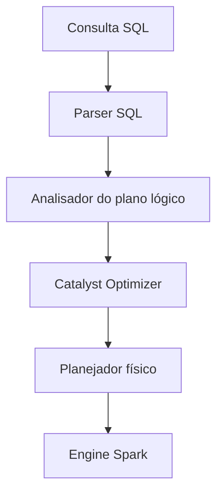

# Fundamentos de Spark SQL

## Visão geral

O Spark SQL oferece uma interface SQL para processar dados estruturados com o poder de computação distribuída do Spark. Ele executa consultas SQL, lê CSV, Parquet e Delta, e se conecta a fontes externas.

> [!abstract] Resumo
>
> - Spark SQL e a API de DataFrame compartilham o mesmo otimizador e engine. Use a linguagem que fizer mais sentido para a tarefa
> - Views permanentes vivem no Unity Catalog. Views temporárias existem só durante a sessão
> - Comandos de catálogo (`SHOW`, `DESCRIBE`, `USE CATALOG`, `USE SCHEMA`) navegam pelo namespace de três níveis

> [!tip] O que a prova cobra
>
> - Apoia as habilidades do Domínio 3 sobre criar tabelas e views no Unity Catalog com SQL
> - Escopo de views temporárias vs permanentes
> - Rodar SQL a partir de Python com `spark.sql()` e células `%sql`

---

## Arquitetura do Spark SQL



## Spark SQL vs DataFrames

| Aspecto | Spark SQL | DataFrames |
|--------|-----------|------------|
| **Interface** | Consultas SQL | API Python/Scala/Java |
| **Performance** | Otimizada pelo Catalyst | O mesmo otimizador Catalyst |
| **Curva de aprendizado** | Fácil para quem sabe SQL | Exige conhecer a API |
| **Flexibilidade** | Sintaxe SQL | Controle programático |
| **Interoperabilidade** | Pode misturar com DataFrames | Pode misturar com SQL |

## Criando tabelas

### Managed vs External

```python
# Managed table (dados no diretório gerenciado)
spark.sql("""
CREATE TABLE my_table (
    id INT,
    name STRING,
    salary DECIMAL(10, 2)
)
USING DELTA
""")

# External table (dados em local externo)
spark.sql("""
CREATE TABLE my_external (
    id INT,
    name STRING
)
USING DELTA
LOCATION '/mnt/data/my_table'
""")
```

### A partir de um DataFrame

```python
df.write.mode("overwrite").saveAsTable("my_table")  # Managed

# Externa
(df.write
    .mode("overwrite")
    .option("path", "/mnt/data/external")
    .saveAsTable("my_external_table"))

# A partir de arquivo
spark.sql("""
CREATE TABLE my_parquet
USING PARQUET
LOCATION '/mnt/data/input.parquet'
""")
```

## Consultas e agregações

### SELECT básico

```python
spark.sql("""
SELECT id, name, salary
FROM employees
WHERE salary > 50000
ORDER BY salary DESC
LIMIT 10
""").show()
```

### Agregações

```python
spark.sql("""
SELECT
    department,
    COUNT(*) as emp_count,
    AVG(salary) as avg_salary,
    MAX(salary) as max_salary,
    MIN(salary) as min_salary
FROM employees
GROUP BY department
HAVING COUNT(*) > 5
""")
```

> `WHERE` filtra linhas **antes** do agrupamento; `HAVING` filtra grupos **depois** da agregação.

### Window functions

```sql
SELECT
    name,
    department,
    salary,
    ROW_NUMBER() OVER (PARTITION BY department ORDER BY salary DESC) as rank,
    SUM(salary) OVER (PARTITION BY department) as dept_total
FROM employees
```

## Views e views temporárias

### Views permanentes

```python
# Criar view (registrada no catálogo)
spark.sql("""
CREATE VIEW high_earners AS
SELECT name, salary
FROM employees
WHERE salary > 100000
""")

spark.sql("DROP VIEW IF EXISTS high_earners")
```

### Views temporárias

```python
# Escopo de sessão (some quando a sessão termina)
spark.sql("""
CREATE TEMP VIEW temp_view AS
SELECT * FROM employees LIMIT 100
""")

# Global temporária (acessível entre sessões no mesmo cluster)
spark.sql("""
CREATE GLOBAL TEMP VIEW global_view AS
SELECT * FROM large_table
""")

# Consultar a global temp view
spark.sql("SELECT * FROM global_temp.global_view")
```

## Operações de catálogo

### Listando objetos

```python
spark.catalog.listDatabases()          # bancos/schemas
spark.catalog.listTables("default")    # tabelas de um schema
spark.catalog.listColumns("my_table")  # colunas
spark.catalog.tableExists("my_table")  # existe?
```

### Trocando o contexto

```python
spark.sql("USE my_database")

# Agora as consultas referenciam my_database por padrão
spark.sql("SELECT * FROM my_table")  # Usa my_database.my_table
```

No Unity Catalog, use `USE CATALOG main;` e `USE SCHEMA silver;` para definir catálogo e schema padrão.

## Tipos de dados

```sql
-- Numéricos
INT, BIGINT, FLOAT, DOUBLE, DECIMAL(10,2)

-- Texto
STRING, VARCHAR(100), CHAR(10)

-- Booleano
BOOLEAN

-- Data/Hora
DATE, TIMESTAMP, TIMESTAMP_NTZ

-- Complexos
ARRAY<INT>
MAP<STRING, INT>
STRUCT<name STRING, age INT>

-- Binário
BINARY
```

## Particionamento

```python
spark.sql("""
CREATE TABLE sales (
    id INT,
    amount DECIMAL(10, 2)
)
PARTITIONED BY (year INT, month INT)
USING DELTA
""")

spark.sql("""
INSERT INTO sales
PARTITION (year=2025, month=1)
SELECT id, amount FROM new_sales
""")
```

> Para tabelas novas, a Databricks recomenda **Liquid Clustering** em vez de particionamento (veja o [Domínio 6](../06-troubleshooting-monitoring-and-optimization/04-liquid-clustering-and-predictive-optimization.md)).

## Spark SQL vs Hive SQL

| Recurso | Spark SQL | Hive SQL |
|---------|-----------|----------|
| **Performance** | Rápida (Catalyst) | Mais lenta |
| **Tipos de dados** | 20+ tipos | Limitados |
| **Conformidade** | ANSI SQL | Dialeto Hive |
| **Execução** | Engine Spark | Hive + MapReduce |

## Casos de uso

- **Transformações em larga escala**: usar a execução distribuída do Spark SQL para transformar datasets de vários terabytes com eficiência.
- **Exploração interativa**: usar Spark SQL em notebooks para consultas ad hoc em tabelas Delta, inspecionar schema com `DESCRIBE` e prototipar lógica de transformação antes de levá-la para pipelines de produção.

## Problemas e erros comuns

### Erros de OOM

**Cenário:** skew nos dados faz um executor ficar sem memória.
**Correção:** use Adaptive Query Execution (AQE) e revise a lógica de join.

### Temp views não visíveis entre SparkSessions

**Cenário:** uma view temporária criada em um notebook não é acessível em outro notebook ou outra SparkSession, gerando `AnalysisException: Table or view not found`.
**Correção:** use global temporary views (`CREATE GLOBAL TEMP VIEW`) consultando via `global_temp.view_name`, ou persista os dados como tabela em vez de view.

### Diferenças de sintaxe entre Spark SQL e ANSI SQL

**Cenário:** consultas com sintaxe ANSI estrita (divisão inteira, cast implícito) geram resultados inesperados ou erros no Spark SQL por diferenças de dialeto.
**Correção:** defina `spark.sql.ansi.enabled = true` para impor o comportamento ANSI, ou revise as regras específicas do Spark SQL para operadores e casts.

## Dicas para a prova

- Saiba a diferença entre managed tables (dados apagados com `DROP TABLE`) e external tables (dados persistem após o `DROP TABLE`)
- Temp views têm escopo de sessão; global temp views usam o banco `global_temp` e sobrevivem entre sessões
- O Catalyst otimiza consultas SQL e de DataFrame da mesma forma
- Entenda `CREATE TABLE ... USING DELTA` vs `CREATE TABLE ... USING PARQUET` e as vantagens do Delta

## Pontos-chave

- **Managed vs External**: local e ciclo de vida dos dados
- **Temp views**: escopo de sessão, apagadas automaticamente
- **Particionamento**: organiza tabelas grandes para performance
- **Catálogo**: gestão de metadados
- **Otimização SQL**: benefícios do Catalyst

## Tópicos relacionados

- [Operações com DataFrame](./02-dataframe-operations.md)

## Documentação oficial

- [Spark SQL Guide](https://docs.databricks.com/en/sql/language-manual/index.html)
- [Tables in Databricks](https://docs.databricks.com/en/tables/index.html)

---

**[↑ Voltar para Data Transformation and Modeling](./README.md) | [Próximo: Operações com DataFrame →](./02-dataframe-operations.md)**
