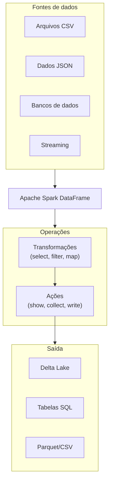

# Operações com DataFrame

## Visão geral

DataFrames são a principal abstração do Spark para dados estruturados. São uma coleção distribuída de linhas organizadas em colunas nomeadas, com um schema definido. Combinam a familiaridade do SQL com o poder da computação distribuída.

> [!abstract] Resumo
>
> - DataFrames são lazy: transformações montam um plano e ações (`count`, `show`, `write`) o executam
> - Operações de coluna: `select`, `withColumn`, `withColumnRenamed`, `drop`, `filter` / `where`
> - Deduplique com `distinct()` (todas as colunas) ou `dropDuplicates([...])` (chaves escolhidas)

> [!tip] O que a prova cobra
>
> - Habilidade do exam guide: manipular colunas, linhas e estrutura de tabelas (adicionar, remover, split, renomear, filtrar, explode)
> - Habilidade do exam guide: deduplicação e agregações (count, contagem distinta aproximada, média, summary)
> - Identificar quais chamadas são ações e quais são transformações

---

## O que é um DataFrame?



## Criando DataFrames

### A partir de coleções Python

```python
data = [
    (1, "Alice", 85000),
    (2, "Bob", 75000),
    (3, "Charlie", 95000)
]

df = spark.createDataFrame(data, ["id", "name", "salary"])
df.show()
```

### A partir de arquivos

```python
df_csv = (spark.read.format("csv")
    .option("header", "true")
    .option("inferSchema", "true")
    .load("/path/to/data.csv"))

df_json = spark.read.json("/path/to/data.json")
df_parquet = spark.read.parquet("/path/to/data.parquet")
df_delta = spark.read.format("delta").load("/path/to/delta/table")
```

### A partir de Pandas

```python
import pandas as pd

pandas_df = pd.DataFrame({
    "id": [1, 2, 3],
    "name": ["Alice", "Bob", "Charlie"],
    "salary": [85000, 75000, 95000]
})

spark_df = spark.createDataFrame(pandas_df)
```

### A partir de uma consulta SQL

```python
df = spark.sql("""
    SELECT id, name, salary
    FROM employees
    WHERE department = 'Engineering'
""")
```

## Schema do DataFrame

### Inspecionando o schema

```python
df.printSchema()
# root
#  |-- id: long (nullable = true)
#  |-- name: string (nullable = true)
#  |-- salary: decimal(10,2) (nullable = true)

schema = df.schema    # StructType
columns = df.columns  # ['id', 'name', 'salary']
dtypes = df.dtypes    # [('id', 'long'), ('name', 'string'), ...]
```

### Definindo o schema explicitamente

```python
from pyspark.sql.types import StructType, StructField, IntegerType, StringType, DecimalType

schema = StructType([
    StructField("id", IntegerType(), True),
    StructField("name", StringType(), True),
    StructField("salary", DecimalType(10, 2), True)
])

df = spark.read.schema(schema).csv("/path/to/data.csv", header=True)
```

Também é possível passar o schema como string DDL: `spark.read.schema("id INT, name STRING, salary DECIMAL(10,2)")`.

## Transformações principais

### Select e projeção

```python
from pyspark.sql.functions import col

df.select("id", "name").show()

# Com alias
df.select(
    col("id"),
    col("name").alias("employee_name"),
    col("salary")
).show()

# Com expressões SQL
df.selectExpr(
    "id",
    "name as employee_name",
    "salary * 1.1 as projected_salary"
).show()
```

### Filter e WHERE

```python
df.filter(col("salary") > 80000).show()

# Várias condições: & (and), | (or), ~ (not) — use parênteses!
df.filter((col("salary") > 50000) & (col("name") != "Bob")).show()

# Filtro em string SQL
df.filter("salary > 80000 AND department = 'Engineering'").show()
```

`filter` e `where` são sinônimos.

### Adicionando, renomeando e removendo colunas

```python
df_new = df.withColumn("bonus", col("salary") * 0.1)

df_new = (df.withColumn("annual_bonus", col("salary") * 0.15)
    .withColumn("is_manager", col("salary") > 100000))

df_renamed = df.withColumnRenamed("salary", "annual_salary")

df_dropped = df.drop("bonus")
```

### Distinct e deduplicação

```python
df.distinct().show()                               # linhas distintas (todas as colunas)
df.select(col("department")).distinct().count()    # contagem de valores distintos
df.dropDuplicates(["id", "name"])                  # dedup por colunas específicas
```

### Ordenação

```python
df.orderBy("salary").show()
df.orderBy(col("salary").desc()).show()
df.orderBy(col("department").asc(), col("salary").desc()).show()
```

### Estatísticas descritivas

```python
df.describe().show()   # count, mean, stddev, min, max
df.summary().show()    # o mesmo + percentis 25%, 50%, 75%
```

## Ações

Ações calculam e retornam resultados ao driver ou gravam dados:

```python
df.show()                 # primeiras 20 linhas
df.show(100)              # 100 linhas
df.show(truncate=False)   # não trunca strings longas

all_rows = df.collect()   # TODAS as linhas para o driver — cuidado!
row_count = df.count()
first_5 = df.take(5)

df.write.format("delta").mode("overwrite").save("/path/to/table")
```

## Referência de tipos de dados

| Tipo | Exemplo Python | Tamanho |
|------|---|---|
| `IntegerType` | `123` | 4 bytes |
| `LongType` | `123456789` | 8 bytes |
| `FloatType` | `1.23` | 4 bytes |
| `DoubleType` | `1.23456` | 8 bytes |
| `StringType` | `"text"` | Variável |
| `BooleanType` | `True` | 1 byte |
| `DateType` | `date(2025, 1, 15)` | 4 bytes |
| `TimestampType` | `datetime.now()` | 8 bytes |
| `ArrayType` | `[1, 2, 3]` | Variável |
| `MapType` | `{"key": "value"}` | Variável |

## Padrões comuns

### Tamanho do DataFrame

```python
num_rows = df.count()

# Não existe API direta de uso de memória no PySpark.
# Faça cache, dispare uma ação e veja a aba "Storage" da Spark UI.
df.cache()
df.count()

print(f"Colunas: {len(df.columns)}")
```

### DataFrame para Pandas (apenas dados pequenos)

```python
# ATENÇÃO: traz todos os dados para o driver
pandas_df = df.toPandas()

# Só as primeiras 1000 linhas
pandas_df = df.limit(1000).toPandas()
```

### Amostragem

```python
sample_df = df.sample(fraction=0.1)  # amostra de 10%

# Amostra estratificada
sample_df = df.sampleBy("category", fractions={"A": 0.2, "B": 0.3})
```

## Considerações de performance

| Operação | Custo | Quando usar |
|-----------|------|-----------|
| `select` | Baixo | Sempre, para reduzir colunas |
| `filter` | Baixo | Aplique filtros cedo |
| `collect` | Alto | Evite em DataFrames grandes |
| `distinct` | Alto | Com cuidado em datasets grandes (causa shuffle) |
| `take` | Baixo | Use antes de show/collect |

## Casos de uso

- **Pipelines de ETL com schema garantido**: definir schemas explícitos com `StructType` para validar os dados recebidos antes de gravar em tabelas Delta, pegando incompatibilidades de tipo cedo.
- **Profiling exploratório**: usar `describe()`, `summary()`, `printSchema()` e `distinct().count()` para conhecer datasets novos e identificar problemas de qualidade antes de escrever a lógica de transformação.

## Problemas e erros comuns

### OOM no driver depois de `collect()`

**Cenário:** `df.collect()` ou `df.toPandas()` em uma tabela grande derruba o driver com out-of-memory.
**Correção:** essas chamadas trazem todas as linhas para o driver. Use `display(df)`, `df.limit(n)` ou grave os resultados numa tabela. Veja [Compute Troubleshooting](../06-troubleshooting-monitoring-and-optimization/05-compute-troubleshooting.md).

### Coluna ambígua após join

**Cenário:** depois de juntar dois DataFrames com colunas de mesmo nome, `select()` ou `filter()` geram `AnalysisException: Reference is ambiguous`.
**Correção:** use aliases ou a sintaxe `df["col"]` para desambiguar, ou faça o join por lista de nomes (ex.: `["id"]`), que deduplica a coluna-chave automaticamente.

### AnalysisException por nome de coluna errado

**Cenário:** `withColumn()` ou `select()` falha com `AnalysisException: cannot resolve column name` por erro de digitação ou maiúsculas/minúsculas.
**Correção:** confira o schema com `df.columns` ou `df.printSchema()` antes de transformar.

## Dicas para a prova

- Entenda a diferença entre transformações (lazy, retornam novo DataFrame) e ações (disparam execução: `show`, `collect`, `count`, `write`)
- Saiba definir schemas com `StructType` e `StructField` — a prova costuma cobrar
- `collect()` traz tudo para o driver; evite em DataFrames grandes — use `take()` ou `limit()`
- `dropDuplicates(["col1", "col2"])` deduplica por colunas específicas; `distinct()` usa todas as colunas

## Pontos-chave

- **DataFrame**: coleção distribuída e imutável de linhas com schema
- **Lazy evaluation**: transformações só executam quando uma ação é chamada
- **Schema**: nomes, tipos e nulabilidade das colunas
- **Transformações**: retornam novo DataFrame (select, filter, withColumn)
- **Ações**: calculam e retornam resultados (show, collect, count, write)
- **Seleção de colunas**: use `col()` para expressões
- **Condições**: use `&` (e), `|` (ou), `~` (não)

## Tópicos relacionados

- [Fundamentos de Spark SQL](./01-spark-sql-fundamentals.md)
- [Joins e Agregações](./03-joins-aggregations.md)

## Documentação oficial

- [PySpark DataFrame API](https://docs.databricks.com/en/pyspark/index.html)
- [Tutorial: Load and transform data using DataFrames](https://docs.databricks.com/aws/en/getting-started/dataframes)

---

**[← Anterior: Fundamentos de Spark SQL](./01-spark-sql-fundamentals.md) | [↑ Voltar para Data Transformation and Modeling](./README.md) | [Próximo: Joins e Agregações →](./03-joins-aggregations.md)**
