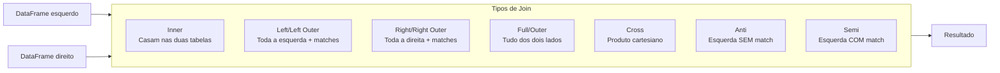

# Joins e Agregações

## Visão geral

Joins e agregações são operações fundamentais para combinar dados de várias fontes e calcular estatísticas resumidas. Dominar a otimização de joins e as funções de agregação é essencial para construir pipelines eficientes.

> [!abstract] Resumo
>
> - Tipos de join: inner, left/right/full outer, cross, semi, anti. Joins podem usar várias chaves
> - `union` / `unionAll` mantêm duplicatas e casam por posição. `unionByName` casa por nome. O `UNION` do SQL deduplica e o `UNION ALL` não
> - Broadcast joins evitam shuffle copiando o lado pequeno para todos os executores

> [!tip] O que a prova cobra
>
> - Habilidade do exam guide: combinar DataFrames com joins inner, left, broadcast, múltiplas chaves e cross, e com union e union all
> - Habilidade do exam guide: agregações como count, contagem distinta aproximada e média
> - Prever a quantidade de linhas de um join e identificar colunas duplicadas após o join

---

## Tipos de join



## Sintaxe dos joins

### Inner join

```sql
SELECT l.id, l.name, r.department, r.salary
FROM employees l
INNER JOIN departments r
    ON l.department_id = r.id
WHERE l.salary > 50000
```

```python
df_inner = employees.join(
    departments,
    employees.department_id == departments.id,
    how="inner"
)

# Ou pelo nome da chave (presente nos dois lados) — não duplica a coluna
df_inner = employees.join(departments, ["department_id"], how="inner")
```

### Join com várias chaves

```python
df = orders.join(
    shipments,
    (orders.order_id == shipments.order_id) & (orders.region == shipments.region),
    "inner"
)

# Ou por lista de nomes
df = orders.join(shipments, ["order_id", "region"], "inner")
```

### Left outer join

```sql
SELECT l.id, l.name, COALESCE(r.department, 'Unknown') as department
FROM employees l
LEFT OUTER JOIN departments r
    ON l.department_id = r.id
```

```python
df_left = employees.join(departments, employees.department_id == departments.id, how="left")
```

### Right outer join

```python
df_right = employees.join(departments, employees.department_id == departments.id, how="right")
```

### Full outer join

```sql
SELECT COALESCE(l.id, r.id) as id, l.name, r.department
FROM employees l
FULL OUTER JOIN departments r
    ON l.department_id = r.id
```

```python
df_full = employees.join(departments, employees.department_id == departments.id, how="outer")
```

### Cross join

```sql
-- Produto cartesiano (cada linha da esquerda com cada linha da direita)
SELECT l.id, r.option
FROM employees l
CROSS JOIN product_options r
```

```python
df_cross = employees.crossJoin(options)   # ou employees.join(options, how="cross")
```

Se a esquerda tem 100 linhas e a direita 5, o resultado tem **500** linhas.

### Semi join (join de filtro)

```sql
-- Linhas da esquerda que têm match na direita (sem colunas da direita)
SELECT *
FROM employees l
WHERE EXISTS (
    SELECT 1 FROM departments r
    WHERE l.department_id = r.id AND r.budget > 100000
)
```

```python
df_semi = employees.join(departments, employees.department_id == departments.id, how="semi")
```

### Anti join

```sql
-- Linhas da esquerda que NÃO têm match na direita
SELECT *
FROM employees l
WHERE NOT EXISTS (
    SELECT 1 FROM blacklist r WHERE l.id = r.employee_id
)
```

```python
df_anti = employees.join(blacklist, employees.id == blacklist.employee_id, how="anti")
```

## Comparação de joins

| Tipo | Linhas da esquerda | Linhas da direita | Caso de uso |
|-----------|-----------|----------|----------|
| Inner | Só matches | Só matches | Encontrar registros correspondentes |
| Left | Todas | Só matches | Manter a esquerda, enriquecer se houver match |
| Right | Só matches | Todas | Manter a direita, enriquecer se houver match |
| Full | Todas | Todas | Nunca perder dados de nenhum lado |
| Cross | Todas | Todas | Criar todas as combinações |
| Semi | Com match | Nunca (sem colunas) | Filtrar a esquerda pela existência na direita |
| Anti | Sem match | Nunca (sem colunas) | Filtrar a esquerda pela inexistência na direita |

## Union e union all

```python
# union / unionAll: casam colunas por POSIÇÃO e mantêm duplicatas (= UNION ALL)
combined = df_2024.union(df_2025)

# unionByName: casa colunas por NOME (seguro se a ordem das colunas diferir)
combined = df_2024.unionByName(df_2025)

# Colunas que faltam em um lado viram NULL
combined = df_a.unionByName(df_b, allowMissingColumns=True)

# Para remover duplicatas depois do union
combined_dedup = df_2024.union(df_2025).distinct()
```

```sql
SELECT * FROM sales_2024
UNION ALL          -- mantém duplicatas
SELECT * FROM sales_2025;

SELECT * FROM sales_2024
UNION              -- remove duplicatas
SELECT * FROM sales_2025;
```

> [!warning] Pegadinha
> No PySpark, `df.union()` **não** remove duplicatas (diferente do `UNION` do SQL). E como casa por posição, unir DataFrames com colunas em ordem diferente gera dados trocados silenciosamente — use `unionByName`.

## Agregações e GROUP BY

### Agregações básicas

```sql
SELECT
    department,
    COUNT(*) as emp_count,
    AVG(salary) as avg_salary,
    MAX(salary) as max_salary,
    MIN(salary) as min_salary,
    SUM(salary) as total_salary
FROM employees
GROUP BY department
```

```python
from pyspark.sql import functions as F

df_agg = (employees
    .groupBy("department")
    .agg(
        F.count("*").alias("emp_count"),
        F.avg("salary").alias("avg_salary"),
        F.max("salary").alias("max_salary"),
        F.min("salary").alias("min_salary"),
        F.sum("salary").alias("total_salary")
    ))
```

### Várias colunas de agrupamento

```python
df_multi_group = (employees
    .groupBy("department", "job_title")
    .agg(
        F.count("*").alias("count"),
        F.avg("salary").alias("avg_salary"),
        F.stddev("salary").alias("salary_stddev")
    ))
```

### HAVING (filtro depois do GROUP BY)

```sql
SELECT department, COUNT(*) as emp_count, AVG(salary) as avg_salary
FROM employees
GROUP BY department
HAVING COUNT(*) > 10 AND AVG(salary) > 80000
```

```python
df_having = (employees
    .groupBy("department")
    .agg(F.count("*").alias("emp_count"), F.avg("salary").alias("avg_salary"))
    .filter((F.col("emp_count") > 10) & (F.col("avg_salary") > 80000)))
```

## Funções de agregação

| Função | Propósito | Exemplo |
|----------|---------|---------|
| `COUNT(*)` | Contagem de linhas | `COUNT(*) = 5` |
| `SUM()` | Soma | `SUM(salary)` |
| `AVG()` / `MEAN()` | Média | `AVG(salary)` |
| `MIN()` / `MAX()` | Extremos | `MAX(salary)` |
| `STDDEV()` | Desvio padrão | `STDDEV(salary)` |
| `VARIANCE()` | Variância | `VARIANCE(salary)` |
| `COLLECT_LIST()` | Junta em array (com repetição) | `COLLECT_LIST(name)` |
| `COLLECT_SET()` | Junta em array (valores únicos) | `COLLECT_SET(category)` |
| `FIRST()` / `LAST()` | Primeiro/último valor | `FIRST(hire_date)` |
| `APPROX_COUNT_DISTINCT()` | Contagem distinta aproximada (HyperLogLog++) — muito mais barata que `COUNT(DISTINCT)` em dados enormes | `APPROX_COUNT_DISTINCT(id)` |

## Agrupamento avançado

### Várias agregações em uma consulta

```python
df_complex = (employees
    .groupBy("department", "year")
    .agg(
        F.count("id").alias("headcount"),
        F.sum(F.when(F.col("salary") > 100000, 1).otherwise(0)).alias("high_earners"),
        F.avg("salary").alias("avg_salary"),
        F.collect_list("name").alias("employee_names")
    ))
```

### Agregação condicional

```python
df_conditional = (employees
    .groupBy("department")
    .agg(
        F.count(F.when(F.col("salary") > 100000, 1)).alias("high_earners"),
        F.count(F.when(F.col("salary") <= 100000, 1)).alias("regular_earners")
    ))
```

## Performance de joins

### Broadcast join (tabela pequena)

```python
# O Spark faz broadcast automático de tabelas < 10 MB
# (spark.sql.autoBroadcastJoinThreshold), mas dá para forçar:
from pyspark.sql.functions import broadcast

df_result = large_df.join(broadcast(small_df), large_df.key == small_df.key, how="inner")
```

```sql
SELECT /*+ BROADCAST(d) */ *
FROM sales s JOIN dim_product d ON s.product_id = d.product_id
```

### Bucketing para joins

```python
(employees.write
    .bucketBy(10, "department_id")
    .mode("overwrite")
    .saveAsTable("employees_bucketed"))
```

### Salting para joins com skew

```python
import pyspark.sql.functions as F

SALT_BUCKETS = 10

employees_salt = employees.withColumn("salt", (F.rand() * SALT_BUCKETS).cast("int"))
departments_salt = departments.crossJoin(spark.range(0, SALT_BUCKETS).toDF("salt"))

result = (employees_salt.join(
    departments_salt,
    (employees_salt.dept_id == departments_salt.id) &
    (employees_salt.salt == departments_salt.salt),
    "inner"
).drop("salt"))
```

## Window functions com agregações

```sql
SELECT
    name,
    department,
    salary,
    AVG(salary) OVER (PARTITION BY department) as dept_avg,
    RANK() OVER (PARTITION BY department ORDER BY salary DESC) as salary_rank
FROM employees
```

```python
from pyspark.sql.window import Window

window = Window.partitionBy("department").orderBy(F.desc("salary"))

df_window = (employees
    .withColumn("dept_avg", F.avg("salary").over(Window.partitionBy("department")))
    .withColumn("salary_rank", F.rank().over(window)))
```

## Problemas comuns de join

| Problema | Causa | Solução |
|-------|-------|----------|
| Explosão cartesiana | Condição de join errada ou ausente | Confira se as chaves casam corretamente |
| Erros de memória | Join de tabelas grandes sem broadcast | Use broadcast ou bucketing |
| Dados com skew | Um valor de chave tem muitas linhas | Aplique salting (ou AQE skew join) |
| Duplicatas | Vários matches dos dois lados | Use semi join ou deduplique antes |

## Casos de uso

- **Transformações em larga escala**: usar a execução distribuída do Spark para transformar datasets de vários terabytes.
- **Enriquecer fatos com dimensões**: usar broadcast joins para enriquecer grandes tabelas de transações com tabelas de referência pequenas (ex.: milhões de pedidos com alguns milhares de categorias) com mínimo de shuffle.

## Problemas e erros comuns

### Erros de OOM

**Cenário:** skew nos dados faz um executor ficar sem memória.
**Correção:** use Adaptive Query Execution (AQE) e revise a lógica do join.

### Shuffle spill em joins grandes causando OOM

**Cenário:** juntar duas tabelas grandes causa shuffle spill excessivo em disco ou `OutOfMemoryError` nos executores.
**Correção:** faça broadcast da tabela menor com `broadcast()`, ou aumente `spark.sql.shuffle.partitions` para distribuir os dados em mais tasks e reduzir a pressão de memória por partição.

### Colunas duplicadas após join com chaves de mesmo nome

**Cenário:** depois de juntar dois DataFrames por colunas de mesmo nome (ex.: ambos têm `id`), o resultado tem duas colunas `id`, causando ambiguidade.
**Correção:** faça o join por lista de nomes (`df1.join(df2, ["id"])`), que deduplica a chave, ou remova a coluna duplicada depois.

## Dicas para a prova

- Saiba os sete tipos de join e quando usar cada um: inner, left, right, full, cross, semi, anti
- Semi join retorna só colunas da esquerda (sem colunas da direita); anti join retorna as linhas sem match
- `HAVING` filtra depois da agregação; `WHERE` filtra antes do agrupamento
- Broadcast é automático para tabelas abaixo de 10 MB; use `broadcast()` para forçar em tabelas de referência maiores
- `union` = por posição e com duplicatas; `unionByName` = por nome

## Pontos-chave

- **Inner join**: só as linhas que casam nas duas tabelas
- **Left join**: todas as linhas da esquerda, as que casam da direita
- **Full join**: todas as linhas das duas tabelas, nulos onde não há match
- **GROUP BY**: agrega pelos campos indicados
- **HAVING**: filtra grupos depois da agregação (não WHERE)
- **Window functions**: agregam sobre partições sem colapsar linhas
- **Otimização**: broadcast para tabelas pequenas, bucketing para grandes
- **Anti join**: retorna as linhas da esquerda sem correspondência

## Tópicos relacionados

- [Operações com DataFrame](./02-dataframe-operations.md)
- [Transformações avançadas](./04-advanced-transformations.md)

## Documentação oficial

- [Join Hints](https://docs.databricks.com/en/sql/language-manual/sql-ref-syntax-qry-select-hints.html)
- [Aggregate Functions](https://docs.databricks.com/en/sql/language-manual/sql-ref-functions-builtin.html)

---

**[← Anterior: Operações com DataFrame](./02-dataframe-operations.md) | [↑ Voltar para Data Transformation and Modeling](./README.md) | [Próximo: Transformações avançadas →](./04-advanced-transformations.md)**
