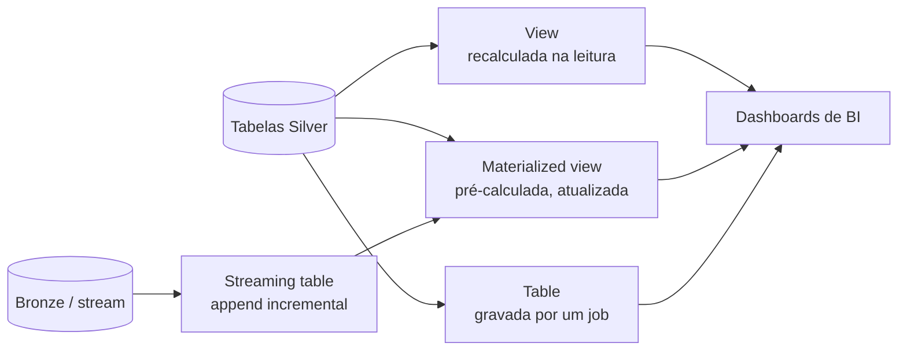

# Objetos da Camada Gold

## Visão geral

A Gold é de onde os times de BI e analytics leem, então o tipo de objeto escolhido define atualidade, custo e velocidade das consultas. O exam guide pede que você entenda a diferença entre **materialized views, views, streaming tables e tables** no Unity Catalog, e como construir cada um. Este arquivo compara os quatro e mostra o SQL de cada um, tanto standalone no Databricks SQL quanto dentro de um Lakeflow pipeline.

> [!abstract] Resumo
>
> - **Table** (Delta gerenciada): você controla cada escrita (`CREATE TABLE AS`, `INSERT`, `MERGE`). Os resultados ficam armazenados
> - **View**: uma consulta salva que é **recalculada a cada leitura** e não armazena dados
> - **Materialized view**: armazena **resultados pré-calculados** e os atualiza, incrementalmente quando possível. Boa para agregados que dashboards consultam repetidamente
> - **Streaming table**: uma tabela UC com **processamento incremental, estilo append**. Cada refresh processa só as linhas novas da fonte. Boa para ingestão e CDC

> [!tip] O que a prova cobra
>
> - Habilidade do exam guide: a diferença entre, e como construir, objetos da camada Gold (materialized views, views, streaming tables, tables) para times de BI e analytics no Unity Catalog
> - Escolher o objeto certo para um requisito de atualidade, custo ou performance
> - Comportamento de refresh: na leitura (view), no refresh ou agenda (MV), append incremental (streaming table)
> - Quais privilégios os consumidores precisam (`SELECT`, mais `REFRESH` para materialized views)

---

## Comparação lado a lado

| | **Table** | **View** | **Materialized view** | **Streaming table** |
| :--- | :--- | :--- | :--- | :--- |
| Armazena dados? | Sim | Não | Sim (resultado pré-calculado) | Sim |
| Quando é calculado? | Quando seu código grava | **Em toda consulta** | Na criação, `REFRESH`, agenda ou `TRIGGER ON UPDATE` | A cada refresh, **só linhas novas** |
| Mudanças na fonte (updates/deletes) | Você trata no código | Sempre refletidas | Refletidas no próximo refresh (incremental ou completo) | Orientado a append. Linhas antigas não são recalculadas |
| Uso típico na Gold | Tabelas de dimensão ou fato curadas, gravadas por jobs | Camada semântica leve, subconjunto de colunas, segurança | KPIs pré-agregados para dashboards | Tabelas de eventos ou fatos mantidas incrementalmente |
| Quem roda o compute | Seu job ou warehouse | O warehouse que consulta, toda vez | Um pipeline serverless | Um pipeline serverless |

Fontes: [materialized views](https://docs.databricks.com/aws/en/views/materialized), [streaming tables](https://docs.databricks.com/aws/en/tables/streaming).



## Construindo cada objeto no Unity Catalog

### Table (CTAS ou MERGE a partir de um job)

```sql
CREATE OR REPLACE TABLE main.gold.daily_revenue AS
SELECT order_date, region, SUM(amount) AS revenue, COUNT(*) AS orders
FROM main.silver.orders
GROUP BY order_date, region;
```

Você é dono da lógica de atualização. Um Lakeflow Job agendado reexecuta o CTAS, ou faz `MERGE` só das datas alteradas.

### View

```sql
CREATE OR REPLACE VIEW main.gold.v_active_customers AS
SELECT customer_id, customer_name, country
FROM main.silver.customers
WHERE is_active = true;
```

- Sem custo de armazenamento. Sempre atual, mas toda consulta paga o cálculo completo
- `CREATE TEMPORARY VIEW` tem escopo de sessão e não é registrada no Unity Catalog. Não use para objetos Gold compartilhados

### Materialized view (standalone, Databricks SQL)

```sql
-- Ad hoc: atualização manual
CREATE OR REPLACE MATERIALIZED VIEW main.gold.mv_revenue_by_region AS
SELECT region, SUM(amount) AS revenue
FROM main.silver.orders
GROUP BY region;

REFRESH MATERIALIZED VIEW main.gold.mv_revenue_by_region;   -- síncrono por padrão

-- Agendada (cron estilo Quartz de seis campos)
CREATE OR REPLACE MATERIALIZED VIEW main.gold.mv_revenue_nightly
SCHEDULE CRON '0 30 3 * * ?' AT TIME ZONE 'UTC'
AS SELECT region, SUM(amount) AS revenue FROM main.silver.orders GROUP BY region;

-- Atualiza automaticamente quando os dados upstream mudam
CREATE OR REPLACE MATERIALIZED VIEW main.gold.mv_revenue_fresh
TRIGGER ON UPDATE
AS SELECT region, SUM(amount) AS revenue FROM main.silver.orders GROUP BY region;
```

Fatos-chave ([Use standalone materialized views](https://docs.databricks.com/aws/en/views/materialized)):

- A criação é **síncrona**: o comando retorna após a carga inicial. `REFRESH ... ASYNC` retorna imediatamente
- Os refreshes rodam em um **pipeline serverless**. O SQL warehouse só coordena, e o custo é cobrado como DBUs de pipeline serverless
- **Refresh incremental** mescla só dados novos ou alterados quando possível, o que exige fontes Delta com **row tracking** habilitado. Caso contrário, roda um recálculo completo. `EXPLAIN CREATE MATERIALIZED VIEW` mostra se a consulta pode ser atualizada incrementalmente
- Agregados e expressões no `SELECT` precisam de **aliases**
- MVs standalone rodam só em modo **triggered**, e **não suportam time travel**
- O dono, e usuários com o privilégio **`REFRESH`**, podem atualizar. Leitores precisam de `SELECT`

### Streaming table (standalone, Databricks SQL)

```sql
CREATE OR REFRESH STREAMING TABLE main.gold.order_events
SCHEDULE EVERY 1 HOUR
AS SELECT order_id, status, event_ts
FROM STREAM main.silver.order_status_changes;
```

- "Um refresh de streaming table avalia apenas as linhas novas que chegaram após a última atualização, e adiciona só os dados novos" ([Use standalone streaming tables](https://docs.databricks.com/aws/en/tables/streaming))
- Mudar a definição não recalcula linhas existentes. `REFRESH STREAMING TABLE ... FULL` reprocessa tudo, o que é arriscado quando a fonte tem retenção curta, como o Kafka
- Conceder `SELECT` em uma streaming table **não** exige conceder `SELECT` nas fontes

### Dentro de um Lakeflow pipeline

```sql
-- Um pipeline pode definir toda a cadeia medallion
CREATE OR REFRESH STREAMING TABLE bronze_orders
AS SELECT * FROM STREAM read_files('/Volumes/main/raw/landing/orders', format => 'json');

CREATE OR REFRESH STREAMING TABLE silver_orders (
  CONSTRAINT valid_amount EXPECT (amount > 0) ON VIOLATION DROP ROW
) AS SELECT * FROM STREAM(bronze_orders);

CREATE OR REFRESH MATERIALIZED VIEW gold_revenue_by_region
AS SELECT region, SUM(amount) AS revenue FROM silver_orders GROUP BY region;
```

```python
from pyspark import pipelines as dp
from pyspark.sql import functions as F

@dp.materialized_view(name="gold_revenue_by_region")
def gold_revenue_by_region():
    return (spark.read.table("silver_orders")
        .groupBy("region")
        .agg(F.sum("amount").alias("revenue")))
```

`@dp.materialized_view` substitui o legado `@dlt.table` sobre um DataFrame batch. `@dp.table` sobre um DataFrame streaming define uma streaming table, e `@dp.temporary_view` substitui `@dlt.view` ([Python reference](https://docs.databricks.com/aws/en/ldp/developer/python-ref)).

> [!note] Sintaxe legada
> Materiais antigos usam `CREATE LIVE TABLE` (hoje uma materialized view) e `CREATE STREAMING LIVE TABLE` (hoje uma streaming table). Se um enunciado mostrar a palavra-chave `LIVE`, mapeie para o tipo de objeto atual.

## Exemplo resolvido: um KPI, quatro implementações

Um time de BI precisa da **receita diária por região**, atualizada de hora em hora, para um dashboard que ~200 pessoas abrem toda manhã.

| Implementação | Atualidade | Padrão de compute | Veredito |
| :--- | :--- | :--- | :--- |
| `CREATE VIEW ... GROUP BY` | Sempre atual | Agregação completa em **cada** carregamento de tile, ~200× por manhã | Simples, mas caro com esse volume de leitura |
| `CREATE MATERIALIZED VIEW ... SCHEDULE EVERY 1 HOUR` | Até 1 hora de atraso | Um refresh por hora, incremental quando possível | **Melhor opção**: muita leitura e atualização horária é aceitável |
| Streaming table sobre eventos de pedido da Silver | Minutos | Adiciona linhas novas, mas um agregado que precisa ser *recalculado* não combina com processamento só-append | Use para o feed de eventos, não para o agregado |
| Tabela reconstruída por um Lakeflow Job a cada hora (`CREATE OR REPLACE TABLE AS`) | Até 1 hora de atraso | Reconstrução completa a cada hora, a menos que você escreva lógica de `MERGE` | Funciona, mas você é dono do código e da agenda |

A materialized view vence porque combina resultados armazenados (leituras baratas) com refresh gerenciado (sem código de job), e pode atualizar incrementalmente quando a fonte suporta.

## Publicando a Gold para consumidores de BI e analytics

Objetos Gold são securables comuns do Unity Catalog, então o acesso é concedido da mesma forma para os quatro tipos:

```sql
-- Analistas podem navegar e ler tudo no schema Gold (objetos atuais e futuros)
GRANT USE CATALOG ON CATALOG main TO `bi_analysts`;
GRANT USE SCHEMA, SELECT ON SCHEMA main.gold TO `bi_analysts`;

-- Um service principal de relatórios também pode disparar refreshes de uma MV
GRANT REFRESH ON main.gold.mv_revenue_by_region TO `reporting-sp`;
```

- Grants em um schema são **herdados** pelos objetos atuais e futuros dele, então novas tabelas e views Gold ficam legíveis sem grants extras
- Dashboards e ferramentas de BI geralmente consultam a Gold via **SQL warehouse**. Serverless SQL warehouse é o tipo recomendado para BI e SQL exploratório (veja [Compute e Clusters](../01-databricks-intelligence-platform/03-compute-clusters.md))
- Row filters e column masks também se aplicam a tabelas Gold. Veja o [Domínio 7](../07-governance-and-security/04-row-filters-column-masks-abac.md)

## Escolhendo um objeto Gold

| Cenário | Melhor objeto |
| :--- | :--- |
| Um dashboard consulta a mesma agregação pesada centenas de vezes por dia | **Materialized view** (paga uma vez por refresh) |
| Um time precisa de uma projeção filtrada e com colunas limitadas da Silver, sempre atual | **View** |
| Um feed de eventos só-append precisa estar na Gold em minutos, processando só linhas novas | **Streaming table** |
| Uma tabela fato precisa de lógica de upsert customizada (SCD, correções tardias) mantida pelo time de dados | **Table** mantida por job com `MERGE` |
| Exploração ad hoc em uma sessão de notebook | Temporary view (não é objeto Gold) |

## Casos de uso

- **Dashboard executivo de KPIs**: uma materialized view com `TRIGGER ON UPDATE` mantém a receita por região atual sem compute por consulta
- **Camada semântica self-service**: views expõem nomes amigáveis sobre a Silver, para que analistas não toquem nas tabelas brutas
- **Status de pedidos quase em tempo real**: uma streaming table adiciona mudanças de status a cada poucos minutos para um dashboard de operações
- **Tabela fato do financeiro**: um job agendado faz `MERGE` de correções tardias em uma tabela Gold com controle total

## Problemas e erros comuns

### Dashboard lento sobre uma view

**Cenário:** uma view Gold com vários joins e agregações faz cada tile do dashboard levar 30 segundos.
**Correção:** views recalculam a cada consulta. Converta a agregação pesada em materialized view e mantenha views para projeções leves.

### Materialized view sempre recalcula tudo

**Cenário:** o refresh noturno de uma MV leva tanto tempo quanto a criação inicial.
**Correção:** o refresh incremental exige fontes Delta com row tracking (`delta.enableRowTracking = true`) e um formato de consulta compatível. Verifique com `EXPLAIN CREATE MATERIALIZED VIEW`.

### Streaming table ignora uma linha atualizada na fonte

**Cenário:** um pedido corrigido na Silver nunca altera a streaming table da Gold.
**Correção:** streaming tables processam só linhas novas. Linhas já processadas não são reavaliadas. Use materialized view, ou tabela mantida com `MERGE`, quando a fonte atualiza linhas existentes.

### Analistas não conseguem atualizar uma materialized view

**Cenário:** um analista com `SELECT` recebe erro de permissão ao rodar `REFRESH MATERIALIZED VIEW`.
**Correção:** atualizar exige ser o dono ou ter o privilégio `REFRESH` na materialized view.

### Temporary view usada como objeto Gold compartilhado

**Cenário:** um notebook cria `CREATE TEMPORARY VIEW gold_kpis`, mas o time do dashboard não a encontra no Catalog Explorer.
**Correção:** temporary views só existem na sessão que as criou. Crie uma `VIEW` permanente (ou uma MV) em um schema do Unity Catalog e conceda `SELECT` aos consumidores.

### Refresh da Gold falha depois que o dono sai

**Cenário:** uma materialized view agendada para de atualizar depois que o acesso do dono à fonte Silver é removido.
**Correção:** refreshes rodam com as permissões do dono, e perder `SELECT` na fonte os interrompe. Transfira a propriedade para um service principal ou grupo que mantenha acesso à fonte.

## Dicas para a prova

> [!tip] Dicas para a prova
>
> - **View** = sem armazenamento, recalculada por consulta. **MV** = armazenada, atualizada. **Streaming table** = append incremental. **Table** = você grava
> - MVs e streaming tables são criadas e atualizadas por **pipelines serverless**, mesmo quando disparadas de um SQL warehouse
> - Streaming tables processam **só linhas novas**; updates na fonte pedem MV ou `MERGE`
> - `CREATE LIVE TABLE` → MV, `CREATE STREAMING LIVE TABLE` → streaming table (palavras-chave legadas)
> - Leitores precisam de `SELECT`. Atualizar uma MV exige `REFRESH` (ou ser o dono)

## Pontos-chave

- Escolha o objeto Gold por atualidade, custo e quem é dono da lógica de atualização
- Materialized views pré-calculam e atualizam, incrementalmente quando possível. Views calculam na leitura
- Streaming tables dão manutenção incremental só-append com baixa latência
- Os quatro são objetos do Unity Catalog governados pelo mesmo modelo de privilégios

## Tópicos relacionados

- [Limpeza e Qualidade de Dados](./05-data-cleaning-and-quality.md)
- [Fundamentos de Spark SQL (views, temp views)](./01-spark-sql-fundamentals.md)
- [Padrões de Ingestão e Lakeflow Connect](../02-data-ingestion-and-loading/01-ingestion-patterns-and-lakeflow-connect.md)

## Documentação oficial

- [Use standalone materialized views](https://docs.databricks.com/aws/en/views/materialized)
- [Use standalone streaming tables](https://docs.databricks.com/aws/en/tables/streaming)
- [Lakeflow pipelines Python language reference](https://docs.databricks.com/aws/en/ldp/developer/python-ref)
- [Manage data quality with pipeline expectations](https://docs.databricks.com/aws/en/ldp/expectations)
- [Configure materialized views (privileges, REFRESH)](https://docs.databricks.com/aws/en/sql/mv-st/materialized-configure)

---

**[← Anterior: Limpeza e Qualidade de Dados](./05-data-cleaning-and-quality.md) | [↑ Voltar para Data Transformation and Modeling](./README.md) | [Próximo: Parâmetros de tuning do Spark →](./07-spark-tuning-parameters.md)**
