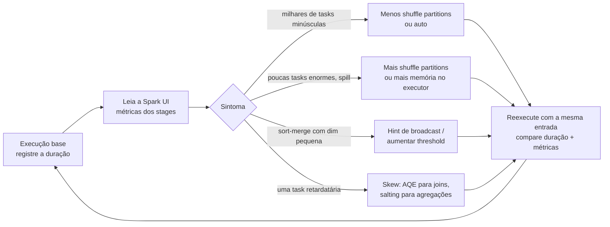

# Parâmetros de Tuning do Spark

## Visão geral

O exam guide cita quatro grupos de parâmetros básicos de tuning: **`spark.sql.shuffle.partitions`**, **`spark.default.parallelism`**, **`spark.executor.memory` / `spark.driver.memory`** e **`spark.sql.autoBroadcastJoinThreshold`**. Também espera que você **meça a performance de novo** depois de alterá-los. Este arquivo explica o que cada um controla, seu padrão, onde pode ser definido (classic vs serverless) e como o Adaptive Query Execution (AQE) muda o cenário no Databricks.

> [!abstract] Resumo
>
> - **`spark.sql.shuffle.partitions`** (padrão OSS `200`) define o número de partições após um shuffle em joins e agregações. No Databricks, `auto` deixa o Spark escolher. É o padrão no serverless
> - **`spark.default.parallelism`** é o número padrão de partições para operações **RDD** (`parallelize`, `reduceByKey`, `join` em RDDs). Não controla shuffles de DataFrame
> - **`spark.executor.memory` / `spark.driver.memory`** (padrão OSS `1g`) definem o heap JVM por executor e do driver. São configurações do compute e não podem ser mudadas numa sessão em execução
> - **`spark.sql.autoBroadcastJoinThreshold`** (padrão **10 MB**, `-1` desativa) é o tamanho máximo de tabela para broadcast em um join. O AQE no Databricks tem seu próprio limite em runtime, `spark.databricks.adaptive.autoBroadcastJoinThreshold` (padrão **30 MB**)

> [!tip] O que a prova cobra
>
> - Habilidade do exam guide: entender os parâmetros básicos de tuning e medir a performance de novo
> - Qual parâmetro mexer para cada sintoma: milhares de tasks minúsculas, poucas tasks enormes com spill, broadcast que não aconteceu, ou OOM no driver com `collect()`
> - Que o AQE (ligado por padrão) já agrupa partições de shuffle e troca para broadcast join em runtime
> - Que o serverless expõe só algumas propriedades Spark, entre elas `spark.sql.shuffle.partitions`

---

## Os quatro parâmetros

| Parâmetro | Controla | Padrão | Aumente quando | Diminua quando |
| :--- | :--- | :--- | :--- | :--- |
| `spark.sql.shuffle.partitions` | Partições após shuffle em joins e agregações de DataFrame/SQL | `200` (Spark OSS). `auto` no serverless | Partições de shuffle são enormes e fazem **spill**. Dados muito grandes | Dados pequenos, com milhares de tasks minúsculas e alto overhead de agendamento |
| `spark.default.parallelism` | Partições padrão para transformações **RDD** (`join`, `reduceByKey`, `parallelize`) | Partições do maior RDD pai, ou para `parallelize`, total de cores dos executores (mínimo 2) | Jobs RDD deixam cores ociosos | Raramente. Não afeta shuffles de DataFrame |
| `spark.executor.memory` | Heap JVM por executor | `1g` (Spark OSS) | Executores dão OOM ou fazem muito spill | Para caber mais executores por nó |
| `spark.driver.memory` | Heap JVM do driver | `1g` (Spark OSS) | OOM no driver: `collect()`, `toPandas()`, broadcasts grandes, muitos arquivos pequenos | — |
| `spark.sql.autoBroadcastJoinThreshold` | Tamanho máx. (bytes) de tabela enviada por broadcast a cada executor | `10485760` (10 MB). `-1` desativa | Uma dimensão um pouco acima de 10 MB ainda deve ir por broadcast | Broadcasts causam pressão de memória no driver/executores |

Fontes: [Spark configuration](https://spark.apache.org/docs/latest/configuration.html), [Spark SQL performance tuning](https://spark.apache.org/docs/latest/sql-performance-tuning.html).

> [!note] Atenção
> `spark.sql.shuffle.partitions` afeta o engine de DataFrame/SQL, que é o que quase todo código no Databricks usa. `spark.default.parallelism` afeta só a API RDD. Espere uma alternativa errada que troca os dois.

## Onde configurá-los

| Compute | Como | O que dá para mudar |
| :--- | :--- | :--- |
| **Classic: nível do compute** | Configuração do compute → **Advanced → Spark → Spark config**, um `chave valor` por linha (ou `spark_conf` na Clusters API) | Tudo, incluindo memória de executor/driver. Vale para todo notebook e job naquele compute |
| **Classic: nível da sessão** | `spark.conf.set("spark.sql.shuffle.partitions", "64")` ou `SET spark.sql.shuffle.partitions = 64` | Configurações SQL de runtime (shuffle partitions, broadcast threshold). **Não** a memória da JVM |
| **Notebooks e jobs serverless** | `spark.conf.set(...)` / `SET ...` | **Apenas** uma lista curta: `spark.sql.shuffle.partitions` (padrão `auto`), `spark.sql.session.timeZone`, `spark.sql.ansi.enabled`, `spark.sql.files.maxPartitionBytes`, `spark.sql.legacy.timeParserPolicy`, `spark.databricks.execution.timeout` |

Fonte: [Set Spark configuration properties on Databricks](https://docs.databricks.com/aws/en/spark/conf). A mesma página diz que "a Databricks geralmente recomenda não configurar a maioria das propriedades Spark", porque configurações legadas podem sobrescrever comportamentos padrão mais novos.

```text
# Classic compute → Advanced → Spark config (nível do compute)
spark.executor.memory 16g
spark.driver.memory 8g
spark.sql.shuffle.partitions auto
```

```python
# Nível da sessão (classic ou serverless), afeta só esta SparkSession
spark.conf.set("spark.sql.shuffle.partitions", "64")
spark.conf.set("spark.sql.autoBroadcastJoinThreshold", str(50 * 1024 * 1024))   # 50 MB (só classic)
print(spark.conf.get("spark.sql.shuffle.partitions"))
```

> [!warning] Erro comum
> `spark.conf.set("spark.driver.memory", "8g")` num notebook em execução não tem efeito. A JVM do driver já iniciou. A documentação do Spark diz que a memória do driver "não deve ser definida via SparkConf diretamente na aplicação" no modo client. Defina no Spark config do compute e reinicie.

## Adaptive Query Execution (AQE) no Databricks

O AQE reotimiza o plano de consulta em runtime, usando os tamanhos reais medidos nas fronteiras de shuffle e broadcast. Está **ligado por padrão** e se aplica a consultas não-streaming que tenham pelo menos um exchange ou subquery ([Adaptive query execution](https://docs.databricks.com/aws/en/optimizations/aqe)).

| Recurso do AQE | O que faz | Parâmetro relacionado |
| :--- | :--- | :--- |
| **Agrupar partições pós-shuffle** | Junta partições de shuffle pequenas em partições de tamanho razoável | `spark.sql.adaptive.coalescePartitions.enabled` (`true`) |
| **Trocar estratégia de join** | Converte um sort-merge join em broadcast hash join quando um lado se revela pequeno | `spark.databricks.adaptive.autoBroadcastJoinThreshold` (`30MB`) |
| **Tratar skew em join** | Divide e replica partições com skew em **sort-merge e shuffle-hash joins** | `spark.sql.adaptive.skewJoin.enabled` (`true`) |
| **Propagação de relação vazia** | Corta partes do plano que não retornam linhas | — |

> [!important] Importante
> O tratamento de skew do AQE vale **só para joins**: sort-merge e shuffle-hash, nunca broadcast. Uma **agregação `groupBy` com skew** não é resolvida pelo AQE. Faça salting na chave e agregue em duas etapas (veja [Spark UI e System Tables](../06-troubleshooting-monitoring-and-optimization/02-spark-ui-and-system-tables.md)).

Definir `spark.sql.shuffle.partitions` como **`auto`** "habilita o shuffle auto-otimizado, que define a quantidade de partições com base no plano e no tamanho dos dados de entrada". Costuma ser um primeiro passo melhor do que chutar um número.

## Broadcast joins na prática

```python
from pyspark.sql.functions import broadcast

# Força o broadcast mesmo que as estatísticas coloquem a dimensão acima do limite
enriched = facts.join(broadcast(dim_store), "store_id")
```

```sql
SELECT /*+ BROADCAST(s) */ f.*, s.region
FROM main.silver.sales f JOIN main.silver.stores s ON f.store_id = s.store_id;
```

- Um hint `BROADCAST` é respeitado "mesmo que o tamanho da tabela sugerido pelas estatísticas esteja acima" de `spark.sql.autoBroadcastJoinThreshold`
- Fazer broadcast de uma tabela grande a faz passar pelo driver e ser copiada para cada executor, com risco de OOM. Faça broadcast só de dimensões realmente pequenas

## Ciclo ajustar → medir de novo

O exam guide associa tuning a **medir de novo**. Mude uma coisa por vez e compare com uma linha de base:



O que comparar em cada reexecução:

1. **Duração total** do job ou task: o histórico de execuções / matrix view dos Lakeflow Jobs mostra por execução
2. **Métricas dos stages** na Spark UI: número de tasks, duração mediana vs máxima das tasks, shuffle read/write e spill (memória e disco)
3. **Plano da consulta** na aba SQL / DataFrame: o `SortMergeJoin` virou `BroadcastHashJoin`?

```python
# Um harness mínimo de tempo antes/depois, com a mesma entrada
import time

def timed(label, fn):
    start = time.time()
    fn()
    print(f"{label}: {time.time() - start:.1f}s")

query = lambda: spark.table("main.silver.sales").groupBy("store_id").count().write.mode("overwrite").saveAsTable("main.scratch.sales_by_store")

spark.conf.set("spark.sql.shuffle.partitions", "200"); timed("200 partições", query)
spark.conf.set("spark.sql.shuffle.partitions", "auto"); timed("partições auto", query)
```

> [!note] Observação
> Disk cache e layout dos dados distorcem execuções isoladas. Compare várias execuções com a mesma entrada, de preferência no mesmo compute, antes de tirar conclusões.

## Cola: sintoma → parâmetro

| Sintoma na Spark UI ou nos logs | Correção provável |
| :--- | :--- |
| 200 tasks de poucos KB cada em um dataset pequeno | Diminua `spark.sql.shuffle.partitions` ou use `auto` (o coalescing do AQE geralmente já resolve) |
| Tasks do stage de shuffle fazem spill em disco | Aumente shuffle partitions (partições menores) ou a memória do executor |
| `SortMergeJoin` contra uma dimensão de 15 MB | Hint de broadcast, ou aumente `spark.sql.autoBroadcastJoinThreshold` |
| `OutOfMemoryError` no driver após `collect()` | Não colete resultados grandes. Senão, aumente `spark.driver.memory` no compute |
| Uma task roda 10× mais que as outras | Skew: o AQE resolve em joins; faça salting na chave em agregações |
| Job RDD usa só alguns cores | Aumente `spark.default.parallelism` ou reparticione o RDD |

## Casos de uso

- **Dimensão pequena, join lento**: uma dimensão de lojas de 20 MB entra em sort-merge. Um hint de broadcast reduz o stage de minutos para segundos
- **Agregação com spill**: aumentar shuffle partitions de 200 para 800 em um `groupBy` de vários terabytes elimina o spill em disco
- **Job pequeno superparticionado**: um job horário sobre 50 MB roda 200 tasks minúsculas. Trocar para `auto` reduz o overhead
- **OOM no driver em notebook de relatório**: a correção é parar de chamar `toPandas()` em 100 milhões de linhas, não aumentar a memória do driver indefinidamente

## Problemas e erros comuns

### Definir memória pelo notebook não faz nada

**Cenário:** `spark.conf.set("spark.executor.memory", "32g")` roda sem erro, mas os OOMs continuam.
**Correção:** memória de executor e driver é fixada quando as JVMs iniciam. Defina no Spark config do compute e reinicie. No serverless, a memória não é configurável.

### Serverless rejeita uma propriedade Spark

**Cenário:** um notebook movido para serverless não consegue mais definir `spark.sql.autoBroadcastJoinThreshold`.
**Correção:** o serverless suporta só uma lista curta de propriedades. Remova a configuração e confie no AQE, ou use um hint `BROADCAST` na consulta.

### Ajustar `spark.default.parallelism` para um job de DataFrame

**Cenário:** um engenheiro aumenta `spark.default.parallelism`, mas a agregação de DataFrame continua com 200 tasks de shuffle.
**Correção:** shuffles de DataFrame usam `spark.sql.shuffle.partitions`. `spark.default.parallelism` vale para operações RDD.

### Broadcast de uma tabela grande

**Cenário:** depois de aumentar o broadcast threshold para 2 GB, os jobs falham com OOM no driver.
**Correção:** tabelas em broadcast passam pelo driver e são copiadas para cada executor. Mantenha o limite modesto e faça broadcast só de dimensões pequenas.

## Dicas para a prova

> [!tip] Dicas para a prova
>
> - **Shuffle partitions** = shuffles de DataFrame/SQL (padrão 200, `auto` no Databricks). **Default parallelism** = RDDs
> - O **broadcast threshold** padrão é 10 MB, e `-1` desativa. O limite do AQE em runtime no Databricks é 30 MB
> - **Memória** de driver/executor é definida no compute, não com `spark.conf.set` na sessão
> - Diminuir shuffle partitions deixa as partições **maiores**, o que piora spill e skew
> - O tratamento de skew do AQE cobre **só joins**. Agregações com skew pedem **salting**
> - Sempre **meça de novo** com a mesma entrada depois de uma mudança

## Pontos-chave

- Quatro parâmetros: shuffle partitions, default parallelism, memória de executor/driver, broadcast threshold
- O AQE (ligado por padrão) agrupa partições, troca para broadcast join e divide partições de join com skew em runtime
- O serverless expõe só algumas propriedades Spark, e `spark.sql.shuffle.partitions` é uma delas
- Ajuste com base em evidências da Spark UI, mude uma configuração por vez e meça de novo

## Tópicos relacionados

- [Joins e Agregações](./03-joins-aggregations.md)
- [Spark UI e System Tables](../06-troubleshooting-monitoring-and-optimization/02-spark-ui-and-system-tables.md)
- [Compute Troubleshooting (OOM)](../06-troubleshooting-monitoring-and-optimization/05-compute-troubleshooting.md)

## Documentação oficial

- [Adaptive query execution](https://docs.databricks.com/aws/en/optimizations/aqe)
- [Set Spark configuration properties on Databricks](https://docs.databricks.com/aws/en/spark/conf)
- [Compute configuration reference (Spark config)](https://docs.databricks.com/aws/en/compute/configure)
- [Apache Spark configuration](https://spark.apache.org/docs/latest/configuration.html)
- [Apache Spark SQL performance tuning](https://spark.apache.org/docs/latest/sql-performance-tuning.html)

---

**[← Anterior: Objetos da camada Gold](./06-gold-layer-objects.md) | [↑ Voltar para Data Transformation and Modeling](./README.md)**
