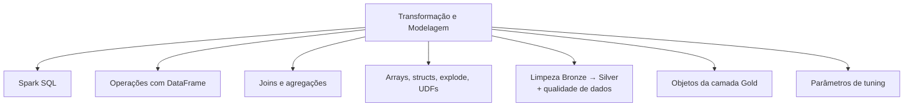

# Data Transformation and Modeling (22 % da prova)

O Domínio 3 é o maior da prova de agosto de 2026. Cobre o trabalho que transforma Bronze em Silver e Gold. Você limpa nulos e tipos com PySpark ou SQL. Faz join e union de DataFrames, reestrutura colunas e arrays, deduplica e agrega. Também precisa conhecer os parâmetros básicos de tuning do Spark, construir objetos da camada Gold (tabelas, views, materialized views, streaming tables) no Unity Catalog e aplicar verificações de qualidade de dados.

## Visão geral dos tópicos

## Conteúdo da seção

| Arquivo | Tópico | Prioridade |
| :--- | :--- | :--- |
| [01-spark-sql-fundamentals.md](./01-spark-sql-fundamentals.md) | Consultas SQL, tabelas, temp views, operações de catálogo | Alta |
| [02-dataframe-operations.md](./02-dataframe-operations.md) | API de DataFrame: select, filter, adicionar/remover/renomear colunas, dedup | Alta |
| [03-joins-aggregations.md](./03-joins-aggregations.md) | Joins inner/left/cross/semi/anti, broadcast joins, GROUP BY, contagem distinta aproximada | Alta |
| [04-advanced-transformations.md](./04-advanced-transformations.md) | Arrays, maps, structs, `explode`, `split`, pivot, UDFs, tratamento de nulos | Alta |
| [05-data-cleaning-and-quality.md](./05-data-cleaning-and-quality.md) | Limpeza Bronze → Silver, constraints, expectations de pipeline | Alta |
| [06-gold-layer-objects.md](./06-gold-layer-objects.md) | Tabelas vs views vs materialized views vs streaming tables no UC | Alta |
| [07-spark-tuning-parameters.md](./07-spark-tuning-parameters.md) | `spark.sql.shuffle.partitions`, `spark.default.parallelism`, memória de executor/driver, broadcast threshold, AQE | Média |

## Cobertura das habilidades oficiais (agosto de 2026)

| Habilidade do exam guide (parafraseada) | Onde é coberta |
| :--- | :--- |
| Limpar Bronze para Silver (nulos, tipos) com PySpark/SQL | [05](./05-data-cleaning-and-quality.md), [02](./02-dataframe-operations.md), [04](./04-advanced-transformations.md) |
| Combinar DataFrames: joins inner, left, broadcast, múltiplas chaves, cross; union / union all | [03](./03-joins-aggregations.md) |
| Manipular colunas, linhas e estrutura: adicionar, remover, split, renomear, filtrar, explode | [02](./02-dataframe-operations.md), [04](./04-advanced-transformations.md) |
| Deduplicação e agregados (count, contagem distinta aproximada, média, summary) | [02](./02-dataframe-operations.md), [03](./03-joins-aggregations.md), [05](./05-data-cleaning-and-quality.md) |
| Parâmetros básicos de tuning e medir a performance de novo | [07](./07-spark-tuning-parameters.md) |
| Objetos da camada Gold: materialized views, views, streaming tables, tabelas | [06](./06-gold-layer-objects.md) |
| Verificações de qualidade e regras de validação para Silver e Gold | [05](./05-data-cleaning-and-quality.md) |

## Conceitos-chave

- **Lazy evaluation**: transformações montam um plano; ações (`count`, `show`, `write`) o executam
- **`union` vs `unionByName`**: `union` casa colunas por posição; `unionByName` casa por nome. Ambos mantêm duplicatas (semântica de `UNION ALL`), enquanto o `UNION` do SQL as remove
- **Objetos Gold**: uma **view** recalcula a cada consulta; uma **materialized view** guarda resultados pré-calculados e é atualizada; uma **streaming table** adiciona dados novos incrementalmente
- **Expectations**: `CONSTRAINT ... EXPECT (...)` com warn (padrão), `DROP ROW` ou `FAIL UPDATE`

## Próximos passos

Continue para [04 — Working with Lakeflow Jobs](../04-working-with-lakeflow-jobs/README.md) para orquestrar essas transformações.

---

**[← Anterior: Data Ingestion and Loading](../02-data-ingestion-and-loading/README.md) | [↑ Voltar à Certificação](../README.md) | [Próximo: Working with Lakeflow Jobs →](../04-working-with-lakeflow-jobs/README.md)**
