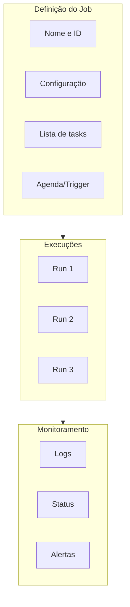
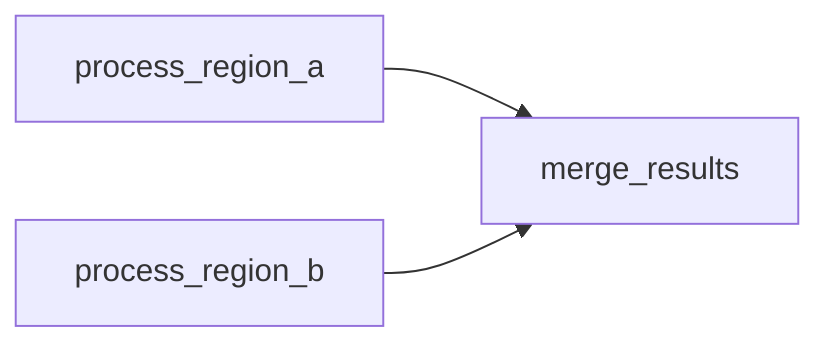
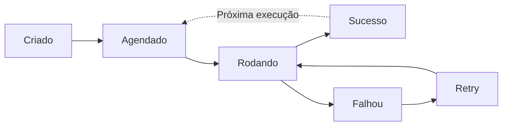

# Lakeflow Jobs e Tasks

## Visão geral

**Lakeflow Jobs** (antigo Databricks Jobs, parte do que se chamava Workflows) é o serviço de orquestração para workloads de engenharia de dados em produção. Um job agrupa uma ou mais **tasks** em um DAG e adiciona triggers, parâmetros, compute, retries e notificações.

> [!abstract] Resumo
>
> - Um **job** tem um trigger e configurações. **Tasks** são os nós do DAG, ligadas por **Depends on**. Tasks sem dependência entre si rodam em paralelo
> - Tipos comuns de task: Notebook, SQL, SQL Alert, Dashboards, Pipeline, Python script, Python wheel, dbt, JAR, Run Job, If/else, For each
> - Parâmetros: job parameters mais dynamic value references como `{{job.run_id}}` e `{{job.start_time.iso_date}}`

> [!tip] O que a prova cobra
>
> - Habilidade do exam guide: configurar tasks comuns (notebook, SQL query, dashboard e pipeline) e suas dependências usando Lakeflow Jobs e seu grafo de tasks (DAG)
> - Inserir uma task upstream alterando o **Depends on**
> - Escolher o compute das tasks: serverless, jobs compute ou um cluster all-purpose existente

---

## O que é um job?



Um job empacota:

- **Tasks**: o código a executar (notebook, Python, SQL, JAR etc.)
- **Configuração**: parâmetros, clusters, dependências
- **Agendamento**: quando/com que frequência rodar
- **Monitoramento**: logs, alertas, política de retry

## Tipos de task

Tipos listados na documentação atual ([Configure and edit tasks](https://docs.databricks.com/aws/en/jobs/configure-task)):

| Tipo de task | Executa | Relevância na prova |
|-----------|------|----------------|
| **Notebook** | Um notebook (Python, SQL, Scala, R) em serverless ou classic | **Alta**: a task de ETL mais comum |
| **SQL** | Uma consulta SQL ou arquivo SQL em um **SQL warehouse** | **Alta**: "SQL query task" no exam guide |
| **Dashboards** | Atualiza um dashboard AI/BI (e pode notificar assinantes) | **Alta**: "dashboard task" |
| **Pipeline** | Dispara um update de um Lakeflow (Declarative) pipeline, incluindo ingestion pipelines do Lakeflow Connect | **Alta**: "pipeline task" |
| **SQL Alert** | Avalia um alerta do Databricks SQL | Média |
| **Python script** / **Python wheel** / **JAR** / **Spark Submit** | Código empacotado | Baixa–média |
| **dbt** | Um projeto dbt | Baixa |
| **Run Job** | Dispara outro Lakeflow Job | Média: orquestração modular |
| **If/else** / **For each** | Control flow (veja [Control Flow](./03-control-flow.md)) | **Alta** |
| Power BI, Clean Room notebook e outros | Integrações especializadas | Baixa |

```yaml
# Tasks de notebook, SQL, dashboard e pipeline ligadas em um DAG (formato YAML de bundle)
tasks:
  - task_key: ingest
    pipeline_task:
      pipeline_id: ${resources.pipelines.orders_pipeline.id}
  - task_key: quality_check
    depends_on: [{task_key: ingest}]
    sql_task:
      warehouse_id: ${var.warehouse_id}
      file:
        path: ../sql/check_orders.sql
  - task_key: enrich
    depends_on: [{task_key: quality_check}]
    notebook_task:
      notebook_path: ../notebooks/enrich_orders
  - task_key: refresh_dashboard
    depends_on: [{task_key: enrich}]
    dashboard_task:
      dashboard_id: ${resources.dashboards.sales.id}
      warehouse_id: ${var.warehouse_id}
```

### Exemplo de task de notebook

```python
# O job passa parâmetros, lidos via widgets
env = dbutils.widgets.get("env")     # "prod"
date = dbutils.widgets.get("date")   # "2025-01-15"

import pyspark.sql.functions as F

df = spark.read.table("main.bronze.events").filter(F.col("event_date") == date)

df_processed = (df
    .filter(F.col("value") > 0)
    .groupBy("category")
    .agg(F.count("*").alias("count")))

df_processed.write.mode("overwrite").saveAsTable("main.silver.event_counts")
```

### Exemplo de task de Python script

```python
# Parâmetros chegam como argumentos de linha de comando
import argparse
from pyspark.sql import SparkSession

def main():
    parser = argparse.ArgumentParser()
    parser.add_argument("--environment", required=True)
    parser.add_argument("--date", required=True)
    args = parser.parse_args()

    spark = SparkSession.builder.appName("ETL").getOrCreate()
    df = spark.read.table("main.bronze.events").filter(f"event_date = '{args.date}'")
    df.write.mode("overwrite").saveAsTable("main.silver.events_clean")

if __name__ == "__main__":
    main()
```

## Criando jobs pela UI

1. Abra **Jobs & Pipelines** na barra lateral (antigo Workflows)
2. Clique em **Create → Job**
3. **Configure a task:** tipo (Notebook, Python, SQL etc.), compute, nome e caminho do código
4. **Adicione parâmetros** (opcional): `environment` = "prod", `date` = `{{job.start_time.iso_date}}`
5. **Configure o trigger** (opcional): agenda cron + fuso horário, file arrival, table update
6. **Adicione notificações** (opcional): email, Slack/webhooks
7. **Salve e rode**

## Criando jobs pela API (Jobs API 2.1)

```json
{
  "name": "daily_etl_pipeline",
  "description": "Processo de ETL diário",
  "max_concurrent_runs": 1,
  "tasks": [
    {
      "task_key": "extract_data",
      "notebook_task": {
        "notebook_path": "/Users/user@company.com/etl/extract",
        "base_parameters": {
          "environment": "prod",
          "date": "{{job.start_time.iso_date}}"
        }
      },
      "existing_cluster_id": "cluster-123",
      "timeout_seconds": 3600
    }
  ],
  "schedule": {
    "quartz_cron_expression": "0 0 * * * ?",
    "timezone_id": "America/Sao_Paulo"
  }
}
```

```bash
curl -X POST https://<workspace>.cloud.databricks.com/api/2.1/jobs/create \
  -H "Authorization: Bearer <TOKEN>" \
  -d @job_config.json

# Ou com a Databricks CLI
databricks jobs create --json @job_config.json
```

## Parâmetros

### Estáticos e dinâmicos

```json
{
  "base_parameters": {
    "environment": "prod",
    "run_date": "{{job.start_time.iso_date}}",
    "run_id": "{{job.run_id}}",
    "task_run_id": "{{task.run_id}}"
  }
}
```

### Dynamic value references disponíveis

| Referência | Descrição | Exemplo |
|-------|-----------|---------|
| `{{job.id}}` | ID do job | "123456" |
| `{{job.name}}` | Nome do job na execução | "daily_etl" |
| `{{job.run_id}}` | ID único da execução do job | "1234567890" |
| `{{job.start_time.iso_date}}` | Data de início da execução (ISO) | "2026-10-26" |
| `{{job.trigger.type}}` | O que iniciou a execução | — |
| `{{job.trigger.file_arrival.location}}` | Local do file arrival trigger | `/Volumes/main/raw/landing/` |
| `{{job.parameters.<nome>}}` | Um parâmetro do job | — |
| `{{task.run_id}}` | ID da execução da task | — |
| `{{tasks.<task>.values.<chave>}}` | Um task value definido upstream | — |

`{{start_date}}` e variáveis legadas parecidas estão depreciadas. Use `{{job.start_time.<argumento>}}` ([dynamic value references](https://docs.databricks.com/aws/en/jobs/dynamic-value-references)).

### Lendo parâmetros nas tasks

```python
# Notebook: via dbutils.widgets
env = dbutils.widgets.get("environment")
run_date = dbutils.widgets.get("run_date")

# Python script: via argparse
import argparse
parser = argparse.ArgumentParser()
parser.add_argument("--environment")
parser.add_argument("--run_date")
args = parser.parse_args()
```

## Jobs multi-task

### Job com dependências (sequencial)

```json
{
  "name": "etl_pipeline_with_tasks",
  "tasks": [
    {"task_key": "extract",
     "notebook_task": {"notebook_path": "/Users/user/extract"}},
    {"task_key": "transform",
     "depends_on": [{"task_key": "extract"}],
     "notebook_task": {"notebook_path": "/Users/user/transform"}},
    {"task_key": "load",
     "depends_on": [{"task_key": "transform"}],
     "notebook_task": {"notebook_path": "/Users/user/load"}}
  ]
}
```

### Tasks em paralelo (fan-out / fan-in)

```json
{
  "tasks": [
    {"task_key": "process_region_a", "notebook_task": {"notebook_path": "/users/user/process_region_a"}},
    {"task_key": "process_region_b", "notebook_task": {"notebook_path": "/users/user/process_region_b"}},
    {"task_key": "merge_results",
     "depends_on": [{"task_key": "process_region_a"}, {"task_key": "process_region_b"}],
     "notebook_task": {"notebook_path": "/users/user/merge"}}
  ]
}
```

`process_region_a` e `process_region_b` rodam **em paralelo**; `merge_results` só começa quando as duas terminarem.



## Opções de compute

| Opção | Prós | Contras |
| :--- | :--- | :--- |
| **Serverless jobs** | Início rápido, sem gestão de infra, paga pelo uso | Menos controle (sem init scripts, poucas configs Spark) |
| **Jobs compute (`new_cluster` / job cluster)** | Criado e encerrado automaticamente, SKU mais barato | Latência de inicialização (minutos) |
| **Cluster all-purpose existente (`existing_cluster_id`)** | Já está rodando, início rápido | Mais caro, gestão manual, custo com tempo ocioso |

```json
{
  "task_key": "my_task",
  "notebook_task": {"notebook_path": "/path/to/notebook"},
  "new_cluster": {
    "spark_version": "15.4.x-scala2.12",
    "node_type_id": "i3.xlarge",
    "num_workers": 2,
    "aws_attributes": {"availability": "SPOT_WITH_FALLBACK"}
  }
}
```

Use `job_cluster_key` para que várias tasks do mesmo job **compartilhem** um job cluster.

## Boas práticas de configuração

```json
{
  "max_concurrent_runs": 1,
  "tasks": [
    {
      "task_key": "main",
      "timeout_seconds": 3600,
      "max_retries": 2,
      "min_retry_interval_millis": 60000
    }
  ],
  "email_notifications": {
    "on_success": ["user@company.com"],
    "on_failure": ["user@company.com", "ops@company.com"]
  },
  "webhook_notifications": {
    "on_failure": [{"id": "slack-webhook-123"}]
  }
}
```

## Ciclo de vida de um job



## Casos de uso

- **Pipelines ETL multi-task**: definir extract, transform e load como tasks separadas em um único job, usando `depends_on` para criar um DAG que roda na ordem certa, com ramos paralelos quando possível.
- **Jobs de backfill parametrizados**: usar dynamic value references como `{{job.start_time.iso_date}}` para rodar o mesmo job em intervalos de datas diferentes, fazendo backfills sem duplicar definições.

## Problemas e erros comuns

### Inserir uma task upstream na direção errada

**Cenário:** um engenheiro adiciona um notebook de validação que deve rodar **antes** da task existente, mas configura a nova task para depender da antiga — então ela roda depois.
**Correção:** a nova task upstream não tem dependência. Edite o **Depends on** da task **original** para incluir a nova task.

### Job falha e ninguém é alertado

**Cenário:** um job de produção falha de madrugada, mas o plantão não é avisado porque notificações nunca foram configuradas.
**Correção:** configure notificações por email (on_failure) e/ou webhooks (ex.: Slack). Verifique a entrega com uma execução de teste antes de confiar nelas em produção.

### Dependência mal configurada faz tasks serem puladas

**Cenário:** uma task downstream nunca executa porque o `depends_on` referencia o `task_key` errado, ou a falha de uma task upstream não é tratada.
**Correção:** revise a visualização do DAG na UI de Jobs para confirmar as arestas de dependência e as condições Run if.

## Dicas para a prova

- Job clusters são mais baratos que all-purpose para jobs de produção; encerram automaticamente ao fim do job
- Jobs multi-task usam `depends_on` para definir o DAG; tasks sem dependências rodam em paralelo
- Saiba as dynamic value references: `{{job.run_id}}`, `{{job.start_time.iso_date}}`, `{{job.parameters.<nome>}}`, `{{tasks.<task>.values.<chave>}}`
- Tipos de task do exam guide: **notebook, SQL query, dashboard, pipeline**. Saiba o compute de cada um (tasks SQL e dashboard usam SQL warehouse)
- `max_concurrent_runs: 1` evita execuções sobrepostas. Uma execução que excederia o limite é pulada (status **Skipped**)

## Pontos-chave

- **Job**: contêiner de workloads agendados/disparados
- **Task**: unidade de trabalho (notebook, Python, SQL etc.)
- **Compute**: serverless, job cluster ou cluster existente
- **Parâmetros**: entradas estáticas/dinâmicas via dynamic value references
- **Dependências**: workflows multi-task com ordem definida
- **Max concurrent runs**: limita execuções simultâneas
- **Timeout**: tempo máximo de execução por task
- **Max retries**: nova tentativa automática em caso de falha

## Tópicos relacionados

- [Agendamento e Triggers](./02-scheduling-triggers.md)
- [Monitoramento de Jobs](../06-troubleshooting-monitoring-and-optimization/01-job-monitoring.md)
- [Compute e Clusters](../01-databricks-intelligence-platform/03-compute-clusters.md)

## Documentação oficial

- [Lakeflow Jobs](https://docs.databricks.com/aws/en/jobs/)
- [Configure and edit tasks in Lakeflow Jobs](https://docs.databricks.com/aws/en/jobs/configure-task)
- [Configure task dependencies](https://docs.databricks.com/aws/en/jobs/conditional-tasks)
- [Dynamic value references](https://docs.databricks.com/aws/en/jobs/dynamic-value-references)

---

**[↑ Voltar para Working with Lakeflow Jobs](./README.md) | [Próximo: Agendamento e Triggers →](./02-scheduling-triggers.md)**
