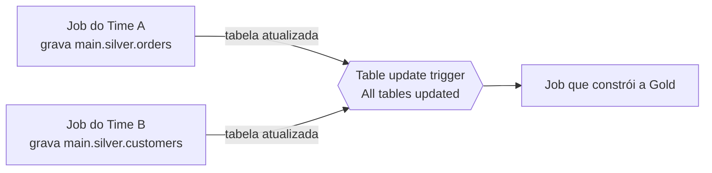

# Agendamento e Triggers

## Visão geral

Um Lakeflow Job inicia execuções a partir de um **trigger**. O exam guide cita três tipos: **scheduled** (por tempo), **file arrival** e **table update** (ambos por dados). Também espera que você escolha entre trigger por tempo e por dados com base na disponibilidade dos dados e nas dependências do pipeline. Execuções contínuas e manuais completam o quadro.

> [!abstract] Resumo
>
> - **Scheduled**: intervalo simples, ou cron Quartz avançado com fuso horário (mínimo de 10 segundos entre execuções)
> - **File arrival**: monitora uma external location ou volume do UC e inicia uma execução quando chegam arquivos novos
> - **Table update**: inicia uma execução quando tabelas UC monitoradas (ou views, MVs e streaming tables) mudam, esperando *qualquer uma* ou *todas*
> - **Continuous**: inicia uma nova execução sempre que a anterior termina. Não pode ser combinado com outros triggers

> [!tip] O que a prova cobra
>
> - Habilidade do exam guide: implementar agendas de jobs entendendo os tipos de trigger (scheduled, file arrival e table update)
> - Habilidade do exam guide: escolher entre triggers por tempo e por dados com base na disponibilidade dos dados e dependências do pipeline
> - Ler cron Quartz (`segundo minuto hora dia-do-mês mês dia-da-semana`) e usar `?` corretamente

---

## Tipos de trigger em resumo

| Trigger | Inicia uma execução quando… | Tipo | Escolha quando |
| :--- | :--- | :--- | :--- |
| **Scheduled** | Uma agenda por tempo dispara (intervalo simples ou cron Quartz + fuso) | Por tempo | Os dados chegam em horário conhecido, ou os consumidores precisam do resultado em horário fixo (ex.: relatório às 6h) |
| **File arrival** | Chegam arquivos novos em uma **external location ou volume do UC** monitorado | Por dados | Arquivos chegam em horários imprevisíveis e devem ser processados logo depois, sem compute ocioso |
| **Table update** | Tabelas UC monitoradas (incluindo views, MVs, streaming tables, tabelas OpenSharing, system tables) são atualizadas | Por dados | O job depende de tabelas upstream produzidas por *outros* jobs ou equipes |
| **Continuous** | A execução anterior termina ou falha, então sempre há uma execução ativa | Sempre ligado | Workloads de streaming que precisam rodar sem parar. Não combina com outros triggers |
| **Nenhum (manual)** | **Run now**, a API ou um orquestrador externo | Manual | Execuções ad hoc e orquestradas externamente |
| Model update *(Beta)* | Uma versão ou alias de modelo no UC muda | Por dados | Promoção de ML (fora desta prova) |

Fonte: [Automate jobs with schedules and triggers](https://docs.databricks.com/aws/en/jobs/triggers).

- Por padrão só **uma execução** de um job pode estar ativa por vez. Execuções que excedem a concorrência máxima são puladas (skipped)
- Pausar um trigger impede novas execuções, mas as ativas continuam. Cada trigger pode ser pausado de forma independente
- **Múltiplos triggers** por job (até cinco) estão em **Beta**

## Triggers agendados (por tempo)

Uma agenda pode ser **simples** (a cada N unidades; o agendador escolhe o primeiro horário) ou **avançada** (período, horário inicial e fuso, opcionalmente em sintaxe cron). "A Databricks impõe um intervalo mínimo de 10 segundos entre execuções subsequentes" ([Run jobs on a schedule](https://docs.databricks.com/aws/en/jobs/scheduled)).

### Sintaxe do cron Quartz

Agendas avançadas usam cron **Quartz**: 6 ou 7 campos, com **segundos primeiro** e ano opcional:

```text
┌ segundos (0-59)
│ ┌ minutos (0-59)
│ │ ┌ horas (0-23)
│ │ │ ┌ dia do mês (1-31)
│ │ │ │ ┌ mês (1-12 ou JAN-DEC)
│ │ │ │ │ ┌ dia da semana (1-7 ou SUN-SAT; 1 = domingo)
│ │ │ │ │ │ ┌ ano (opcional)
0 0 2 * * ?
```

- `?` significa "sem valor específico". Quando você restringe o dia da semana, coloque `?` no dia do mês, e vice-versa
- Cron Unix tem 5 campos e não tem segundos — não cole cron Unix numa agenda Quartz

| Agenda | Expressão Quartz |
| :--- | :--- |
| Todo dia às 02:00 | `0 0 2 * * ?` |
| Todo dia ao meio-dia | `0 0 12 * * ?` |
| A cada hora cheia | `0 0 * * * ?` |
| A cada 15 minutos | `0 0/15 * * * ?` |
| Dias úteis às 09:00 | `0 0 9 ? * MON-FRI` |
| Dias úteis às 10:15 | `0 15 10 ? * MON-FRI` |
| Primeiro dia de cada mês à meia-noite | `0 0 0 1 * ?` |
| Segundas à meia-noite | `0 0 0 ? * MON` |
| De hora em hora, das 9h às 17h, seg–sex | `0 0 9-17 ? * MON-FRI` |

```json
{
  "schedule": {
    "quartz_cron_expression": "0 0 2 * * ?",
    "timezone_id": "America/Sao_Paulo",
    "pause_status": "UNPAUSED"
  }
}
```

### Fusos horários comuns

| Fuso | Identificador |
|----------|-----------|
| UTC | `UTC` |
| Brasília | `America/Sao_Paulo` |
| EUA Leste | `America/New_York` |
| EUA Pacífico | `America/Los_Angeles` |
| Reino Unido | `Europe/London` |
| Europa Central | `Europe/Berlin` |
| Tóquio | `Asia/Tokyo` |

### Horário de verão

- Com um fuso que tem horário de verão, "um job horário é pulado ou pode parecer atrasado em uma ou duas horas" na mudança
- Use **UTC** quando as execuções precisam acontecer em intervalos absolutos
- Documente o fuso pretendido na descrição do job

## Políticas de agendamento

### Max concurrent runs

Impede que várias instâncias do mesmo job rodem ao mesmo tempo:

```json
{
  "name": "daily_load",
  "max_concurrent_runs": 1,
  "schedule": {"quartz_cron_expression": "0 0 * * * ?"}
}
```

Se um job demora mais que o intervalo da agenda com `max_concurrent_runs: 1`:

- As novas execuções agendadas são **puladas** (Skipped)
- Não se forma fila
- Evita falhas em cascata e processamento duplicado

### Comportamento de timeout

Quando o `timeout_seconds` de uma task é excedido:

1. A task é encerrada (status **Timed out**)
2. Alertas de falha são enviados
3. A lógica de retry é acionada (se configurada)
4. A execução do job fica como falha

## File arrival triggers (por dados)

Um file arrival trigger monitora a raiz ou um subcaminho de uma **external location ou volume do Unity Catalog**, recursivamente, e faz o "melhor esforço para verificar novos arquivos a cada minuto" ([Trigger jobs when new files arrive](https://docs.databricks.com/aws/en/jobs/file-arrival-triggers)).

| Configuração | Efeito |
| :--- | :--- |
| **Minimum time between triggers in seconds** | Cooldown: no máximo uma execução por intervalo (ex.: `900` = uma a cada 15 min) |
| **Wait after last change in seconds** | Debounce: cada arquivo novo reinicia o timer, e a execução começa quando as chegadas param (ex.: `60` para lotes) |

- Só arquivos **novos** disparam execuções. Sobrescrever um arquivo com o mesmo nome não dispara
- Sem file events, um workspace suporta no máximo 50 desses triggers, e o local pode ter até 10.000 arquivos. **Habilite file events** na external location para remover o limite de arquivos
- Permissões: `READ` no local de armazenamento e **CAN MANAGE** no job
- Dentro do job disparado, use **Auto Loader** (com checkpoint fora do caminho monitorado) para processar exatamente os arquivos novos. `{{job.trigger.file_arrival.location}}` passa o local para a task

## Table update triggers (por dados)

Um table update trigger roda o job quando tabelas monitoradas mudam (updates, merges, deletes), sem um cluster rodando continuamente ([Trigger jobs when source tables are updated](https://docs.databricks.com/aws/en/jobs/trigger-table-update)).

| Configuração | Efeito |
| :--- | :--- |
| **Trigger when** | **Any table is updated** ou **All tables are updated** (quando você monitora várias) |
| **Minimum time between triggers in seconds** | Espera após uma execução terminar antes de disparar de novo |
| **Wait after last change in seconds** | Espera após um update antes de disparar; novos updates reiniciam o timer |

- Fontes suportadas: tabelas Delta e Iceberg gerenciadas pelo UC, tabelas Delta externas, materialized views, streaming tables, views e metric views do UC (quando suas dependências são suportadas), objetos OpenSharing e system tables
- Até **10 tabelas** por trigger
- O principal **Run as** do job precisa de `SELECT` em cada tabela, mais `USE CATALOG` e `USE SCHEMA`. Sem isso, o trigger não consegue avaliar e o job nunca roda



## Escolhendo: por tempo vs por dados

| Pergunta | Aponta para |
| :--- | :--- |
| Os dados chegam em horário imprevisível e devem ser processados logo depois? | **File arrival** |
| O job depende de tabelas mantidas por outros jobs ou equipes, sem agenda compartilhada? | **Table update** (*All tables* quando precisa de todas as entradas atualizadas) |
| O prazo é fixo (relatório até 06:00), ou a fonte entrega em horário fixo? | **Scheduled** |
| Nenhum compute deve rodar, nem execuções vazias, em longos períodos ociosos? | Por dados (file arrival ou table update) |
| O workload nunca pode parar? | **Continuous** |
| As dependências são *dentro* de um pipeline? | Nenhum: use dependências de task em **um** DAG |

Um job agendado que verifica a cada 5 minutos "por via das dúvidas" inicia execuções que não encontram dados. Um trigger por dados só roda quando há algo a fazer.

## Padrões de agendamento

- **Diário em horário fixo**: `0 0 6 * * ?` com `timezone_id` definido
- **Várias vezes ao dia**: `0 0 * * * ?` (de hora em hora)
- **Horário comercial**: `0 0 9-17 ? * MON-FRI`
- **Escalonar jobs independentes** para distribuir carga: região A `0 0 * * * ?`, região B `0 10 * * * ?`, região C `0 20 * * * ?`
- **Ambientes diferentes**: agendas separadas para prod e teste evitam interferência

> [!note] Atenção
> Escalonar horários **não** é a forma certa de garantir a ordem entre tarefas dependentes. Se B depende de A, coloque as duas como tasks no **mesmo job** com `depends_on`, ou use um table update trigger.

## Pausar e retomar

- **Pela UI**: em **Jobs & Pipelines**, abra o job e clique em **Pause** — nenhuma nova execução é agendada
- **Pela API**: não há endpoint de pause separado. Defina o `pause_status` do trigger nas configurações do job (`jobs/update`, ou `pause_status` no YAML do bundle):

```bash
curl -X POST https://<workspace-host>/api/2.1/jobs/update \
  -H "Authorization: Bearer <token>" \
  -d '{"job_id": 123, "new_settings": {"schedule": {"quartz_cron_expression": "0 0 2 * * ?", "timezone_id": "UTC", "pause_status": "PAUSED"}}}'
```

Use `"pause_status": "UNPAUSED"` para retomar. Pausar impede novas execuções; as ativas continuam.

## Execução manual

```bash
# Rodar o job agora (ignora a agenda)
curl -X POST https://<workspace-host>/api/2.1/jobs/run-now \
  -H "Authorization: Bearer <TOKEN>" \
  -d '{"job_id": 123}'

# Com parâmetros customizados
curl -X POST https://<workspace-host>/api/2.1/jobs/run-now \
  -H "Authorization: Bearer <TOKEN>" \
  -d '{"job_id": 123, "job_parameters": {"date": "2025-01-20", "environment": "staging"}}'
```

## Casos de uso

- **Batch agendado por tempo**: rodar ETL noturno às 2h via cron para processar os dados do dia anterior antes que os usuários cheguem, com fuso definido para equipes globais.
- **Ingestão orientada a eventos via file arrival**: disparar um job automaticamente quando arquivos novos chegam ao cloud storage (S3/ADLS), eliminando atraso de polling e processando os dados assim que ficam disponíveis.

## Problemas e erros comuns

### Execuções vazias por agenda de polling

**Cenário:** um job agendado a cada 5 minutos para "verificar arquivos do fornecedor" inicia centenas de execuções por dia, e a maioria não encontra nada.
**Correção:** substitua a agenda por um **file arrival** trigger na external location ou volume do fornecedor, e use Auto Loader dentro do job.

### Cron roda no horário errado por causa do fuso

**Cenário:** um job agendado para 2h no horário local roda na hora errada porque o fuso não foi definido explicitamente, caindo em UTC.
**Correção:** sempre defina `timezone_id` na agenda (ex.: `"timezone_id": "America/Sao_Paulo"`). Documente o fuso na descrição do job.

### Execuções sobrepostas por file arrival

**Cenário:** um file arrival trigger dispara várias vezes seguidas (um lote de arquivos chegando ao mesmo tempo), causando execuções duplicadas ou concorrentes que corrompem tabelas downstream.
**Correção:** configure **Wait after last change** para que uma rajada de arquivos gere uma única execução, e **Minimum time between triggers** para limitar a frequência. Mantenha `max_concurrent_runs = 1`; o Auto Loader pega na próxima execução os arquivos que chegarem depois.

## Dicas para a prova

- O exam guide cita três triggers: **scheduled**, **file arrival** e **table update**. Saiba qual é por tempo e quais são por dados
- "Arquivos chegam em intervalos imprevisíveis, processar logo após chegar, sem compute ocioso, sem execuções vazias" → **file arrival**
- "Rodar quando tabelas upstream de outra equipe mudarem" → **table update** (escolha *All tables* se toda entrada precisa estar atualizada)
- Cron Quartz tem **segundos primeiro**. `?` vai no dia do mês ou no dia da semana. Dias úteis às 9h = `0 0 9 ? * MON-FRI`
- Triggers contínuos não combinam com outros triggers. Agendas têm intervalo mínimo de 10 segundos

## Pontos-chave

- **Scheduled** = por tempo (simples ou cron Quartz com fuso)
- **File arrival** = arquivos novos em uma external location ou volume do UC. Debounce com *wait after last change*
- **Table update** = mudanças em até 10 tabelas UC monitoradas, disparando em *qualquer* ou *todas*
- **Continuous** = sempre ligado. **Manual** = Run now ou API
- Escolha triggers por dados quando é a disponibilidade dos dados, não o relógio, que decide quando o trabalho deve rodar

## Tópicos relacionados

- [Lakeflow Jobs e Tasks](./01-lakeflow-jobs-and-tasks.md)
- [Monitoramento de Jobs](../06-troubleshooting-monitoring-and-optimization/01-job-monitoring.md)

## Documentação oficial

- [Automate jobs with schedules and triggers](https://docs.databricks.com/aws/en/jobs/triggers)
- [Run jobs on a schedule](https://docs.databricks.com/aws/en/jobs/scheduled)
- [Trigger jobs when new files arrive](https://docs.databricks.com/aws/en/jobs/file-arrival-triggers)
- [Trigger jobs when source tables are updated](https://docs.databricks.com/aws/en/jobs/trigger-table-update)

---

**[← Anterior: Lakeflow Jobs e Tasks](./01-lakeflow-jobs-and-tasks.md) | [↑ Voltar para Working with Lakeflow Jobs](./README.md) | [Próximo: Control Flow →](./03-control-flow.md)**
