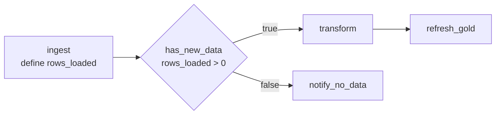

# Control Flow em Lakeflow Jobs

## Visão geral

Um DAG de tasks resolve "rode B depois de A". Pipelines de produção também precisam de **control flow**: tentar de novo uma task instável, ramificar conforme uma condição, iterar sobre uma lista de entradas e rodar uma limpeza independentemente do que aconteceu antes. O Lakeflow Jobs oferece isso com **retries e timeouts**, a task **If/else condition**, a task **For each**, condições de dependência **Run if** e **task values** para passar dados entre tasks.

> [!abstract] Resumo
>
> - **Retries**: política de retry por task, com intervalo entre tentativas. Quando ambos estão definidos, o **timeout vale para cada tentativa**
> - **If/else condition**: uma expressão booleana sobre dois operandos (job parameters, task values, literais). Tasks downstream dependem do resultado `(true)` ou `(false)`
> - **For each**: roda **uma task aninhada** para cada elemento de um array de entrada, com **concorrência** configurável (padrão 1)
> - **Run if**: *All succeeded* (padrão), *At least one succeeded*, *None failed*, *All done*, *At least one failed*, *All failed*

> [!tip] O que a prova cobra
>
> - Habilidade do exam guide: implementar control flow (retries e tasks condicionais como ramificação e loop) usando Lakeflow Jobs
> - Qual status resulta de cada condição Run if (**Upstream failed** vs **Excluded**)
> - Comparação de string vs numérica nos operadores do If/else
> - Passar valores entre tasks com `dbutils.jobs.taskValues` e `{{tasks.<task>.values.<chave>}}`

---

## Retries e timeouts

| Configuração | Comportamento |
| :--- | :--- |
| **Retries** | Adicione uma política de retry por task. A maioria das configurações não faz retry por padrão. O **retry interval** é em milissegundos, medido do início da execução que falhou até a nova tentativa |
| **Timeout** | Se uma task roda mais que o timeout, o status vira **Timed Out**. Com retries configurados, "o timeout vale para cada tentativa" |
| **Metric thresholds → Run duration → Warning** | Tempo esperado de conclusão. Excedê-lo gera evento e notificação, mas não para a execução |
| Jobs serverless / contínuos | Jobs serverless otimizam retries automaticamente. Jobs contínuos usam backoff exponencial |

Fonte: [Configure and edit tasks](https://docs.databricks.com/aws/en/jobs/configure-task).

```yaml
tasks:
  - task_key: call_vendor_api
    notebook_task:
      notebook_path: ../notebooks/call_vendor_api
    max_retries: 3
    min_retry_interval_millis: 60000      # espera 1 minuto entre tentativas
    retry_on_timeout: false
    timeout_seconds: 1800                 # cada tentativa pode rodar 30 minutos
```

> [!warning] Erro comum
> Uma task falha como **Timed Out** aos 45 minutos, mas precisa de ~60 minutos para o volume de dados de hoje. Aumente o **timeout** da task para acima de 60 minutos, com folga. Retries, max concurrent runs e auto termination do cluster não ajudam.

## Task If/else condition

A task If/else adiciona ramificação: "um operador booleano e um par de operandos" ([Add branching logic with If/else](https://docs.databricks.com/aws/en/jobs/if-else)).

| Operadores | Comparação |
| :--- | :--- |
| `==`, `!=` | Comparação de **string**, então `12.0 == 12` é **falso** |
| `>`, `>=`, `<`, `<=` | Comparação **numérica**, então `12.0 >= 12` é **verdadeiro** |

- Operandos: literais, `{{job.parameters.<nome>}}`, parâmetros de task e `{{tasks.<task>.values.<chave>}}`. Task values usados como operandos devem ser numéricos, string ou booleanos — booleanos viram `"true"` / `"false"`
- Tasks downstream escolhem o ramo no **Depends on**: `<task> (true)` (padrão) ou `<task> (false)`
- A task If/else falha se a task upstream que fornece o valor da condição estiver desabilitada



```python
# No notebook de ingestão: publica um task value
rows = new_df.count()
dbutils.jobs.taskValues.set(key="rows_loaded", value=rows)
```

```yaml
  - task_key: has_new_data
    depends_on: [{task_key: ingest}]
    condition_task:
      op: GREATER_THAN
      left: "{{tasks.ingest.values.rows_loaded}}"
      right: "0"
  - task_key: transform
    depends_on: [{task_key: has_new_data, outcome: "true"}]
    notebook_task: {notebook_path: ../notebooks/transform}
```

## Task For each (loop)

A task For each "roda uma task aninhada em loop, passando um conjunto diferente de parâmetros para cada iteração" ([Use a For each task](https://docs.databricks.com/aws/en/jobs/for-each)).

| Aspecto | Detalhe |
| :--- | :--- |
| **Entradas** | Um array JSON digitado (limite de 5.000 caracteres), um job parameter `{{job.parameters.<nome>}}` ou um task value `{{tasks.<task>.values.<chave>}}` |
| **Task aninhada** | Exatamente uma task de qualquer tipo padrão, **exceto outro For each** |
| **Concorrência** | Quantas iterações rodam em paralelo. **Padrão 1** |
| **Valor da iteração** | `{{input}}`, ou `{{input.<chave>}}` ao iterar sobre objetos |
| **Downstream** | Tasks dependem da task For each, não da aninhada. Task values por iteração voltam como lista ordenada (Beta) |

```yaml
  - task_key: load_each_table
    for_each_task:
      inputs: '[{"table": "orders"}, {"table": "customers"}, {"table": "products"}]'
      concurrency: 3
      task:
        task_key: load_one_table
        notebook_task:
          notebook_path: ../notebooks/load_table
          base_parameters:
            table_name: "{{input.table}}"
```

## Dependências Run if

A condição **Run if** de cada task decide se ela roda, com base nas tasks upstream ([Configure task dependencies](https://docs.databricks.com/aws/en/jobs/conditional-tasks)).

| Run if | Roda quando | Caso contrário, fica |
| :--- | :--- | :--- |
| **All succeeded** *(padrão)* | Todas as dependências rodaram e tiveram sucesso | `Upstream failed` |
| **At least one succeeded** | Uma ou mais dependências tiveram sucesso | `Upstream failed` |
| **None failed** | Nenhuma dependência falhou e pelo menos uma rodou | `Upstream failed` |
| **All done** | Todas as dependências terminaram, **qualquer que seja o resultado** | (sempre roda) |
| **At least one failed** | Uma ou mais dependências falharam | `Excluded` |
| **All failed** | Todas as dependências falharam | `Excluded` |

- Upstream `Excluded` conta como sucesso na avaliação das condições. `Upstream failed` e `Upstream canceled` contam como falha
- Se **todas** as dependências de uma task forem excluídas, ela também é excluída. A exclusão se propaga pela cadeia
- Use **All done** para tasks de limpeza (apagar tabelas temporárias, liberar locks) e **At least one failed** para tratamento customizado de falhas

## Passando valores entre tasks

```python
# Task upstream (notebook Python)
dbutils.jobs.taskValues.set(key="max_order_date", value="2026-10-25")

# Task downstream (notebook Python)
max_date = dbutils.jobs.taskValues.get(taskKey="ingest", key="max_order_date", debugValue="2026-01-01")
```

- Os valores precisam ser serializáveis em JSON, até 48 KiB, e as chaves precisam ser strings
- A forma recomendada de consumir um valor é por referência em parâmetros ou condições: `{{tasks.ingest.values.max_order_date}}`
- `debugValue` é usado quando o notebook roda interativamente fora de um job. A Databricks não recomenda definir `default`

Fonte: [Use task values to pass information between tasks](https://docs.databricks.com/aws/en/jobs/task-values).

## Task Run Job (orquestração modular)

Uma task **Run Job** dispara outro Lakeflow Job como etapa. Times usam isso para reaproveitar um job de ingestão compartilhado em várias orquestrações downstream, em vez de copiar suas tasks.

## Casos de uso

- **Pular trabalho quando não há nada novo**: If/else sobre o task value `rows_loaded` pula as tasks Silver e Gold em dias vazios
- **Carregar 40 tabelas com uma definição**: For each sobre uma lista de nomes de tabelas, com concorrência 5
- **Fonte REST instável**: três retries com um minuto de intervalo só na task de extração
- **Sempre limpar**: uma task final com Run if **All done** apaga tabelas de staging mesmo após falhas
- **Caminho de falha customizado**: uma task com Run if **At least one failed** abre um ticket de incidente

## Problemas e erros comuns

### Task values lidos na task errada

**Cenário:** `dbutils.jobs.taskValues.get(taskKey="ingest", ...)` falha em uma task que não depende de `ingest`.
**Correção:** task values são lidos de tasks upstream. Adicione `ingest` ao **Depends on** da task que lê.

### If/else compara números como strings

**Cenário:** a condição `{{tasks.count.values.n}} == 10` é falsa quando `n` é `10.0`.
**Correção:** `==` e `!=` comparam strings. Use um operador numérico como `>=`, ou publique o valor em formato consistente.

### Task de limpeza nunca roda após uma falha

**Cenário:** uma task de limpeza depende da transformação com o Run if padrão, e é pulada sempre que a transformação falha.
**Correção:** o padrão é **All succeeded**. Defina o Run if da limpeza como **All done**.

### For each roda uma iteração por vez

**Cenário:** um For each sobre 30 tabelas leva horas.
**Correção:** a concorrência padrão é 1. Aumente dentro da capacidade do compute.

## Dicas para a prova

- **Ramificação** = task If/else condition. **Loop** = task For each. **Retries** = política de retry da task
- O timeout vale **por tentativa** quando há retries
- Run if **All done** = roda de qualquer jeito (limpeza). O padrão **All succeeded** marca a task como `Upstream failed` quando uma dependência falha
- `==` / `!=` comparam strings. `>`, `<` e afins comparam números
- Um For each tem **uma** task aninhada, que não pode ser outro For each. Concorrência padrão 1

## Pontos-chave

- Retries e timeouts tratam falhas transitórias e tasks descontroladas
- If/else direciona o DAG com base em parâmetros ou task values
- For each repete uma task aninhada sobre um array de entrada, opcionalmente em paralelo
- Condições Run if permitem rodar tasks no sucesso, na falha ou na conclusão das dependências
- Task values são a forma nativa de passar resultados pequenos entre tasks

## Tópicos relacionados

- [Lakeflow Jobs e Tasks](./01-lakeflow-jobs-and-tasks.md)
- [Agendamento e Triggers](./02-scheduling-triggers.md)
- [Monitoramento de Jobs (status e histórico)](../06-troubleshooting-monitoring-and-optimization/01-job-monitoring.md)

## Documentação oficial

- [Configure task dependencies](https://docs.databricks.com/aws/en/jobs/conditional-tasks)
- [Add branching logic with the If/else task](https://docs.databricks.com/aws/en/jobs/if-else)
- [Use a For each task to run another task in a loop](https://docs.databricks.com/aws/en/jobs/for-each)
- [Use task values to pass information between tasks](https://docs.databricks.com/aws/en/jobs/task-values)
- [Configure and edit tasks in Lakeflow Jobs](https://docs.databricks.com/aws/en/jobs/configure-task)

---

**[← Anterior: Agendamento e Triggers](./02-scheduling-triggers.md) | [↑ Voltar para Working with Lakeflow Jobs](./README.md)**
