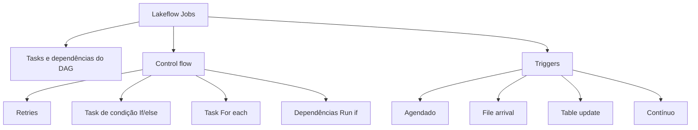

# Working with Lakeflow Jobs (16 % da prova)

O Domínio 4 cobre orquestração com **Lakeflow Jobs**. Você configura tipos comuns de task (notebook, SQL query, dashboard, pipeline) e liga suas dependências em um DAG. Adiciona control flow: retries, ramificação If/else e loop For each. E escolhe um trigger: agendado (por tempo), ou file arrival e table update (por dados).

> [!note] Terminologia
> "Workflows" e "Databricks Jobs" são nomes legados. O exam guide usa **Lakeflow Jobs** do início ao fim, assim como a documentação atual. Monitoramento de jobs e histórico de execuções foram para o [Domínio 6](../06-troubleshooting-monitoring-and-optimization/README.md) no blueprint de agosto de 2026.

## Visão geral dos tópicos

## Conteúdo da seção

| Arquivo | Tópico | Prioridade |
| :--- | :--- | :--- |
| [01-lakeflow-jobs-and-tasks.md](./01-lakeflow-jobs-and-tasks.md) | Jobs vs tasks, tipos de task, parâmetros, dynamic value references, DAGs multi-task, opções de compute | Alta |
| [02-scheduling-triggers.md](./02-scheduling-triggers.md) | Agendado (cron Quartz), file arrival, table update, contínuo; por tempo vs por dados | Alta |
| [03-control-flow.md](./03-control-flow.md) | Retries, timeouts, If/else, For each, dependências Run if, task values | Alta |

## Cobertura das habilidades oficiais (agosto de 2026)

| Habilidade do exam guide (parafraseada) | Onde é coberta |
| :--- | :--- |
| Control flow: retries, tasks condicionais (ramificação) e de loop | [03](./03-control-flow.md) |
| Tasks comuns (notebook, SQL query, dashboard, pipeline) e dependências do DAG | [01](./01-lakeflow-jobs-and-tasks.md) |
| Agendas e tipos de trigger (scheduled, file arrival, table update) | [02](./02-scheduling-triggers.md) |
| Escolher trigger por tempo vs por dados | [02](./02-scheduling-triggers.md) |

## Conceitos-chave

- **Job vs task**: um job é a unidade de orquestração com um trigger. Tasks são os nós do DAG, e tasks sem dependência entre si rodam em paralelo
- **Run if**: o padrão é *All succeeded*. *All done* roda tasks de limpeza independentemente do resultado
- **If/else**: `==` / `!=` comparam como strings; `>`, `>=`, `<`, `<=` comparam como números
- **For each**: roda uma task aninhada por elemento da entrada. A concorrência padrão é 1
- **Triggers**: agendado (por tempo) vs file arrival / table update (por dados). Contínuo mantém uma execução sempre ativa

## Próximos passos

Continue para [05 — Implementing CI/CD](../05-implementing-cicd/README.md) para versionar e promover seus jobs com Git folders e Declarative Automation Bundles.

---

**[← Anterior: Data Transformation and Modeling](../03-data-transformation-and-modeling/README.md) | [↑ Voltar à Certificação](../README.md) | [Próximo: Implementing CI/CD →](../05-implementing-cicd/README.md)**
