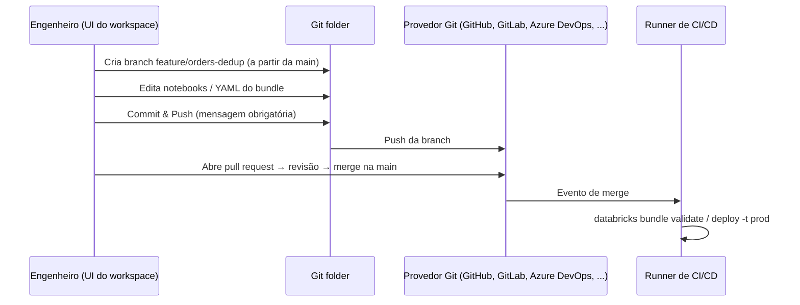

# Git Folders

## Visão geral

**Databricks Git folders** (antigo Databricks Repos) são "um cliente Git visual e uma API que integram repositórios Git ao seu workspace" ([Databricks Git folders](https://docs.databricks.com/aws/en/repos/)). O exam guide espera que você gerencie todo o ciclo de desenvolvimento pela UI do workspace: clonar, criar e trocar branches, commit e push, pull, e passar para um **pull request** de revisão antes que o CI/CD implante o código.

> [!abstract] Resumo
>
> - Crie um Git folder clonando um repositório remoto. Você precisa de credenciais Git configuradas e `CAN MANAGE` na pasta pai
> - O **diálogo Git** faz criar branch, trocar branch, **Commit & Push** (uma única ação, com mensagem obrigatória), pull, merge, rebase, resolução de conflitos e reset
> - **Pull requests** são criados na interface do **provedor Git**. Os Git folders cuidam de branches e pushes; o provedor cuida da revisão e do merge na branch padrão
> - Automatize Git folders com **service principals**, a Repos API ou Terraform. Faça deploy com **Declarative Automation Bundles**

> [!tip] O que a prova cobra
>
> - Habilidade do exam guide: gerenciar o fluxo de código na UI do workspace: criar e trocar branches em Git folders (antigo Repos), commit e push, e criar pull requests usando a integração Git da Databricks
> - Quais operações acontecem na Databricks e quais no provedor Git
> - O que trocar de branch faz com mudanças não commitadas e com os ativos do workspace
> - Por que **Pull** é a forma de sincronizar mudanças dos colegas, e o que o **Reset** destrói

---

## O ciclo de desenvolvimento



## Operações Git no workspace

Todas as operações abaixo são feitas pelo **diálogo Git** de um Git folder ([Create and manage Git folders](https://docs.databricks.com/aws/en/repos/git-operations-with-repos)).

| Operação | Como | O que saber |
| :--- | :--- | :--- |
| **Clonar / criar** | Workspace → Create → Git folder → URL do repositório | Precisa de credenciais Git e `CAN MANAGE` na pasta pai. O `git clone` no web terminal também funciona |
| **Criar branch** | Diálogo Git → **Create Branch** → nome + branch base | Crie a partir da branch padrão para trabalho de feature |
| **Trocar branch** | Dropdown de branch no diálogo Git | Mudanças não commitadas podem ser levadas junto. Trocar "pode apagar ativos do workspace quando a nova branch não os contém", e voltar recria esses ativos com **novos IDs e URLs** |
| **Commit & Push** | Selecione as mudanças, escreva uma mensagem de commit **obrigatória**, clique em **Commit & Push** | Faz commit e push em **uma ação**. Sem permissão na branch padrão, faça push de uma nova branch |
| **Pull** | **Pull** no diálogo Git | Atualiza notebooks e arquivos para a versão remota e **limpa o estado do notebook**. Conflitos precisam ser resolvidos |
| **Merge** | Menu (kebab) → **Merge** | Recomendado em vez de rebase para iniciantes em Git. Um merge limpo é enviado ao remoto |
| **Rebase** | Menu (kebab) → **Rebase** | Termina com commit e **force push**, reescrevendo o histórico para os colaboradores |
| **Resolver conflitos** | Edite o arquivo, ou **Keep all current** / **Take all incoming**, depois **Mark As Resolved** → **Continue Merge/Rebase** | Ou aborte |
| **Reset** | UI de Git folders | Equivale a `git reset --hard` + `git push --force`. "Você perde todas as mudanças, commitadas ou não, na versão local e remota da branch" |
| **Pull request** | No **provedor Git** | "Use a interface do seu provedor Git para criar um pull request e fazer merge na branch padrão" |

> [!note] Linguagem da prova vs documentação
> O exam guide fala em "criar pull requests usando a integração Git da Databricks". Na documentação atual, o diálogo Git leva você ao provedor Git, onde o pull request é aberto, revisado e mesclado. Espere respostas que combinam **Commit & Push na Databricks** com **revisão e merge do PR no provedor**.

## Estratégia de branches

```text
main (protegida, implantada em prod pelo CI)
├── feature/orders-dedup     ← trabalhe aqui no seu Git folder
├── feature/new-ingest
└── hotfix/null-amounts
```

- Um Git folder por engenheiro por repositório, cada um em sua branch de feature. Evite compartilhar um Git folder entre pessoas
- Proteja a `main` no provedor Git e exija revisão de PR
- Jobs de produção **não** devem rodar a partir do Git folder de alguém. O CI implanta um bundle da `main` no workspace de prod, rodando como service principal (veja [Declarative Automation Bundles](./02-declarative-automation-bundles.md))

## Git folders vs histórico de versões do notebook

| Necessidade | Histórico de revisões do notebook | Git folder |
| :--- | :--- | :--- |
| Desfazer uma edição recente em um notebook | Sim | Sim |
| Várias branches | Não | **Sim** |
| Code review via pull requests | Não | **Sim** (no provedor) |
| Versionar notebooks *e* arquivos, SQL, YAML juntos | Não | **Sim** |
| Alimentar deploys de CI/CD | Não | **Sim** |

## Automação e CI/CD

- **Service principals** podem ser donos e atualizar Git folders programaticamente
- **Terraform** pode provisionar Git folders como infraestrutura como código
- Para deploys, prefira **Declarative Automation Bundles** executados pelo CI a partir da branch mesclada, em vez de apontar jobs de produção para um Git folder

## Casos de uso

- **Desenvolvimento de feature**: um engenheiro cria `feature/orders-dedup`, itera no workspace, faz commit e push e abre um PR
- **Hotfix**: branch a partir da `main`, corrige, push e PR com prioridade. O CI reimplanta o bundle
- **Sincronizar o trabalho de um colega**: **Pull** traz as mudanças mescladas para o seu Git folder
- **Recuperar de um estado local ruim**: **Reset** descarta mudanças locais e remotas da branch (use com cuidado)

## Problemas e erros comuns

### Notebook perdeu o vínculo com o job após trocar de branch

**Cenário:** um notebook que não existe na nova branch some do workspace. Quando o engenheiro volta, um job que apontava para ele falha.
**Correção:** trocar de branch pode apagar e recriar ativos do workspace com novos IDs e URLs. Rode jobs de produção a partir de bundles implantados, não de um Git folder pessoal.

### Push rejeitado na branch padrão

**Cenário:** Commit & Push na `main` falha com erro de permissão.
**Correção:** crie uma branch, faça push dela e abra um pull request no provedor Git.

### Pull apaga as variáveis do notebook

**Cenário:** depois de um **Pull**, o estado do notebook (variáveis, DataFrames em cache) sumiu.
**Correção:** o Pull limpa o estado do notebook por design. Reexecute o notebook.

### Rebase quebra a branch de um colega

**Cenário:** depois de um rebase pela UI, um colaborador não consegue fazer push.
**Correção:** rebase reescreve o histórico e faz force push. Prefira **Merge** em branches compartilhadas.

## Dicas para a prova

> [!tip] Dicas para a prova
>
> - Git folders = o **nome atual** de Repos
> - **Commit & Push** é uma única ação, com mensagem de commit **obrigatória**
> - **Pull** sincroniza mudanças remotas no seu Git folder (fetch + merge)
> - Crie e troque branches na Databricks. Abra, revise e faça merge de **pull requests no provedor Git**
> - Git folders suportam várias branches. O histórico de versões do notebook não

## Pontos-chave

- Git folders trazem branches, commits, pushes, pulls, merges e resolução de conflitos para a UI do workspace
- Pull requests e políticas de branch protegida ficam no provedor Git
- Trocar de branch pode recriar ativos com novos IDs, e o Reset descarta trabalho local e remoto
- O CI/CD implanta a partir da branch mesclada com bundles, não a partir de Git folders pessoais

## Tópicos relacionados

- [Declarative Automation Bundles](./02-declarative-automation-bundles.md)
- [Databricks Workspace](../01-databricks-intelligence-platform/02-databricks-workspace.md)

## Documentação oficial

- [Databricks Git folders](https://docs.databricks.com/aws/en/repos/)
- [Create and manage Git folders (Git operations)](https://docs.databricks.com/aws/en/repos/git-operations-with-repos)

---

**[↑ Voltar para Implementing CI/CD](./README.md) | [Próximo: Declarative Automation Bundles →](./02-declarative-automation-bundles.md)**
