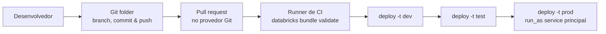

# Implementing CI/CD (10 % da prova)

O Domínio 5 cobre o caminho do código até a produção. Você gerencia branches, commits, pushes e pull requests em **Databricks Git folders (antigo Databricks Repos)**. Empacota jobs, pipelines e outros ativos do workspace como **Declarative Automation Bundles (antigo Databricks Asset Bundles)** e usa **variables** e **target overrides** do bundle para promover um único código entre dev, test e prod. Tudo isso é conduzido pela **Databricks CLI** em pipelines automatizados.

> [!note] Atualização da plataforma (out/2026)
> A renomeação "Databricks Asset Bundles agora é Declarative Automation Bundles" foi anunciada em 16/03/2026. O grupo de comandos da CLI continua `databricks bundle`, e o arquivo de configuração continua `databricks.yml`. Os enunciados podem abreviar o produto como **DABs**.

## Visão geral dos tópicos

## Conteúdo da seção

| Arquivo | Tópico | Prioridade |
| :--- | :--- | :--- |
| [01-git-folders.md](./01-git-folders.md) | Criar/clonar, branch, trocar, commit & push, pull, merge, conflitos, pull requests | Alta |
| [02-declarative-automation-bundles.md](./02-declarative-automation-bundles.md) | Anatomia do bundle, variables, target overrides, modos de deploy, CLI `databricks bundle` | Alta |

## Cobertura das habilidades oficiais (agosto de 2026)

| Habilidade do exam guide (parafraseada) | Onde é coberta |
| :--- | :--- |
| Fluxo de código na UI do workspace: branches em Git folders, commit & push, pull requests | [01](./01-git-folders.md) |
| Configuração por ambiente com variables e overrides do bundle entre targets dev/test/prod | [02](./02-declarative-automation-bundles.md) |
| Deploy de bundles para empacotar e promover Lakeflow Jobs, pipelines e outros ativos | [02](./02-declarative-automation-bundles.md) |
| Databricks CLI para validar, implantar e gerenciar bundles em CI/CD automatizado | [02](./02-declarative-automation-bundles.md) |

## Conceitos-chave

| Conceito | Por que importa |
| :--- | :--- |
| **Git folders** | Cliente Git visual no workspace (antigo Repos). Branch, commit & push, pull, merge e rebase pela UI |
| **Pull requests** | Criados na interface do seu provedor Git. O diálogo Git leva até o provedor |
| **`databricks.yml`** | Raiz do bundle: `bundle`, `include`, `variables`, `resources`, `targets` |
| **Variables** | `${var.nome}`. Os valores vêm de `--var`, `BUNDLE_VAR_<nome>`, `variable-overrides.json`, `variables` do target ou `default`, nessa ordem de precedência |
| **`mode: development` vs `mode: production`** | Dev adiciona prefixo aos nomes e pausa triggers. Prod valida branch Git, `run_as` e caminhos |
| **CLI** | `databricks bundle validate`, `deploy -t <target>`, `run`, `summary`, `destroy` |

## Próximos passos

Continue para [06 — Troubleshooting, Monitoring, and Optimization](../06-troubleshooting-monitoring-and-optimization/README.md).

---

**[← Anterior: Working with Lakeflow Jobs](../04-working-with-lakeflow-jobs/README.md) | [↑ Voltar à Certificação](../README.md) | [Próximo: Troubleshooting, Monitoring, and Optimization →](../06-troubleshooting-monitoring-and-optimization/README.md)**
