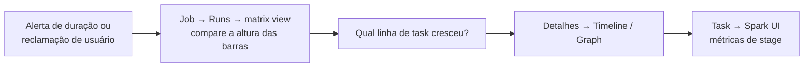

# Monitoramento de Jobs

## Visão geral

Monitorar Lakeflow Jobs é saber onde olhar: a lista **Jobs & Pipelines**, a aba **Runs** de um job (matrix view do histórico) e as visões **Graph / Timeline / List** de uma execução. Você também precisa ler corretamente os status de execução e de task, e ser alertado quando algo quebra.

> [!abstract] Resumo
>
> - A **matrix view** mostra o histórico de um job: uma barra por execução, altura = duração, cor = status. É assim que você encontra execuções mais lentas que a linha de base
> - Status de execução: Queued, Pending, Running, Skipped, Succeeded, **Succeeded with failures**, Failed, Timed Out, Canceling, Canceled. O resultado é decidido pelas **leaf tasks**
> - Estados de task incluem **Upstream failed** (uma dependência falhou) e **Excluded** (uma condição de ramo ou Run if não foi atendida)

> [!tip] O que a prova cobra
>
> - Habilidade do exam guide: identificar tendências de performance usando o histórico de execuções dos Lakeflow Jobs para comparar tempos atuais com a linha de base histórica
> - Habilidade do exam guide: usar a UI de Lakeflow Jobs para monitorar a saúde do pipeline: interpretar status, usar o grafo do DAG para encontrar bloqueios upstream e acompanhar tempos e taxas de falha
> - Corrigir uma task **Timed Out** aumentando o timeout, e alertar com notificações

---

## Onde olhar na UI de Jobs

| Visão | O que mostra | Use para |
| :--- | :--- | :--- |
| Lista **Jobs & Pipelines** | Todos os jobs e pipelines que você acessa, com criador, trigger e as **últimas cinco execuções** | Ver de relance quais jobs estão falhando |
| Aba **Runs** (do workspace) | Execuções de jobs e pipelines dos últimos 60 dias, gráfico *Finished runs count* (48 h) e *Top 5 error types* | Acompanhar taxas de falha e erros comuns |
| **Job → Runs → matrix view** | Uma coluna por execução, com uma linha **Run total duration** e uma linha por task. **Altura = duração**, cor = status | **Comparar durações atuais com a linha de base histórica** e ver qual task ficou mais lenta |
| **Detalhes da execução → Graph** | O DAG, com o status de cada task | Encontrar o **bloqueio upstream** que falhou ou foi pulado |
| **Detalhes da execução → Timeline** | Durações, dependências e sobreposição das tasks | Encontrar o caminho crítico da execução |
| **Detalhes da execução → List** | Lista de tasks pesquisável e ordenável | Filtrar por status ou duração |

Cores da matrix view: **verde** = sucesso, **vermelho** = sem sucesso, **rosa** = pulado, **amarelo** = aguardando retry, **cinza** = pendente, cancelado ou timed out. Um aviso aparece quando uma execução excede o tempo esperado (limite de **run duration warning**). Fonte: [Monitor Lakeflow Jobs](https://docs.databricks.com/aws/en/jobs/monitor).



O histórico de execuções é mantido por **60 dias**. Para tendências mais longas, consulte as tabelas de jobs em `system.lakeflow` (veja [Spark UI e System Tables](./02-spark-ui-and-system-tables.md)) ou junte com `system.billing.usage` para custo.

## Status de execução e de task

**Status de execução** (da documentação): `Queued`, `Pending`, `Running`, `Skipped`, `Succeeded`, `Succeeded with failures`, `Failed`, `Timed Out`, `Canceling`, `Canceled`.

| Status | Significado | Ação típica |
| :--- | :--- | :--- |
| **Queued** | Aguardando porque um limite de concorrência foi atingido e o enfileiramento está ligado | Verifique max concurrent runs |
| **Pending** | Preparando para rodar, ex.: enquanto o compute inicia | Verifique a inicialização do compute se demorar |
| **Skipped** | Não iniciou, ex.: porque max concurrent runs já tinha sido atingido | A execução anterior ainda está ativa. Ajuste agenda ou concorrência |
| **Succeeded with failures** | Algumas tasks falharam, mas **todas as leaf tasks** tiveram sucesso | Inspecione as tasks não-leaf que falharam |
| **Failed** | Uma leaf task falhou | Abra a saída e os logs da task que falhou |
| **Timed Out** | Uma task excedeu o **timeout** configurado | Aumente o timeout (cada retry tem o timeout inteiro) ou acelere a task |
| **Canceled** | Parado por usuário, API ou propagação de cancelamento | — |

**Estados de task** para reconhecer na visão Graph:

| Estado da task | Causa |
| :--- | :--- |
| **Upstream failed** | Uma dependência falhou e o Run if da task (padrão *All succeeded*) não foi atendido. O problema real está **upstream** |
| **Excluded** | Uma condição Run if como *At least one failed* não foi atendida, ou um ramo If/else não foi seguido |
| **Waiting for retry** | A task falhou e um retry está agendado |
| **Disabled** | A task foi desabilitada na definição do job e pulada |

O resultado geral de uma execução depende das **leaf tasks** (tasks sem dependentes downstream).

### Encontrando o bloqueio upstream

1. Abra a execução que falhou → visão **Graph**
2. Tasks marcadas **Upstream failed** não são a causa. Siga as arestas para cima até a primeira task **Failed** ou **Timed Out**
3. Abra a saída e os logs dessa task e, se precisar, sua **Spark UI**
4. Corrija e use **Repair run** para reexecutar só a task que falhou e suas dependentes

## Logs e debugging

- **Pela UI**: Jobs & Pipelines → job → execução → task → saída da task e logs (driver logs)
- **Driver logs**: inicialização, parâmetros e a maioria das exceções Python/SQL — o primeiro lugar a olhar
- **Logs dos workers/executores**: específicos das tasks Spark; úteis para OOM em executores
- `print()` e o módulo `logging` do Python aparecem na saída da task

```python
import logging
logger = logging.getLogger(__name__)
logger.info("Processamento iniciado")
logger.warning("Encontradas linhas duplicadas")
logger.error("Falha ao conectar no banco")
```

```sql
-- Consultas mais lentas do último dia (SQL warehouses)
SELECT statement_id, statement_text, total_duration_ms, produced_rows
FROM system.query.history
WHERE start_time > current_timestamp() - INTERVAL 1 DAY
ORDER BY total_duration_ms DESC
LIMIT 10;
```

### Validação no próprio notebook

```python
rows_in = spark.table("main.bronze.orders").count()
rows_out = spark.table("main.silver.orders").count()

if rows_out == 0:
    raise ValueError("Tabela de saída vazia!")       # falha a task → aciona alertas
if rows_out > rows_in * 2:
    raise ValueError("Contagem de saída suspeitamente alta!")
```

## Alertas e notificações

```json
{
  "email_notifications": {
    "on_start": [],
    "on_success": ["user@company.com"],
    "on_failure": ["user@company.com", "ops@company.com"],
    "on_duration_warning_threshold_exceeded": ["ops@company.com"]
  },
  "webhook_notifications": {
    "on_failure": [{"id": "slack-notification-destination-id"}]
  },
  "health": {
    "rules": [{"metric": "RUN_DURATION_SECONDS", "op": "GREATER_THAN", "value": 3600}]
  }
}
```

- Notificações podem ir para email ou para **notification destinations** (Slack, Microsoft Teams, PagerDuty, webhooks) configurados pelo admin
- Eventos: início, sucesso, falha, duração acima do limite e backlog de streaming
- Você pode notificar **por task** ou **por job**, e silenciar notificações de execuções puladas/canceladas ou de retries intermediários

## Métricas de performance

Durante a execução, acompanhe:

- **CPU/memória do driver e dos workers** (aba Metrics do compute)
- **Shuffle read/write**: custo de movimentação de dados
- **GC time**: pausas de garbage collection
- **Duração por task** na matrix view

Para tendências de longo prazo, as system tables `system.lakeflow.jobs`, `system.lakeflow.job_run_timeline` e `system.lakeflow.job_task_run_timeline` guardam o histórico além dos 60 dias da UI.

## Troubleshooting de problemas comuns

| Problema | Causas | Soluções |
| :--- | :--- | :--- |
| **Timeout** (`Timed Out`) | Consulta longa, compute pequeno, código ineficiente, volume de dados cresceu | Aumente `timeout_seconds`; otimize a consulta (filtros cedo, Liquid Clustering); aumente o compute |
| **Out of memory** | DataFrame grande no driver (`collect`), partições enormes, skew | Evite `collect`/`toPandas`; mais shuffle partitions; workers maiores; trate o skew |
| **Execução Skipped** | Execução anterior ainda rodando com `max_concurrent_runs: 1` | Acelere o job, ajuste a agenda, ou aumente a concorrência se for seguro |
| **Falha ao iniciar o cluster** | Quota excedida, tipo de instância indisponível, problemas de rede/subnet | Verifique quotas, troque o tipo de nó, revise VPC/subnet; veja [Compute Troubleshooting](./05-compute-troubleshooting.md) |
| **Dados errados com sucesso** | Falta de validação, processamento duplicado | Adicione verificações de qualidade, registre contagens por etapa, use expectations |

## Casos de uso

- **Dashboards proativos de saúde do pipeline**: consultar as system tables `system.lakeflow.*` em um dashboard do Databricks SQL para acompanhar tendências de duração, aderência a SLA e taxas de falha.
- **Alertas e escalonamento automáticos**: notificações por email e Slack em falhas de jobs, com escalonamento (dono da task na primeira falha, plantão após esgotar os retries).

## Problemas e erros comuns

### Task continua dando timeout conforme os dados crescem

**Cenário:** uma task falha como **Timed Out** após 45 minutos. O volume cresceu e a task agora precisa de ~60 minutos.
**Correção:** aumente o **timeout** da task (ex.: para 90 minutos). Retries, max concurrent runs e auto termination não impedem o timeout de encerrar a task.

### Spark UI não carrega para execuções concluídas

**Cenário:** depois que o job cluster encerra, a Spark UI da execução fica inacessível, dificultando investigar performance de uma execução passada.
**Correção:** acesse a Spark UI enquanto o cluster ainda roda, ou consulte system tables para métricas históricas. Considere registrar contadores-chave (contagens, durações) no próprio notebook.

### Fadiga de alertas por notificações de falha ruidosas

**Cenário:** erros transitórios (preempção de spot, falhas rápidas de rede) disparam alertas a cada tentativa, inundando o plantão com notificações não acionáveis.
**Correção:** configure retries na task (`max_retries: 2-3`) e notificações apenas na falha final, após esgotar os retries, não a cada tentativa.

## Dicas para a prova

- **Tendências ao longo do tempo** → a **matrix view** do job (altura da barra = duração por execução) ou tabelas `system.lakeflow` além de 60 dias
- **Bloqueios upstream** → visão **Graph** da execução. Tasks `Upstream failed` apontam de volta para a falha real
- **Succeeded with failures** = todas as leaf tasks tiveram sucesso, mas alguma outra task falhou
- **Timed Out** → aumente o **timeout** da task. O **warning** de duração só alerta
- Execuções **Skipped** geralmente significam que max concurrent runs já tinha sido atingido
- **Repair run** reexecuta as tasks que falharam e suas dependentes, não o DAG inteiro

## Pontos-chave

- Lista Jobs & Pipelines → aba Runs do job (matrix view) → detalhes da execução (Graph, Timeline, List) → task → Spark UI
- O resultado da execução é decidido pelas leaf tasks. Saiba a diferença entre Upstream failed e Excluded
- Notificações (email, webhooks) disparam em início, sucesso, falha e limites de duração
- O histórico é mantido por 60 dias. Use system tables para análises mais longas

## Tópicos relacionados

- [Lakeflow Jobs e Tasks](../04-working-with-lakeflow-jobs/01-lakeflow-jobs-and-tasks.md)
- [Control Flow](../04-working-with-lakeflow-jobs/03-control-flow.md)
- [Spark UI e System Tables](./02-spark-ui-and-system-tables.md)

## Documentação oficial

- [Monitor Lakeflow Jobs](https://docs.databricks.com/aws/en/jobs/monitor)
- [Diagnose Lakeflow Jobs performance](https://docs.databricks.com/aws/en/jobs/diagnose-job-performance)
- [Add notifications on a job](https://docs.databricks.com/aws/en/jobs/notifications)
- [Repair a failed job run](https://docs.databricks.com/aws/en/jobs/repair-job-failures)

---

**[↑ Voltar para Troubleshooting, Monitoring, and Optimization](./README.md) | [Próximo: Spark UI e System Tables →](./02-spark-ui-and-system-tables.md)**
