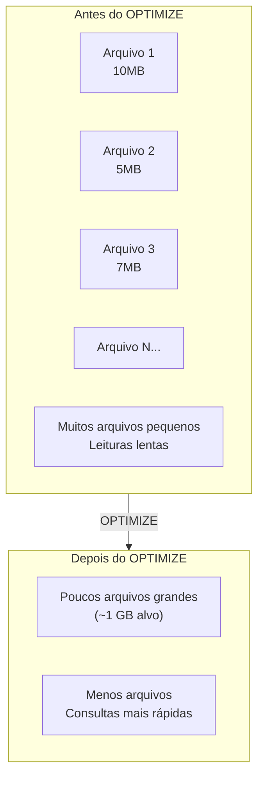

# Otimização do Delta Lake

## Visão geral

A otimização do Delta Lake mantém as tabelas performáticas conforme crescem. As operações-chave são compactar arquivos pequenos, remover arquivos antigos, organizar os dados para consultas mais rápidas e coletar estatísticas para o otimizador.

> [!abstract] Resumo
>
> - `OPTIMIZE` compacta arquivos pequenos. `ZORDER BY` co-localiza valores para data skipping em tabelas particionadas ou sem clustering
> - `VACUUM` remove arquivos de dados não referenciados pelo log após o período de retenção (7 dias por padrão), e limita o time travel
> - Para tabelas novas, a Databricks recomenda **Liquid Clustering** em vez de particionamento + Z-order. Veja [Liquid Clustering e Predictive Optimization](./04-liquid-clustering-and-predictive-optimization.md)

> [!tip] O que a prova cobra
>
> - Apoia as habilidades de otimização do Domínio 6 (Liquid Clustering e predictive optimization se baseiam nesses comandos)
> - `OPTIMIZE` vs `VACUUM`: compactação vs exclusão de arquivos
> - Por que `VACUUM` com retenção curta quebra o time travel e leitores concorrentes

---

## OPTIMIZE (compactação)



### OPTIMIZE básico

```sql
OPTIMIZE employees;

-- Só algumas partições (tabelas particionadas)
OPTIMIZE employees WHERE year = 2025 AND month = 1;
```

```python
from delta.tables import DeltaTable

delta_table = DeltaTable.forName(spark, "main.silver.employees")
delta_table.optimize().executeCompaction()
delta_table.optimize().where("year = 2025").executeCompaction()
```

- O `OPTIMIZE` é **idempotente**: rodá-lo de novo sem novos dados não faz nada
- Não altera os dados lógicos — cria novos arquivos maiores e marca os pequenos como removidos no log (eles continuam no storage até o `VACUUM`)

### OPTIMIZE com Z-order

Z-order reorganiza os dados para co-localizar valores das colunas mais filtradas, melhorando o **data skipping**:

```sql
OPTIMIZE employees ZORDER BY (department, hire_date);
OPTIMIZE orders ZORDER BY (customer_id, order_date);
```

```python
DeltaTable.forName(spark, "main.silver.employees").optimize().executeZOrderBy("department")
```

### Quando usar Z-order

| Tipo de coluna | Benefício | Exemplo |
|-----------|---------|---------|
| **Muito filtrada** | Alto | `WHERE department = 'X'` |
| **Consultas por faixa** | Alto | `WHERE salary BETWEEN X AND Y` |
| **Alta cardinalidade e usada em filtros** | Alto | `customer_id`, `device_id` |
| **Colunas de data** | Alto | `WHERE date > '2025-01-01'` |
| **Baixa cardinalidade** | Baixo | `WHERE active = true` |

- A eficácia cai a cada coluna adicionada — use poucas (1 a 4)
- As colunas precisam ter **estatísticas coletadas** (por padrão, as primeiras 32 colunas)
- Z-order **não é incremental**: rodar de novo reescreve os dados. Liquid Clustering resolve isso

## VACUUM

O VACUUM remove arquivos de dados que **não são mais referenciados** pela versão atual e são mais antigos que o período de retenção:

```sql
VACUUM employees;                    -- retenção padrão: 7 dias
VACUUM employees RETAIN 720 HOURS;   -- 30 dias
VACUUM employees DRY RUN;            -- mostra o que seria apagado
```

```python
DeltaTable.forName(spark, "main.silver.employees").vacuum(168)  # horas = 7 dias
```

### Segurança do VACUUM

- A retenção padrão vem de `delta.deletedFileRetentionDuration` (`interval 7 days`)
- Retenções abaixo de 7 dias são bloqueadas por uma verificação de segurança (`spark.databricks.delta.retentionDurationCheck.enabled`); desativá-la é perigoso
- Leitores/escritores concorrentes podem falhar se o VACUUM apagar arquivos que ainda estão usando
- O VACUUM apaga **arquivos de dados**; o log de transações é limpo separadamente, nos checkpoints, conforme `delta.logRetentionDuration` (30 dias)

### Impacto do VACUUM no time travel

```text
Tabela criada (v0) e atualizada diariamente por 60 dias (v0 → v60)

VACUUM RETAIN 720 HOURS (30 dias)
  → arquivos usados só por versões com mais de 30 dias são apagados
  → time travel para v5 FALHA

Retenção de 60 dias → time travel funciona para todas as versões dos últimos 60 dias
```

## Estatísticas da tabela

O Delta coleta estatísticas por arquivo automaticamente na escrita (min, max, contagem de nulos) para as **primeiras 32 colunas**. Elas permitem o **data skipping**: arquivos cujo intervalo min/max não satisfaz o filtro nem são lidos.

```sql
-- Força a coleta de estatísticas para o otimizador (custo/cardinalidade)
ANALYZE TABLE employees COMPUTE STATISTICS;
ANALYZE TABLE employees COMPUTE STATISTICS FOR COLUMNS salary, department;

-- Detalhes da tabela: número de arquivos, tamanho total, local, clustering
DESCRIBE DETAIL employees;
```

## Propriedades de tabela para otimização

```sql
-- Optimized writes + auto compaction (agrupam arquivos na escrita / após a escrita)
ALTER TABLE employees SET TBLPROPERTIES (
    'delta.autoOptimize.optimizeWrite' = 'true',
    'delta.autoOptimize.autoCompact' = 'true'
);

-- Quantas colunas têm estatísticas coletadas (padrão 32)
ALTER TABLE employees SET TBLPROPERTIES ('delta.dataSkippingNumIndexedCols' = '32');

-- Ou escolha explicitamente as colunas com estatísticas
ALTER TABLE employees SET TBLPROPERTIES ('delta.dataSkippingStatsColumns' = 'customer_id,order_date');
```

- **Optimized writes**: reduz o número de arquivos na própria escrita (agrupa dados antes de gravar)
- **Auto compaction**: depois de uma escrita, compacta arquivos pequenos de forma síncrona
- Nenhum dos dois substitui o `OPTIMIZE` completo, mas reduzem o problema de arquivos pequenos

## Estratégia de manutenção

| Frequência | Tarefa |
| :--- | :--- |
| A cada escrita | Optimized writes / auto compaction (se habilitados) |
| Diária/semanal | `OPTIMIZE` nas tabelas grandes ou muito atualizadas |
| Semanal/mensal | `VACUUM` com retenção adequada ao seu time travel |
| Quando o padrão de consulta mudar | Revisar chaves de clustering (Liquid Clustering) ou Z-order |
| **Melhor opção em managed tables do UC** | Habilitar **predictive optimization**, que agenda `OPTIMIZE`, `VACUUM` e `ANALYZE` automaticamente |

## Verificando a performance da consulta

```sql
EXPLAIN EXTENDED
SELECT * FROM employees WHERE salary > 100000;
-- Procure filtros empurrados (PushedFilters / DataFilters) e o número de arquivos lidos na Spark UI
```

## Casos de uso

- **Manutenção agendada**: rodar `OPTIMIZE` semanal e `VACUUM` mensal num job de manutenção para manter tabelas Delta rápidas conforme o volume cresce (ou deixar o predictive optimization fazer isso).
- **Aceleração de dashboards de BI**: organizar as tabelas pelas colunas usadas nos filtros do dashboard (ex.: `region`, `product_category`) para que as consultas pulem arquivos irrelevantes.

## Problemas e erros comuns

### Problema de arquivos pequenos

**Cenário:** escritas frequentes em micro-batch deixam as leituras lentas.
**Correção:** rode `OPTIMIZE` regularmente, habilite optimized writes/auto compaction, ou use predictive optimization.

### OPTIMIZE não melhora a consulta

**Cenário:** o `OPTIMIZE` compacta os arquivos, mas as consultas continuam lentas porque filtram por colunas que não estão organizadas.
**Correção:** organize pelos campos realmente usados nos `WHERE` (Z-order ou, melhor, Liquid Clustering). Só compactar ajuda pouco em consultas seletivas.

### Z-order em colunas erradas desperdiça recursos

**Cenário:** fazer Z-order em muitas colunas, ou em colunas de baixa cardinalidade que nunca aparecem nos filtros, não melhora o data skipping e gasta compute.
**Correção:** faça Z-order em 1–4 colunas **frequentemente filtradas**, idealmente de **alta cardinalidade** (ex.: `customer_id`, datas). Colunas booleanas ou com poucos valores trazem pouco ganho.

## Dicas para a prova

- `OPTIMIZE` compacta arquivos pequenos; `ZORDER BY` agrupa os dados pelas colunas indicadas para filtros mais rápidos — saiba a sintaxe `OPTIMIZE tabela ZORDER BY (col)`
- Retenção padrão do VACUUM: 7 dias; `VACUUM RETAIN 0 HOURS` quebra o time travel e é perigoso
- `ANALYZE TABLE ... COMPUTE STATISTICS` coleta estatísticas para o otimizador
- `delta.autoOptimize.optimizeWrite` e `delta.autoOptimize.autoCompact` reduzem arquivos pequenos na escrita
- Para tabelas novas, prefira Liquid Clustering a particionamento + Z-order

## Pontos-chave

- **OPTIMIZE**: compacta arquivos pequenos em maiores para leituras mais rápidas
- **Z-order**: co-localiza valores das colunas filtradas para data skipping
- **VACUUM**: remove arquivos de dados antigos não referenciados para economizar armazenamento
- **Estatísticas**: coletadas automaticamente nas primeiras 32 colunas; habilitam data skipping
- **Retenção**: 7 dias por padrão evita perda acidental
- **Optimized writes / auto compaction**: menos arquivos pequenos na escrita
- **Manutenção**: OPTIMIZE, ANALYZE e VACUUM regulares — ou predictive optimization

## Tópicos relacionados

- [Time Travel e Versionamento](../01-databricks-intelligence-platform/05-time-travel-versioning.md)
- [Fundamentos do Delta Lake](../01-databricks-intelligence-platform/04-delta-lake-fundamentals.md)
- [Liquid Clustering e Predictive Optimization](./04-liquid-clustering-and-predictive-optimization.md)

## Documentação oficial

- [Optimize Data Files](https://docs.databricks.com/en/delta/optimize.html)
- [Remove Unused Data Files with Vacuum](https://docs.databricks.com/en/delta/vacuum.html)
- [Data skipping](https://docs.databricks.com/aws/en/delta/data-skipping)

---

**[← Anterior: Spark UI e System Tables](./02-spark-ui-and-system-tables.md) | [↑ Voltar para Troubleshooting, Monitoring, and Optimization](./README.md) | [Próximo: Liquid Clustering e Predictive Optimization →](./04-liquid-clustering-and-predictive-optimization.md)**
