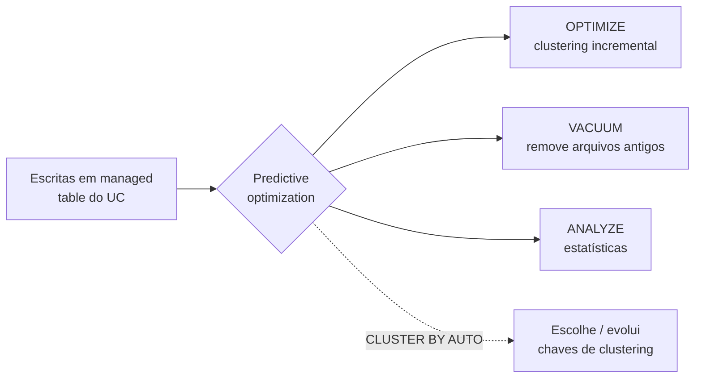

# Liquid Clustering e Predictive Optimization

## Visão geral

**Liquid Clustering** é a técnica de layout de dados da Databricks para tabelas Delta (e Iceberg). Ela "substitui o particionamento de tabelas e o `ZORDER`", e você pode mudar as chaves de clustering sem reescrever os dados existentes. **Predictive optimization** tira a manutenção de tabelas da sua lista de tarefas, rodando `OPTIMIZE`, `VACUUM` e `ANALYZE` automaticamente em managed tables do Unity Catalog. Juntos, são a resposta moderna para "deixe esta tabela rápida e mantenha assim".

> [!abstract] Resumo
>
> - Habilite com `CLUSTER BY (col, ...)` (até **quatro** chaves) no `CREATE TABLE` ou `ALTER TABLE`. Deixe a Databricks escolher as chaves com `CLUSTER BY AUTO`
> - `OPTIMIZE` faz clustering incremental. `OPTIMIZE ... FULL` reorganiza tudo após mudar as chaves
> - Clustering **não é compatível com particionamento nem com `ZORDER`**
> - **Predictive optimization** faz manutenção apenas em **managed tables do UC**, em serverless jobs compute, e vem habilitado por padrão para contas criadas a partir de 11/11/2024

> [!tip] O que a prova cobra
>
> - Habilidade do exam guide: entender os recursos do Liquid Clustering e do predictive optimization
> - Quando o Liquid Clustering é melhor que particionamento ou Z-order: filtros de alta cardinalidade, skew, crescimento rápido e padrões de acesso que mudam
> - O que o predictive optimization automatiza, a quais tabelas se aplica e como habilitar/desabilitar por catálogo, schema ou tabela
> - Que o liquid clustering automático (`CLUSTER BY AUTO`) exige predictive optimization

---

## Liquid Clustering

### Sintaxe

```sql
-- Nova tabela com chaves explícitas
CREATE TABLE main.silver.events (
  event_id BIGINT, customer_id BIGINT, event_ts TIMESTAMP, event_type STRING
) CLUSTER BY (customer_id, event_ts);

-- Habilitar ou mudar chaves em uma tabela existente não particionada (sem reescrever os dados)
ALTER TABLE main.silver.events CLUSTER BY (event_type, event_ts);

-- Deixar a Databricks escolher as chaves pelos padrões de consulta (exige predictive optimization)
ALTER TABLE main.silver.events CLUSTER BY AUTO;

-- Remover o clustering
ALTER TABLE main.silver.events CLUSTER BY NONE;

-- Disparar o clustering
OPTIMIZE main.silver.events;          -- incremental: só dados novos ou não organizados
OPTIMIZE main.silver.events FULL;     -- reorganiza todos os dados pelas chaves atuais (pode levar horas)

-- Converter uma tabela particionada (DBR 18.1+)
ALTER TABLE main.silver.legacy_events REPLACE PARTITIONED BY WITH CLUSTER BY (customer_id);
```

Fonte: [Use liquid clustering for tables](https://docs.databricks.com/aws/en/delta/clustering).

### Fatos-chave

| Recurso | Detalhe |
| :--- | :--- |
| **Substitui** | Particionamento e `ZORDER`. "Não é compatível" com nenhum dos dois |
| **Máximo de chaves** | Quatro. Em tabelas abaixo de 10 TB, mais chaves podem deixar filtros de uma coluna mais lentos |
| **Mudar as chaves** | `ALTER TABLE ... CLUSTER BY (...)` a qualquer momento. Dados existentes não são reescritos até serem reorganizados (`OPTIMIZE FULL`) |
| **Incremental** | `OPTIMIZE` reescreve só o que precisa ser organizado. As escritas também podem organizar dados |
| **Automático** | `CLUSTER BY AUTO` escolhe e evolui as chaves. Exige predictive optimization |
| **Runtime** | GA para Delta no DBR 15.4 LTS+. Converter tabelas particionadas exige DBR 18.1+ |
| **Recomendado para** | Todas as tabelas novas, especialmente filtros por colunas de alta cardinalidade, skew forte, tabelas que crescem rápido, escritores concorrentes e padrões de acesso que mudam |

### Liquid Clustering vs particionamento vs Z-order

| | Particionamento | Z-order | Liquid Clustering |
| :--- | :--- | :--- | :--- |
| Cardinalidade boa da chave | Baixa (data, região) | Alta | Baixa ou alta |
| Mudar chaves depois | Reescrever a tabela | Rodar de novo com novas colunas | `ALTER TABLE ... CLUSTER BY`, sem reescrita imediata |
| Risco de arquivos pequenos / skew | Alto com chave mal escolhida | — | Tratado pelo clustering |
| Manutenção | Manual | `OPTIMIZE ... ZORDER BY` (reescrita completa dos dados alvo) | `OPTIMIZE` (incremental), ou automático com predictive optimization |
| Combinar com os outros? | — | Não com clustering | **Não** com particionamento nem Z-order |

## Predictive optimization

O predictive optimization roda automaticamente `OPTIMIZE`, `VACUUM` e `ANALYZE` em managed tables do Unity Catalog, e coleta estatísticas quando os dados são escritos ([Predictive optimization](https://docs.databricks.com/aws/en/optimizations/predictive-optimization)).

| Aspecto | Detalhe |
| :--- | :--- |
| **Operações** | `OPTIMIZE` (clustering incremental; não roda `ZORDER`), `VACUUM` (retenção padrão de 7 dias, via `delta.deletedFileRetentionDuration`), `ANALYZE` |
| **Aplica-se a** | **Managed tables do UC** (Delta e Iceberg) apenas. Não a external tables, nem a tabelas recebidas via OpenSharing |
| **Padrão** | Habilitado para contas criadas a partir de **11/11/2024**. Contas existentes receberam aos poucos, com conclusão prevista até agosto de 2026 |
| **Compute e cobrança** | Roda em serverless jobs compute, cobrado em SKU de serverless jobs |
| **Observabilidade** | `system.storage.predictive_optimization_operations_history` |
| **Pré-requisitos** | Plano Premium ou superior, região suportada, e SQL warehouses ou DBR 12.2 LTS+ |

```sql
-- Sobrescreve a configuração da conta em qualquer nível; INHERIT volta à configuração do pai
ALTER CATALOG main ENABLE PREDICTIVE OPTIMIZATION;
ALTER SCHEMA main.scratch DISABLE PREDICTIVE OPTIMIZATION;
ALTER TABLE main.silver.events INHERIT PREDICTIVE OPTIMIZATION;

-- O que ele fez?
SELECT * FROM system.storage.predictive_optimization_operations_history
LIMIT 20;
```

> [!note] Observação
> Com predictive optimization ligado, "normalmente você não precisa de jobs agendados de OPTIMIZE" para tabelas com clustering. Lembre que ele também roda `VACUUM`, o que limita até onde o time travel consegue voltar (7 dias por padrão).



## Casos de uso

- **Tabela de eventos de clientes** filtrada por `customer_id` (alta cardinalidade) e tempo: `CLUSTER BY (customer_id, event_ts)` em vez de partições por data + Z-order
- **Padrões de consulta desconhecidos ou que mudam**: `CLUSTER BY AUTO` deixa a Databricks escolher as chaves
- **Centenas de tabelas, nenhum job de manutenção**: predictive optimization cuida de compactação, vacuum e estatísticas
- **Tabela particionada legada com arquivos minúsculos**: converta com `REPLACE PARTITIONED BY WITH CLUSTER BY` e depois rode `OPTIMIZE`

## Problemas e erros comuns

### `CLUSTER BY` falha em tabela particionada

**Cenário:** `ALTER TABLE t CLUSTER BY (customer_id)` falha em uma tabela particionada por `event_date`.
**Correção:** clustering não é compatível com particionamento. No DBR 18.1+, use `REPLACE PARTITIONED BY WITH CLUSTER BY`, ou recrie a tabela com `CLUSTER BY`.

### Novas chaves não aceleram os dados antigos

**Cenário:** depois de mudar as chaves de clustering, consultas em dados históricos continuam lentas.
**Correção:** dados existentes não são reescritos quando as chaves mudam. Rode `OPTIMIZE ... FULL` para reorganizar tudo.

### Predictive optimization não roda em uma tabela

**Cenário:** uma external table nunca aparece no histórico do predictive optimization.
**Correção:** o predictive optimization só se aplica a **managed tables do UC**. Converta a tabela com `ALTER TABLE ... SET MANAGED` (veja [Managed and External Tables](../07-governance-and-security/02-managed-and-external-tables.md)), ou agende a manutenção você mesmo.

### `CLUSTER BY AUTO` nunca escolhe chaves

**Cenário:** o liquid clustering automático está habilitado, mas as chaves continuam vazias.
**Correção:** a seleção automática de chaves exige predictive optimization. Verifique se está habilitado no catálogo, schema ou tabela.

## Dicas para a prova

> [!tip] Dicas para a prova
>
> - Liquid Clustering = `CLUSTER BY` (até 4 chaves). Substitui particionamento e Z-order e não pode ser combinado com eles
> - Mude as chaves com `ALTER TABLE ... CLUSTER BY` (sem reescrita imediata). `OPTIMIZE FULL` reorganiza todos os dados
> - `CLUSTER BY AUTO` precisa de predictive optimization
> - Predictive optimization = `OPTIMIZE` + `VACUUM` + `ANALYZE` automáticos **só em managed tables do UC**
> - Habilite/desabilite com `ALTER CATALOG | SCHEMA | TABLE ... ENABLE | DISABLE | INHERIT PREDICTIVE OPTIMIZATION`

## Pontos-chave

- Liquid Clustering é o layout recomendado para tabelas novas: chaves flexíveis, clustering incremental e solução para skew
- Predictive optimization automatiza a manutenção e combina com o clustering automático
- Ambos favorecem **managed tables do Unity Catalog** — mais um motivo pelo qual a Databricks as recomenda

## Tópicos relacionados

- [Otimização do Delta Lake (OPTIMIZE, Z-order, VACUUM)](./03-delta-optimization.md)
- [Spark UI e System Tables](./02-spark-ui-and-system-tables.md)
- [Managed and External Tables](../07-governance-and-security/02-managed-and-external-tables.md)

## Documentação oficial

- [Use liquid clustering for tables](https://docs.databricks.com/aws/en/delta/clustering)
- [Predictive optimization for Unity Catalog managed tables](https://docs.databricks.com/aws/en/optimizations/predictive-optimization)

---

**[← Anterior: Otimização do Delta Lake](./03-delta-optimization.md) | [↑ Voltar para Troubleshooting, Monitoring, and Optimization](./README.md) | [Próximo: Compute Troubleshooting →](./05-compute-troubleshooting.md)**
