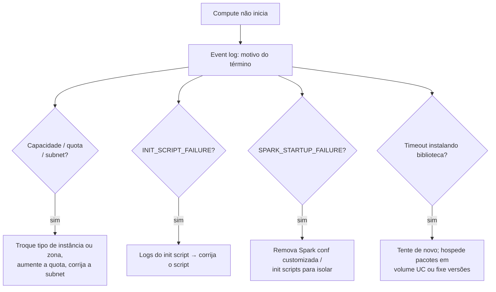

# Troubleshooting de Compute

## Visão geral

O exam guide pede que você diagnostique três classes de problema de compute: **falhas de inicialização de cluster**, **conflitos de bibliotecas** e erros de **falta de memória (OOM)**. Cada um deixa uma trilha diferente no **event log** do compute, nos **driver logs** ou na **Spark UI**. Este arquivo mapeia sintomas para causas e correções, usando os códigos de término documentados e as regras de precedência de bibliotecas da Databricks.

> [!abstract] Resumo
>
> - **Falhas de inicialização**: leia o motivo ou código de término no event log. Causas típicas: capacidade ou quota na nuvem, falta de IPs na subnet, init scripts falhando e Spark não iniciando
> - **Conflitos de bibliotecas**: bibliotecas com escopo de notebook (`%pip`) têm precedência sobre as do compute, que têm precedência sobre as nativas do Databricks Runtime. Instalar uma versão conflitante de um pacote central pode quebrar o REPL Python
> - **OOM**: OOM no driver geralmente vem de trazer dados para o driver (`collect()`, `toPandas()`, broadcasts enormes). OOM ou spill no executor vem de partições grandes demais, skew ou linhas largas
> - Verifique o **event log** (ciclo de vida), os **driver logs** (stdout, stderr, log4j) e a **Spark UI** (executores, stages)

> [!tip] O que a prova cobra
>
> - Habilidade do exam guide: diagnosticar falhas de inicialização de cluster, conflitos de bibliotecas e problemas de falta de memória
> - Diferenciar OOM no driver de OOM no executor, e a correção certa para cada um
> - Onde olhar primeiro: event log, driver logs, Spark UI ou logs de init script
> - Por que bibliotecas com escopo de notebook e versões fixadas evitam conflitos

---

## Onde ficam as evidências

| Fonte | Contém | Retenção / observações |
| :--- | :--- | :--- |
| **Event log do compute** | Eventos de ciclo de vida: criação, início, término, resize, edições de configuração | 60 dias. Exportável como CSV ou Excel |
| **Driver logs** | stdout, stderr e Log4j de notebooks, jobs e bibliotecas | Configure log delivery para guardar por mais tempo |
| **Spark UI → Executors / Stages** | Memória dos executores, tempo de GC, tasks com falha, spill | Mostra só a sessão mais recente após um restart |
| **Logs de init script** | Saída dos init scripts com escopo de cluster | Primeiro lugar a olhar quando o código é `INIT_SCRIPT_FAILURE` |
| **Detalhes da execução (jobs)** | Divisão do tempo: na fila, aguardando recursos, instalando bibliotecas, rodando | Mostra *onde* o tempo foi antes mesmo do código rodar |

## Falhas de inicialização do cluster

| Código de término (exemplos) | Causa | Correção |
| :--- | :--- | :--- |
| `CLOUD_PROVIDER_LAUNCH_FAILURE` | O provedor de nuvem não conseguiu iniciar a VM | Tente mais tarde. Escale com o provedor se persistir |
| `CLOUD_PROVIDER_RESOURCE_STOCKOUT_DUE_TO_MISCONFIG` | Sem capacidade para o tipo de instância ou zona pedidos por configurações restritivas | Habilite tipos de nó flexíveis, ou mude a zona ou o tipo de instância |
| `AWS_RESOURCE_QUOTA_EXCEEDED` (e equivalentes) | A inicialização excederia uma quota da conta | Peça aumento de quota, ou use outros tipos de instância ou regiões |
| `AWS_INSUFFICIENT_FREE_ADDRESSES_IN_SUBNET_FAILURE` | "Não há endereços livres suficientes na subnet" | Use outra zona ou `auto`, ou amplie o CIDR da subnet |
| `INIT_SCRIPT_FAILURE` | Um init script de cluster não carregou ou saiu com código diferente de zero | Leia os logs do init script e corrija caminho, permissões ou comando |
| `SPARK_STARTUP_FAILURE` | O driver Spark não iniciou dentro do timeout | Remova configs Spark customizadas e init scripts para isolar a causa, ou tente outro tipo de instância |
| `INVALID_ARGUMENT` | Parâmetros ruins, secrets ausentes ou problemas de permissão | Corrija a configuração indicada e confira o secret scope e a chave |

Fonte: [Classic compute termination error codes](https://docs.databricks.com/aws/en/compute/troubleshooting/cluster-error-codes). A Knowledge Base da Databricks também documenta **timeouts de instalação de bibliotecas** (ex.: "Library installation timed out after 1800 seconds"), geralmente problemas intermitentes de rede resolvidos com nova execução ou restart.



> [!tip] Dica
> Serverless elimina a maioria das falhas de inicialização: não há tipos de instância, quotas ou init scripts para gerenciar. Se um job agendado vive falhando ao provisionar compute classic, migrá-lo para serverless costuma ser a solução mais simples.

## Conflitos de bibliotecas

Quando o código roda `import <biblioteca>`, a cópia com maior precedência vence ([Install libraries](https://docs.databricks.com/aws/en/libraries/)):

1. Diretório de trabalho atual (só em Git folders)
2. Raiz do Git folder (só em Git folders)
3. **Bibliotecas com escopo de notebook** (`%pip install`)
4. **Bibliotecas com escopo de compute**
5. **Bibliotecas nativas do Databricks Runtime**
6. Diretório de trabalho atual (fora de Git folders)
7. Workspace files adicionados ao `sys.path`

| Sintoma | Causa provável | Correção |
| :--- | :--- | :--- |
| `ImportError` / `AttributeError` depois de adicionar uma biblioteca | Uma biblioteca do compute sobrescreveu uma versão nativa do Runtime | Fixe uma versão compatível com o Runtime, ou isole como biblioteca de notebook |
| Dois notebooks no mesmo cluster precisam de versões diferentes | Bibliotecas do compute são compartilhadas por todos os notebooks | Use `%pip install pkg==x.y` em cada notebook, ou computes separados |
| Comandos Python passam a retornar **Cancelled** após mudar um pacote | Uma versão conflitante de um pacote central (ex.: numpy ou pandas) quebrou o REPL | Remova a biblioteca conflitante e reinstale a versão correta |
| Uma biblioteca resolve de forma diferente a cada execução | Instalada por init script, cuja ordem em relação às nativas pode variar | A Databricks "não recomenda instalar bibliotecas com init scripts". Use bibliotecas do compute ou `requirements.txt` |
| Arquivos de biblioteca editados por usuários desconhecidos | Guardados no DBFS | Armazenar bibliotecas no DBFS está depreciado (e desabilitado por padrão no DBR 15.1+). Use volumes UC ou workspace files |

```python
# Escopo de notebook e versão fixada: isolado dos outros notebooks no mesmo compute
%pip install pandas==2.2.2
dbutils.library.restartPython()   # reinicia o Python para importar a nova versão
```

No **serverless**, gerencie dependências com **environments** (base environments) em vez de bibliotecas de compute. No DBR 15.0+, arquivos `requirements.txt` podem gerenciar dependências Python.

## Erros de falta de memória (OOM)

| Onde | Mensagem / sinal típico | Causas comuns | Correções |
| :--- | :--- | :--- | :--- |
| **Driver** | `java.lang.OutOfMemoryError` no driver, "driver is temporarily unavailable", notebook desanexado | `collect()` / `toPandas()` em dados grandes, broadcast de tabela grande, muitíssimos arquivos pequenos rastreados no driver | Mantenha os dados distribuídos: grave resultados numa tabela, `display()` / `limit()`. Não faça broadcast de tabelas grandes. Aumente `spark.driver.memory` (no compute) só quando necessário |
| **Executor** | Executor perdido ou OOM, tasks reexecutadas, muito **spill** | Partições de shuffle grandes demais, **skew**, linhas largas ou arrays grandes, cache demais | `spark.sql.shuffle.partitions=auto` ou mais partições. Trate o skew (salting). Selecione menos colunas. Use workers maiores ou otimizados para memória. Faça unpersist de caches sem uso |
| **Worker Python** | Processo Python morto em uma UDF | UDFs Python ou pandas UDFs segurando lotes grandes | Use funções nativas. Reduza o tamanho do lote Arrow ou os dados por grupo |

```python
# Antipadrão: traz 200 milhões de linhas para o driver
pdf = spark.table("main.silver.events").toPandas()          # OOM no driver

# Padrão: agregue no Spark e colete só o resultado pequeno
summary = (spark.table("main.silver.events")
    .groupBy("event_type").count()
    .toPandas())                                             # poucas linhas
```

Veja [Parâmetros de tuning do Spark](../03-data-transformation-and-modeling/07-spark-tuning-parameters.md) para configurações de memória, e [Spark UI e System Tables](./02-spark-ui-and-system-tables.md) para ler spill e skew.

## Casos de uso

- **Job noturno preso em Pending e depois encerrado**: o event log mostra código de falta de IPs na subnet; mudar de zona resolve
- **Pipeline quebra após upgrade "inofensivo" de biblioteca**: um upgrade de pandas no compute conflita com o Runtime; a versão é fixada e movida para escopo de notebook
- **Notebook de relatório derruba o driver**: `toPandas()` substituído por agregação no Spark + coleta pequena
- **Stage de join perde executores**: o skew é tratado com salting e shuffle partitions passa a `auto`

## Problemas e erros comuns

### Tratar todo OOM como "adicione mais workers"

**Cenário:** um OOM no driver após `collect()` persiste mesmo depois de dobrar os workers.
**Correção:** workers não adicionam memória ao driver. Pare de coletar dados grandes no driver, ou aumente a memória do driver no compute.

### Mudança em init script derruba o cluster

**Cenário:** depois de editar um init script de cluster, o cluster encerra com `INIT_SCRIPT_FAILURE`.
**Correção:** leia os logs do init script, corrija (caminho, permissões, comando que falha) e reinicie. Prefira bibliotecas de compute ou environments a instalações via init script.

### Versão da biblioteca diferente entre dev e prod

**Cenário:** o código funciona num cluster de dev mas falha no job de prod com `AttributeError`.
**Correção:** os dois computes rodam bibliotecas nativas ou versões diferentes. Fixe as versões nas bibliotecas ou environment do job e use um runtime LTS para jobs.

## Dicas para a prova

> [!tip] Dicas para a prova
>
> - Falha de inicialização → **motivo de término no event log** primeiro. Falha de init script → **logs do init script**
> - Precedência de bibliotecas: **notebook (`%pip`) > compute > nativas do Runtime**
> - Use bibliotecas de notebook ou versões fixadas para evitar conflitos. Evite instalar via init script e bibliotecas no DBFS
> - **OOM no driver** ← `collect()` / `toPandas()` / broadcast grande. **OOM ou spill no executor** ← partições grandes, skew, linhas largas
> - Mais workers não resolvem nem OOM no driver nem uma única task com skew

## Pontos-chave

- Event log, driver logs e Spark UI respondem, cada um, a um "por que falhou?" diferente
- Códigos de término apontam para causas de capacidade, quota, rede, init script ou inicialização do Spark
- A precedência de bibliotecas explica a maioria dos conflitos de versão. Isole e fixe versões
- Diagnostique o OOM por *onde* ele acontece (driver vs executor) e corrija o padrão de dados antes de adicionar memória

## Tópicos relacionados

- [Compute e Clusters](../01-databricks-intelligence-platform/03-compute-clusters.md)
- [Parâmetros de tuning do Spark](../03-data-transformation-and-modeling/07-spark-tuning-parameters.md)
- [Spark UI e System Tables](./02-spark-ui-and-system-tables.md)

## Documentação oficial

- [Classic compute termination error codes](https://docs.databricks.com/aws/en/compute/troubleshooting/cluster-error-codes)
- [Manage classic compute](https://docs.databricks.com/aws/en/compute/clusters-manage)
- [Install libraries](https://docs.databricks.com/aws/en/libraries/)
- [Diagnose Lakeflow Jobs performance](https://docs.databricks.com/aws/en/jobs/diagnose-job-performance)

---

**[← Anterior: Liquid Clustering e Predictive Optimization](./04-liquid-clustering-and-predictive-optimization.md) | [↑ Voltar para Troubleshooting, Monitoring, and Optimization](./README.md)**
