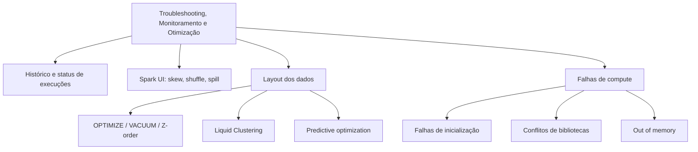

# Troubleshooting, Monitoring, and Optimization (10 % da prova)

O Domínio 6 cobre manter os pipelines saudáveis e rápidos. Você lê o histórico de execuções dos **Lakeflow Jobs** para comparar durações com uma linha de base, e interpreta status de jobs e grafos de tasks para achar bloqueios upstream. Diagnostica skew, shuffle e disk spill a partir das métricas de stage da Spark UI. Sabe o que **Liquid Clustering** e **predictive optimization** fazem, e consegue resolver falhas de inicialização de cluster, conflitos de bibliotecas e erros de falta de memória.

## Visão geral dos tópicos

## Conteúdo da seção

| Arquivo | Tópico | Prioridade |
| :--- | :--- | :--- |
| [01-job-monitoring.md](./01-job-monitoring.md) | Lista Jobs & Pipelines, matrix view, status de execução, visões graph/timeline, notificações, repair runs | Alta |
| [02-spark-ui-and-system-tables.md](./02-spark-ui-and-system-tables.md) | Métricas de stage, skew, shuffle, spill, limites do AQE, system tables | Alta |
| [03-delta-optimization.md](./03-delta-optimization.md) | `OPTIMIZE`, Z-order, `VACUUM`, estatísticas, tamanho de arquivos | Média |
| [04-liquid-clustering-and-predictive-optimization.md](./04-liquid-clustering-and-predictive-optimization.md) | `CLUSTER BY`, `CLUSTER BY AUTO`, `OPTIMIZE FULL`, predictive optimization | Alta |
| [05-compute-troubleshooting.md](./05-compute-troubleshooting.md) | Códigos de término, init scripts, precedência e conflitos de bibliotecas, OOM no driver/executor | Alta |

## Cobertura das habilidades oficiais (agosto de 2026)

| Habilidade do exam guide (parafraseada) | Onde é coberta |
| :--- | :--- |
| Tendências de performance a partir do histórico de execuções vs linha de base | [01](./01-job-monitoring.md) |
| Monitorar a saúde do pipeline na UI de Jobs: status, grafo do DAG, tempos de execução, taxas de falha | [01](./01-job-monitoring.md) |
| Métricas de stage da Spark UI para skew, shuffle e disk spill | [02](./02-spark-ui-and-system-tables.md) |
| Recursos do Liquid Clustering e do predictive optimization | [04](./04-liquid-clustering-and-predictive-optimization.md), [03](./03-delta-optimization.md) |
| Falhas de inicialização de cluster, conflitos de bibliotecas, problemas de falta de memória | [05](./05-compute-troubleshooting.md) |

## Conceitos-chave

- **Matrix view**: histórico de execuções de um job, uma barra por execução. A altura é a duração e a cor é o status, então uma barra crescendo mostra regressão em relação à linha de base
- **Resultado da execução**: decidido pelas leaf tasks (tasks finais). *Succeeded with failures* significa que algumas tasks falharam, mas todas as leaf tasks tiveram sucesso
- **Teste de skew**: nas Summary Metrics de um stage, se a duração Max das tasks está pelo menos 50 % acima do percentil 75, o stage pode ter skew
- **Tratamento de skew do AQE**: vale só para sort-merge e shuffle-hash joins, não para broadcast joins e nem para agregações `groupBy`. Em agregações, faça salting da chave
- **Liquid Clustering**: substitui particionamento e Z-order (não pode ser combinado com nenhum dos dois). Use até quatro chaves, que podem ser alteradas sem reescrever os dados
- **Predictive optimization**: roda `OPTIMIZE`, `VACUUM` e `ANALYZE` automaticamente em managed tables do UC

## Próximos passos

Termine com [07 — Governance and Security](../07-governance-and-security/README.md).

---

**[← Anterior: Implementing CI/CD](../05-implementing-cicd/README.md) | [↑ Voltar à Certificação](../README.md) | [Próximo: Governance and Security →](../07-governance-and-security/README.md)**
