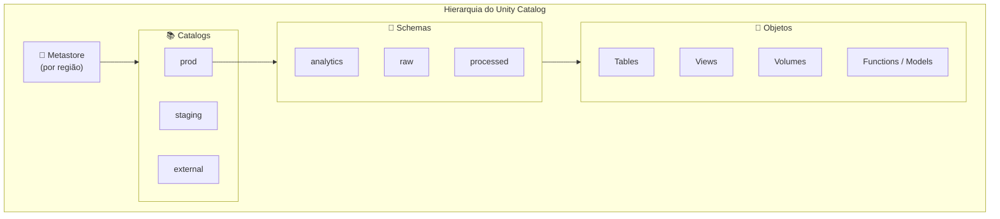

# Unity Catalog Básico

## Visão geral

O Unity Catalog (UC) é a solução centralizada de metadados e controle de acesso da Databricks, um único lugar para governar dados em toda a plataforma. Ele resolve problemas de governança como metadados espalhados, controle de acesso inconsistente e falta de trilhas de auditoria.

> [!abstract] Resumo
>
> - O metastore é o contêiner de nível mais alto (um por região). Abaixo dele fica o namespace de três níveis `catalog.schema.object`
> - Objetos securables incluem tabelas, views, volumes, functions, models, external locations e storage credentials
> - Storage credentials + external locations governam o acesso a caminhos no cloud storage

> [!tip] O que a prova cobra
>
> - Apoia as habilidades do Domínio 7: a hierarquia de objetos sobre a qual privilégios são concedidos
> - Configurar storage externo na ordem: storage credential → external location → external table ou volume
> - Unity Catalog vs o Hive metastore legado, por workspace

---

## Arquitetura do Unity Catalog



## Metastore

Um **metastore** é o contêiner raiz do Unity Catalog em uma região. É criado por região e contém:

- Todos os catálogos, schemas e objetos
- Políticas de controle de acesso
- Logs de auditoria
- Informações de linhagem

Cada região tem **um** metastore por conta; vários workspaces da mesma região podem ser anexados ao mesmo metastore e compartilhar os mesmos dados governados.

## Namespace de três níveis

O Unity Catalog usa um namespace de **três níveis**: `catalog.schema.object`

```text
metastore/
├── prod/                          (Catalog)
│   ├── analytics/                 (Schema)
│   │   ├── orders                 (Table)
│   │   ├── customers              (Table)
│   │   └── revenue_metrics        (View)
│   └── raw/                       (Schema)
│       ├── events                 (Table)
│       └── landing                (Volume)
├── staging/                       (Catalog)
│   └── experimental/              (Schema)
│       └── test_data              (Table)
└── external/                      (Catalog)
    └── partner_data/              (Schema)
        └── partner_a_forecast     (Table)
```

```sql
SELECT * FROM prod.analytics.orders;
SELECT * FROM staging.experimental.test_data;
-- O Hive metastore legado usava dois níveis: schema.table (dentro de hive_metastore)
```

## Criando catálogos e schemas

```sql
CREATE CATALOG IF NOT EXISTS prod COMMENT "Catálogo de produção";
CREATE CATALOG IF NOT EXISTS staging COMMENT "Dados de staging e teste";

CREATE SCHEMA IF NOT EXISTS prod.analytics COMMENT "Datasets analíticos";
CREATE SCHEMA IF NOT EXISTS prod.raw COMMENT "Camada de ingestão bruta";

-- Opcional: local de armazenamento gerenciado próprio do catálogo/schema
CREATE CATALOG finance MANAGED LOCATION 's3://finance-bucket/managed/';

SHOW CATALOGS;
SHOW SCHEMAS IN prod;
DESCRIBE CATALOG prod;
DESCRIBE SCHEMA prod.analytics;
```

## Objetos no Unity Catalog

### Managed tables

```sql
CREATE TABLE prod.analytics.orders (
    order_id INT,
    customer_id INT,
    amount DECIMAL(10, 2),
    order_date DATE
);
-- Dados no local gerenciado do UC; a Databricks gerencia ciclo de vida e layout
```

### External tables

```sql
CREATE TABLE external.partner_data.forecasts (
    forecast_id INT,
    product_id INT,
    predicted_sales DECIMAL(10, 2)
)
LOCATION 's3://partner-bucket/forecasts/';
-- Dados no bucket do parceiro; o UC fornece metadados e controle de acesso
-- O caminho precisa estar coberto por uma external location
```

### Views

```sql
CREATE VIEW prod.analytics.high_value_orders AS
SELECT order_id, customer_id, amount
FROM prod.analytics.orders
WHERE amount > 10000;
```

### Volumes

Volumes são locais de armazenamento governados para **arquivos** (documentos, imagens, CSVs brutos, código):

```sql
CREATE VOLUME IF NOT EXISTS prod.raw.landing;                              -- managed volume
CREATE EXTERNAL VOLUME prod.raw.vendor LOCATION 's3://vendor-bucket/in/'; -- external volume
```

```python
dbutils.fs.ls("/Volumes/prod/raw/landing/")
spark.read.csv("/Volumes/prod/raw/landing/customers.csv", header=True)
```

## Storage credentials e external locations

O acesso a cloud storage passa por dois objetos:

1. **Storage credential**: guarda a identidade de nuvem (IAM role na AWS, managed identity na Azure, service account no GCP)
2. **External location**: combina um caminho de storage com uma storage credential

```sql
-- Admin: external location sobre uma credential existente
CREATE EXTERNAL LOCATION partner_data
URL 's3://partner-bucket/data/'
WITH (STORAGE CREDENTIAL partner_role);

GRANT READ FILES, CREATE EXTERNAL TABLE ON EXTERNAL LOCATION partner_data TO `data_engineers`;

-- Tabela externa dentro dessa external location
CREATE TABLE external.partner_data.sales
LOCATION 's3://partner-bucket/data/sales/';
```

## UC vs Hive metastore

| Recurso | Unity Catalog | Hive Metastore (legado) |
|---------|---|---|
| **Namespace** | 3 níveis (catalog.schema.table) | 2 níveis (schema.table) |
| **Controle de acesso** | Privilégios granulares por objeto, centralizados na conta | Limitado, por workspace |
| **Auditoria** | Linhagem e trilha de acesso completas | Limitada |
| **Dados externos** | External locations governadas | Mounts/caminhos não governados |
| **Escopo** | Um metastore compartilhado por vários workspaces da região | Um metastore por workspace |
| **Compartilhamento** | OpenSharing (antigo Delta Sharing) | Exportações manuais |

## Navegando no catálogo

```sql
USE CATALOG prod;
USE SCHEMA analytics;

SELECT * FROM orders;  -- equivale a prod.analytics.orders
```

```python
spark.sql("USE CATALOG prod")
spark.sql("SELECT * FROM analytics.orders")  # equivale a prod.analytics.orders
```

## Convenções de nomes e organização

```text
Catálogos: minúsculos e descritivos   → prod, staging, dev
Schemas: área funcional ou camada     → raw, silver, gold, reporting
Tabelas/colunas: snake_case           → customer_transactions, order_date
Views: descritivas, prefixo v_        → v_high_value_customers
```

| Padrão | Exemplo |
| :--- | :--- |
| Por ambiente | `prod`, `staging`, `dev` (schemas por camada dentro) |
| Por camada | `bronze`, `silver`, `gold` |
| Por domínio/fonte | `crm`, `erp`, `finance` |

## Casos de uso

- **Governança centralizada multiambiente**: separar os dados em catálogos (`prod`, `staging`, `dev`) para que controle de acesso, linhagem e auditoria sejam aplicados de forma consistente a partir de um único metastore.
- **Descoberta de dados entre times**: permitir que analistas e cientistas de dados naveguem pelo namespace `catalog.schema.table` para encontrar e pedir acesso a datasets sem conhecer caminhos de storage.

## Problemas e erros comuns

### Tabela criada no catálogo errado

**Cenário:** um notebook roda `CREATE TABLE orders ...` e a tabela vai para o catálogo padrão do workspace em vez de `prod`.
**Correção:** nomes de uma ou duas partes são resolvidos contra o catálogo e schema atuais. Use nomes totalmente qualificados `catalog.schema.table`, ou rode `USE CATALOG` / `USE SCHEMA` antes.

### INSUFFICIENT_PERMISSIONS ao consultar outro catálogo

**Cenário:** um usuário recebe `INSUFFICIENT_PERMISSIONS` em `SELECT * FROM other_catalog.schema.table` mesmo tendo `SELECT` na tabela.
**Correção:** verifique se ele também tem `USE CATALOG` no catálogo e `USE SCHEMA` no schema. Os três privilégios (`USE CATALOG` + `USE SCHEMA` + `SELECT`) são necessários.

### Metastore não anexado ao workspace

**Cenário:** objetos do Unity Catalog não aparecem no workspace, e `SHOW CATALOGS` volta vazio ou com erro.
**Correção:** um account admin precisa anexar o metastore do UC ao workspace pelo account console. Cada workspace deve ser associado explicitamente a um metastore regional.

## Dicas para a prova

- O namespace de três níveis é `catalog.schema.object` — saiba escrever referências como `prod.analytics.orders`
- Um metastore por região; ele é o contêiner raiz de todos os objetos do UC
- Managed tables (UC gerencia o storage) vs external tables (dados em local externo, com controle de acesso do UC)
- Volumes guardam arquivos não tabulares (PDFs, imagens, CSVs brutos) e são acessados em `/Volumes/catalog/schema/volume/`
- Ordem para storage externo: **storage credential → external location → external table/volume**

## Pontos-chave

- **Unity Catalog**: governança centralizada em toda a plataforma Databricks
- **Metastore**: contêiner raiz (um por região)
- **Catalog**: contêiner organizacional de nível superior
- **Schema**: agrupa objetos relacionados
- **Namespace de três níveis**: `catalog.schema.object`
- **Managed tables**: o UC gerencia storage e ciclo de vida
- **External tables**: controle de acesso do UC, dados em storage externo
- **Volumes**: armazenamento governado para arquivos
- **External locations**: caminhos de cloud storage associados a uma storage credential

## Tópicos relacionados

- [Managed and External Tables](./02-managed-and-external-tables.md)
- [Controle de acesso e permissões](./03-access-control-permissions.md)
- [Compartilhamento de dados](./05-data-sharing.md)

## Documentação oficial

- [Unity Catalog Overview](https://docs.databricks.com/en/data-governance/unity-catalog/index.html)
- [Create and Manage Catalogs](https://docs.databricks.com/en/catalogs/index.html)

---

**[↑ Voltar para Governance and Security](./README.md) | [Próximo: Managed and External Tables →](./02-managed-and-external-tables.md)**
