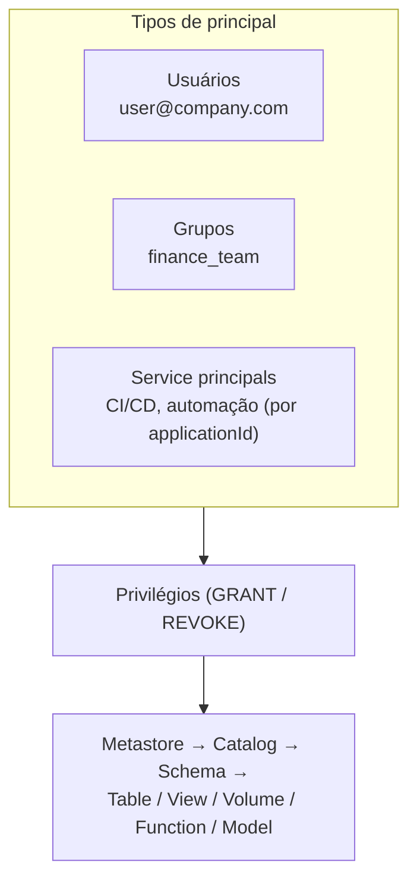

# Controle de Acesso e Permissões

## Visão geral

Controle de acesso e permissões no Unity Catalog dão controle granular sobre quem acessa quais dados. O modelo de privilégios é hierárquico e permite delegar a gestão de acesso pela organização.

> [!abstract] Resumo
>
> - Principals: usuários, grupos e service principals. Conceda a **grupos** sempre que possível
> - Para chegar a um objeto você precisa de `USE CATALOG` + `USE SCHEMA`, mais o privilégio do objeto (`SELECT`, `MODIFY`, ...). Grants em um pai são herdados pelos filhos atuais e futuros
> - `GRANT` adiciona e `REVOKE` remove. O comando clássico `DENY` é **só do Hive metastore legado**. O mecanismo de negação do Unity Catalog é a política ABAC DENY (Beta)

> [!tip] O que a prova cobra
>
> - Habilidade do exam guide: configurar controles de acesso pela UI e por SQL aplicando GRANT, REVOKE e DENY a principals no nível certo da hierarquia
> - Os privilégios mínimos para um cenário (ex.: ler uma tabela sem acesso ao resto do schema)
> - Quem pode conceder: o dono, um usuário com `MANAGE`, o dono do pai ou um metastore admin

---

## Principals: usuários, grupos e service principals



| Principal | Identificado por | Use para |
| :--- | :--- | :--- |
| **Usuário** | Email | Pessoas. Evite conceder a indivíduos em produção |
| **Grupo** | Nome do grupo | **Escolha padrão**: o acesso acompanha automaticamente as mudanças de membros |
| **Service principal** | Application ID | Jobs, CI/CD e deploys de bundles (`run_as`) |

Nomes de principals com caracteres especiais (como `@` ou `-`) precisam estar entre **crases** (backticks).

## Hierarquia de securables e herança

```text
Metastore
└── Catalog                       USE CATALOG, CREATE SCHEMA, BROWSE, ...
    └── Schema                    USE SCHEMA, CREATE TABLE, CREATE VOLUME, CREATE FUNCTION, ...
        ├── Table / View / MV     SELECT, MODIFY, REFRESH (MV)
        ├── Volume                READ VOLUME, WRITE VOLUME
        ├── Function              EXECUTE
        └── Model                 EXECUTE
External locations / storage credentials: CREATE EXTERNAL TABLE, READ FILES, WRITE FILES, ...
```

- **Herança**: um privilégio concedido em um catálogo ou schema vale para os objetos dentro dele, **incluindo objetos futuros**. `GRANT SELECT ON SCHEMA main.gold` cobre toda tabela e view atual e futura de `main.gold`
- **Privilégios de uso**: `USE CATALOG` e `USE SCHEMA` são "necessários para interagir com qualquer objeto dentro" do catálogo ou schema, mas **não dão acesso aos dados por si sós**

Fonte: [Unity Catalog privileges reference](https://docs.databricks.com/aws/en/data-governance/unity-catalog/manage-privileges/privileges).

## Privilégios principais

| Privilégio | Permite |
| :--- | :--- |
| `USE CATALOG` / `USE SCHEMA` | Chegar aos objetos dentro do catálogo/schema (sem acesso a dados sozinho) |
| `BROWSE` | Descobrir objetos e ver metadados **sem** privilégios de uso (recomendado em catálogos) |
| `SELECT` | "Consultar dados de uma tabela, view, materialized view ou share" |
| `MODIFY` | "Inserir, atualizar e apagar dados de uma tabela" |
| `CREATE SCHEMA` | Criar um schema em um catálogo |
| `CREATE TABLE` | "Criar tabelas ou views em um schema" |
| `CREATE MATERIALIZED VIEW` / `CREATE VOLUME` / `CREATE FUNCTION` | Criar esses objetos em um schema |
| `REFRESH` | Atualizar manualmente uma materialized view |
| `READ VOLUME` / `WRITE VOLUME` | Ler ou alterar arquivos em um volume |
| `EXECUTE` | Executar uma function ou carregar um modelo registrado |
| `CREATE EXTERNAL TABLE` | Criar external tables em uma external location |
| `READ FILES` / `WRITE FILES` | Acesso direto por caminho via external location (prefira volumes) |
| `MANAGE` | "Gerenciar privilégios, transferir propriedade, renomear e apagar um objeto" |
| `ALL PRIVILEGES` | Todos os privilégios aplicáveis, **exceto** `EXTERNAL USE SCHEMA`, `EXTERNAL USE LOCATION`, `MANAGE` e `READ METADATA` |

> [!note] Nomes legados
> `USAGE`, `READ_METADATA` e `CREATE_TABLE` (com underscore) pertencem ao modelo legado de table ACLs do Hive metastore. No Unity Catalog use `USE CATALOG`, `USE SCHEMA`, `BROWSE` e `CREATE TABLE`.

## GRANT e REVOKE

```sql
-- Privilégios mínimos para ler UMA tabela (não o schema inteiro)
GRANT USE CATALOG ON CATALOG prod TO `analysts`;
GRANT USE SCHEMA  ON SCHEMA  prod.analytics TO `analysts`;
GRANT SELECT      ON TABLE   prod.analytics.revenue TO `analysts`;

-- Ler tudo em um schema, agora e no futuro
GRANT USE SCHEMA, SELECT ON SCHEMA prod.analytics TO `analysts`;

-- Engenheiros podem criar e escrever tabelas no schema silver
GRANT USE SCHEMA, CREATE TABLE, MODIFY, SELECT ON SCHEMA prod.silver TO `data_engineers`;

-- Service principal usado pelo job de produção
GRANT USE CATALOG ON CATALOG prod TO `6d5c1f2e-orders-sp-application-id`;
GRANT USE SCHEMA, SELECT, MODIFY ON SCHEMA prod.silver TO `6d5c1f2e-orders-sp-application-id`;

-- Descobrir sem ler dados
GRANT BROWSE ON CATALOG prod TO `all_employees`;

-- Remover privilégios
REVOKE MODIFY ON SCHEMA prod.silver FROM `data_engineers`;
REVOKE SELECT ON TABLE prod.analytics.revenue FROM `user@company.com`;

-- Inspecionar
SHOW GRANTS ON TABLE prod.analytics.revenue;
SHOW GRANTS `analysts` ON SCHEMA prod.analytics;
```

- Sintaxe: `GRANT <privilégio> ON <tipo> <nome> TO <principal>` e `REVOKE <privilégio> ON <tipo> <nome> FROM <principal>`
- "Um `REVOKE` tem sucesso mesmo que os privilégios nunca tenham sido concedidos"
- **REVOKE remove um grant feito naquele nível**. Se o principal também recebe o privilégio por um objeto pai ou por um grupo, o acesso continua até esses grants serem revogados também

### Pela UI

No **Catalog Explorer**, abra o catálogo, schema ou tabela → aba **Permissions** → **Grant** (ou selecione um grant → **Revoke**). Escolha o principal e os privilégios. A propriedade é alterada na aba **Overview** do objeto (ícone de edição ao lado de **Owner**).

### Quem pode conceder

- O **dono** do objeto (que tem todos os privilégios nele)
- O dono do **catálogo ou schema pai**
- Um usuário com **`MANAGE`** no objeto
- Um **metastore admin**. Account admins também podem conceder diretamente no metastore

A transferência de propriedade é feita com `ALTER <securable> <nome> OWNER TO <principal>`, por exemplo `ALTER TABLE prod.analytics.revenue OWNER TO accounting`. Pode ser feita pelo dono atual, por um metastore admin, pelo dono do contêiner pai ou por um usuário com `MANAGE`.

## DENY: comando legado vs políticas ABAC DENY

O exam guide lista **DENY** junto com GRANT e REVOKE. A documentação atual separa isso em duas coisas diferentes:

| | Comando clássico `DENY` | **Política DENY** do ABAC (Beta) |
| :--- | :--- | :--- |
| Aplica-se a | **Apenas** o catálogo legado `hive_metastore` ("Esta função não é suportada pelo Unity Catalog") | Unity Catalog, anexada no metastore (Beta), catálogo ou schema |
| Sintaxe | `DENY SELECT ON TABLE hive_metastore.default.t TO user` | `CREATE POLICY ... DENY MANAGE ACCESS CONTROL FOR <tipo> [WHEN ...]` |
| O que bloqueia | Qualquer privilégio. "Negar um privilégio tem precedência sobre qualquer grant explícito ou implícito" | Hoje, só **`MANAGE ACCESS CONTROL`**: a capacidade de conceder ou revogar, mudar propriedade e gerenciar políticas |
| Desfazer | `REVOKE` do mesmo privilégio do mesmo principal | `DROP POLICY` |
| Visibilidade | `SHOW GRANTS` | `SHOW EFFECTIVE POLICIES` (não `SHOW GRANTS`) |

Fontes: [DENY](https://docs.databricks.com/aws/en/sql/language-manual/security-deny), [ABAC DENY policies](https://docs.databricks.com/aws/en/data-governance/unity-catalog/abac/deny-policies).

Como responder questões sobre DENY:

- Para impedir alguém de **ler dados** no Unity Catalog, **não conceda** o privilégio, ou faça **REVOKE** (inclusive dos grupos de que ele faz parte). Restrinja *linhas ou colunas* com **row filters, column masks ou ABAC** (veja [Row Filters, Column Masks e ABAC](./04-row-filters-column-masks-abac.md))
- Um `DENY` que sobrepõe grants vale para o **Hive metastore legado**. No Unity Catalog, o conceito de negação é a política ABAC DENY, que hoje governa só `MANAGE ACCESS CONTROL`

## Boas práticas de controle de acesso

- **Menor privilégio**: conceda só o que a função precisa, no nível mais restrito que fizer sentido
- **Conceda a grupos**, nunca a indivíduos em produção
- **Organize por schema** (`bronze`, `silver`, `gold`, `finance`) para que um grant no schema cubra uma camada inteira
- **Separe ambientes** com catálogos (`dev`, `test`, `prod`) e dê escrita em produção só a service principals
- **Rode jobs como service principals** (`run_as`), não com identidades pessoais
- Dê descoberta ampla com `BROWSE`, não com `SELECT`

## Auditando o acesso

```sql
-- Mudanças de permissão e leituras de tabelas recentes
SELECT event_time, user_identity.email, action_name, request_params
FROM system.access.audit
WHERE service_name = 'unityCatalog'
  AND action_name IN ('updatePermissions', 'getTable')
ORDER BY event_time DESC
LIMIT 100;
```

## Cenários de permissão

| Cenário | Grants |
| :--- | :--- |
| Analistas leem todo objeto da Gold | `USE CATALOG` em `prod`. `USE SCHEMA`, `SELECT` em `prod.gold` |
| Analista lê só uma tabela | `USE CATALOG`, `USE SCHEMA` e `SELECT` naquela **tabela** |
| Engenheiros constroem a Silver | `USE CATALOG`. `USE SCHEMA`, `CREATE TABLE`, `MODIFY`, `SELECT` em `prod.silver` |
| SP de ingestão grava arquivos brutos | `READ VOLUME`, `WRITE VOLUME` no volume de landing |
| Todos podem encontrar datasets | `BROWSE` no catálogo |
| Um time deve perder acesso | `REVOKE` do grupo (e verifique outros grupos e grants em níveis superiores) |

## Casos de uso

- **Gestão de acesso por grupo**: grants para `finance_team` acompanham automaticamente as mudanças de membros
- **Identidade de produção**: jobs rodam como service principal que tem `MODIFY` só nos schemas em que escreve
- **Descoberta self-service**: `BROWSE` nos catálogos permite encontrar dados e pedir acesso sem lê-los

## Problemas e erros comuns

### GRANT funciona, mas o usuário ainda não acessa

**Cenário:** um admin roda `GRANT SELECT ON TABLE ...` e o usuário continua recebendo erro de permissão.
**Correção:** o usuário também precisa de `USE CATALOG` e `USE SCHEMA` nos pais. Grants em um filho não dão passagem pelos pais.

### O acesso continua depois do REVOKE

**Cenário:** depois de `REVOKE SELECT ... FROM user`, o usuário ainda consulta a tabela.
**Correção:** ele tem o privilégio por um grupo ou por um grant no schema. Revogue no nível, e do principal, que realmente concedeu.

### DENY falha no Unity Catalog

**Cenário:** `DENY SELECT ON TABLE prod.gold.revenue TO contractors` falha.
**Correção:** o comando clássico `DENY` só funciona no `hive_metastore`. No Unity Catalog, revogue ou não conceda o grant, use filtros, máscaras ou ABAC para acesso parcial, ou use uma política ABAC DENY (Beta) para remover `MANAGE ACCESS CONTROL`.

### Usar nomes de privilégios legados

**Cenário:** `GRANT USAGE ON SCHEMA prod.gold TO analysts` não dá aos analistas o que eles esperam no Unity Catalog.
**Correção:** use os privilégios do Unity Catalog `USE CATALOG` / `USE SCHEMA` (e `BROWSE` para descoberta).

## Dicas para a prova

- Ler uma tabela = `USE CATALOG` + `USE SCHEMA` + `SELECT` na tabela
- Grants em catálogo ou schema são herdados pelos objetos filhos **atuais e futuros**
- Três tipos de principal: usuários, grupos, **service principals**. Conceda a grupos
- `ALL PRIVILEGES` exclui `MANAGE` (e alguns privilégios de uso externo)
- O comando clássico **DENY** é **só Hive metastore**. A negação do Unity Catalog é a política ABAC DENY (Beta), limitada a `MANAGE ACCESS CONTROL`
- Donos, donos do pai, quem tem `MANAGE` e metastore admins podem conceder e transferir propriedade

## Pontos-chave

- **Principals**: usuários, grupos, service principals
- **Hierarquia**: metastore → catalog → schema → objetos, com herança para baixo
- **GRANT / REVOKE** em SQL ou na aba Permissions do Catalog Explorer
- **DENY**: comando legado do Hive metastore vs política ABAC DENY do Unity Catalog
- **Menor privilégio + grupos + service principals** é o padrão de produção

## Tópicos relacionados

- [Unity Catalog Básico](./01-unity-catalog-basics.md)
- [Managed e External Tables](./02-managed-and-external-tables.md)
- [Row Filters, Column Masks e ABAC](./04-row-filters-column-masks-abac.md)

## Documentação oficial

- [Manage privileges in Unity Catalog](https://docs.databricks.com/aws/en/data-governance/unity-catalog/manage-privileges/)
- [Unity Catalog privileges reference](https://docs.databricks.com/aws/en/data-governance/unity-catalog/manage-privileges/privileges)
- [DENY (legacy Hive metastore)](https://docs.databricks.com/aws/en/sql/language-manual/security-deny)
- [ABAC DENY policies (Beta)](https://docs.databricks.com/aws/en/data-governance/unity-catalog/abac/deny-policies)

---

**[← Anterior: Managed e External Tables](./02-managed-and-external-tables.md) | [↑ Voltar para Governance and Security](./README.md) | [Próximo: Row Filters, Column Masks e ABAC →](./04-row-filters-column-masks-abac.md)**
