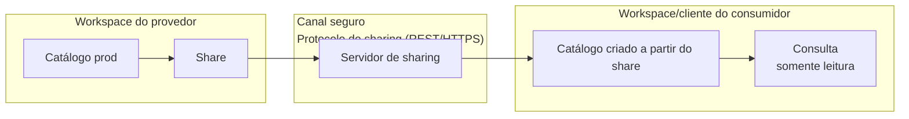

# Compartilhamento de Dados (Delta Sharing / OpenSharing)

## Visão geral

O Delta Sharing é um protocolo aberto e seguro para compartilhar dados entre organizações **sem copiar os dados** e sem distribuir credenciais de storage. Ele permite que provedores compartilhem dados vivos e curados com consumidores dentro e fora da organização.

> [!abstract] Resumo
>
> - Delta Sharing (agora chamado **OpenSharing**) compartilha tabelas vivas com outras organizações ou workspaces sem copiar dados
> - Provedores criam **shares** e **recipients**. Compartilhamento Databricks-to-Databricks usa um *sharing identifier*; o compartilhamento aberto (open sharing) usa tokens/arquivo de credencial
> - Recipients têm acesso **somente leitura**. Compartilhe views ou tabelas filtradas para limitar o que é exposto

> [!tip] O que a prova cobra
>
> - **Não faz parte** do outline da prova de agosto de 2026. Mantenha como contexto para cenários de governança e para a prova Professional
> - Diferenciar compartilhamento (sem cópia, entre organizações) de Lakehouse Federation (consultar bancos externos no lugar)

> [!note] Atualização da plataforma (out/2026)
> "Após o lançamento do OpenSharing open source, o Delta Sharing agora é OpenSharing" (10/06/2026). Este arquivo mantém o nome Delta Sharing usado em materiais antigos.

---

## Arquitetura



## Vantagens

| Aspecto | Exportação tradicional | Delta Sharing |
|--------|---|---|
| **Cópia de dados** | Cópia completa (custo, latência) | Referência viva, sem cópia |
| **Atualidade** | Snapshot desatualizado | Sempre atual |
| **Controle de acesso** | Arquivo tudo-ou-nada | Por tabela, partição, view |
| **Auditoria** | Limitada | Logs de acesso completos |
| **Credenciais** | Compartilhar credenciais (risco) | Sem compartilhar credenciais de storage |
| **Plataforma** | Formato do fornecedor | Protocolo aberto (Spark, pandas, Power BI, outros) |

## Do lado do provedor

```sql
-- 1. Criar o share
CREATE SHARE sales_data_2025 COMMENT 'Vendas 2025 para o parceiro de marketing';

-- 2. Adicionar objetos (o provedor controla o que é compartilhado)
ALTER SHARE sales_data_2025 ADD TABLE prod.analytics.orders;
ALTER SHARE sales_data_2025 ADD TABLE prod.analytics.revenue;
-- Também é possível compartilhar views, volumes, modelos e partições específicas

-- 3. Criar o recipient
--    Databricks-to-Databricks: usa o sharing identifier do metastore do consumidor
CREATE RECIPIENT partner_dbx USING ID 'aws:us-west-2:<metastore-uuid>';
--    Open sharing (consumidor fora da Databricks): gera link de ativação/credencial
CREATE RECIPIENT partner_open COMMENT 'Parceiro externo sem Databricks';

-- 4. Conceder o share ao recipient
GRANT SELECT ON SHARE sales_data_2025 TO RECIPIENT partner_dbx;

SHOW SHARES;
SHOW ALL IN SHARE sales_data_2025;
SHOW GRANTS ON SHARE sales_data_2025;
```

## Do lado do consumidor

```sql
-- Databricks-to-Databricks: criar um catálogo (somente leitura) a partir do share
CREATE CATALOG shared_sales USING SHARE provider_name.sales_data_2025;

SELECT * FROM shared_sales.analytics.orders;
```

Consumidores fora da Databricks usam o arquivo de credencial (open sharing) com conectores como o cliente Python `delta-sharing`, Spark, pandas ou Power BI.

## Sharing vs Federation vs cópia

| Necessidade | Use |
| :--- | :--- |
| Dar a outra organização acesso de leitura a dados vivos, sem copiar | **Delta Sharing / OpenSharing** |
| Consultar um banco externo (PostgreSQL, Snowflake...) sem ingerir | **Lakehouse Federation** |
| Ter uma cópia governada e histórica dos dados de outra fonte | **Ingestão** (Lakeflow Connect, Auto Loader, JDBC) |

## Pontos de atenção

- Recipients têm acesso **somente leitura**
- Tabelas com **row filters / column masks por tabela** não podem ser compartilhadas via Delta Sharing — compartilhe uma view ou uma tabela derivada
- Use **views** ou **partições** compartilhadas para expor apenas o subconjunto necessário
- O provedor pode revogar o acesso a qualquer momento com `REVOKE SELECT ON SHARE ... FROM RECIPIENT ...`

## Dicas para a prova

- Delta Sharing = compartilhar **sem copiar**, somente leitura, entre organizações/plataformas
- Objetos: **share** (o que é compartilhado) + **recipient** (quem recebe)
- D2D usa sharing identifier; open sharing usa credencial/token
- Não confunda com Lakehouse Federation, que consulta bancos externos

## Tópicos relacionados

- [Unity Catalog Básico](./01-unity-catalog-basics.md)
- [Controle de acesso e permissões](./03-access-control-permissions.md)
- [Row Filters, Column Masks e ABAC](./04-row-filters-column-masks-abac.md)

## Documentação oficial

- [What is Delta Sharing / OpenSharing?](https://docs.databricks.com/aws/en/delta-sharing/)
- [Create and manage shares](https://docs.databricks.com/aws/en/delta-sharing/create-share)
- [Create and manage recipients](https://docs.databricks.com/aws/en/delta-sharing/create-recipient)

---

**[← Anterior: Row Filters, Column Masks e ABAC](./04-row-filters-column-masks-abac.md) | [↑ Voltar para Governance and Security](./README.md)**
