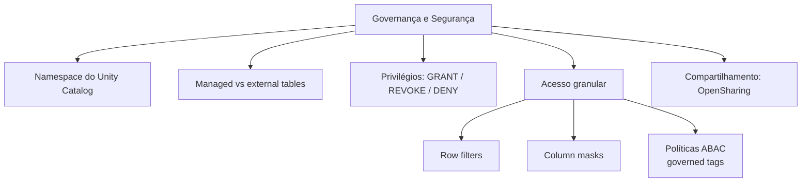

# Governance and Security (15 % da prova)

O Domínio 7 cobre o Unity Catalog como camada de governança. Você diferencia **managed e external tables** e faz operações básicas com elas: criar, modificar, remover e converter nos dois sentidos. Configura acesso com **GRANT, REVOKE e DENY** para usuários, grupos e service principals no nível certo da hierarquia. Também restringe a visibilidade com **row filters e column masks**, e em escala com **políticas ABAC do Unity Catalog**.

> [!important] DENY no Unity Catalog
> O exam guide lista **DENY** junto com GRANT e REVOKE. Na documentação atual, o comando SQL clássico `DENY` vale só para o catálogo legado `hive_metastore` e "não é suportado pelo Unity Catalog". O mecanismo de negação do Unity Catalog é a **política ABAC DENY (Beta)**, que hoje só consegue negar `MANAGE ACCESS CONTROL`. Veja [03-access-control-permissions.md](./03-access-control-permissions.md) para o quadro completo.

## Visão geral dos tópicos

## Conteúdo da seção

| Arquivo | Tópico | Prioridade |
| :--- | :--- | :--- |
| [01-unity-catalog-basics.md](./01-unity-catalog-basics.md) | Metastore, namespace de três níveis, catalogs, schemas, volumes, external locations | Alta |
| [02-managed-and-external-tables.md](./02-managed-and-external-tables.md) | Managed vs external, create/alter/drop/UNDROP, `SET MANAGED` / `UNSET MANAGED` | Alta |
| [03-access-control-permissions.md](./03-access-control-permissions.md) | Principals, privilégios, herança, GRANT / REVOKE, DENY, ownership | Alta |
| [04-row-filters-column-masks-abac.md](./04-row-filters-column-masks-abac.md) | Row filters, column masks, `is_account_group_member()`, dynamic views, políticas ABAC | Alta |
| [05-data-sharing.md](./05-data-sharing.md) | Delta Sharing (agora OpenSharing): shares, recipients | Baixa (fora do outline de agosto de 2026) |

## Cobertura das habilidades oficiais (agosto de 2026)

| Habilidade do exam guide (parafraseada) | Onde é coberta |
| :--- | :--- |
| Managed vs external tables; criar, modificar, apagar, converter entre elas | [02](./02-managed-and-external-tables.md), [01](./01-unity-catalog-basics.md) |
| GRANT, REVOKE e DENY para usuários, grupos e service principals via UI e SQL | [03](./03-access-control-permissions.md) |
| Mascaramento por coluna e segurança por linha conforme o grupo do usuário | [04](./04-row-filters-column-masks-abac.md) |
| Políticas ABAC do Unity Catalog para row filtering e column masking centralizados | [04](./04-row-filters-column-masks-abac.md) |

## Conceitos-chave

- **Namespace de três níveis**: `catalog.schema.object`
- **Privilégios de uso**: `USE CATALOG` + `USE SCHEMA` são necessários para chegar a qualquer objeto, mas sozinhos não dão acesso aos dados
- **Herança**: um grant em um catálogo ou schema cobre os objetos filhos atuais *e futuros*
- **Managed tables**: o UC é dono do ciclo de vida e do layout. Após `DROP`, os dados podem ser recuperados com `UNDROP` por 7 dias (padrão)
- **External tables**: `DROP` remove apenas os metadados; os arquivos continuam no seu storage
- **Row filter / column mask**: uma SQL UDF anexada com `SET ROW FILTER` ou `SET MASK`, normalmente condicionada a `is_account_group_member()`
- **ABAC**: `CREATE POLICY ... ROW FILTER | COLUMN MASK ... FOR TABLES` anexada no nível de catálogo, schema ou tabela, e aplicada por governed tags

## Próximos passos

Você terminou as pastas de conteúdo. Teste-se com as [questões práticas](../../questoes/README.md) e os simulados — de preferência no [site de estudos](../../site/index.html).

---

**[← Anterior: Troubleshooting, Monitoring, and Optimization](../06-troubleshooting-monitoring-and-optimization/README.md) | [↑ Voltar à Certificação](../README.md)**
