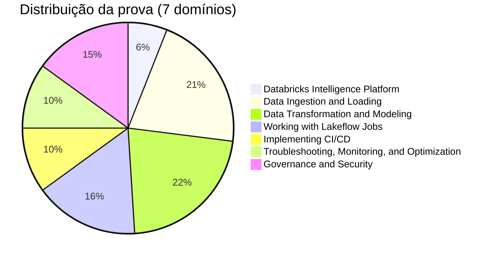

# Databricks Certified Data Engineer Associate

> [!important] O que mudou no exam guide de agosto de 2026
> (prova publicada em 04/05/2026; guia atualizado em 06/08/2026)
>
> - **7 domínios com peso oficial**, publicados pela primeira vez desde a reformulação de maio de 2026: Databricks Intelligence Platform 6 %, Data Ingestion and Loading 21 %, Data Transformation and Modeling 22 %, Working with Lakeflow Jobs 16 %, Implementing CI/CD 10 %, Troubleshooting, Monitoring, and Optimization 10 %, Governance and Security 15 %
> - O guia agora diz explicitamente: **45 questões pontuadas + até 10 itens não pontuados** em 90 minutos. O tempo extra dos itens não pontuados já está incluído
> - **Recertificação:** faça o *Data Engineer Associate Renewal Exam* ou a prova completa atual
> - Em CI/CD, os nomes agora são **Declarative Automation Bundles (antigo Databricks Asset Bundles)** e **Databricks Git folders (antigo Databricks Repos)**
> - A preparação oficial aponta para o **AI Prep Guide** e prática no **Databricks Free Edition**
> - As questões de exemplo foram atualizadas. A questão de skew agora é uma agregação `groupBy`, em que o tratamento de skew join do AQE não ajuda e você faz salting na chave
> - Aprovado/reprovado: **a Databricks não publica a nota mínima**
>
> As pastas de conteúdo abaixo correspondem **1 : 1 aos 7 domínios oficiais**. O PDF oficial é a fonte da verdade: [exam guide de agosto de 2026 (PDF)](https://www.databricks.com/sites/default/files/2026-10/Databricks-Certified-Data-Engineer-Associate-Exam-Guide-August-2026.pdf).

> [!note] Atualização da plataforma (out/2026)
> Alguns nomes de produtos mudaram desde que o guia foi escrito. Este material usa os nomes da prova e indica os nomes atuais onde aparecem:
>
> - **Lakeflow Declarative Pipelines** (antigo DLT) foi renomeado para **Lakeflow Spark Declarative Pipelines** em 12/11/2025. A documentação também usa a forma curta "Lakeflow pipelines"
> - **Databricks Asset Bundles** foi renomeado para **Declarative Automation Bundles** em 16/03/2026
> - **Delta Sharing** agora é **OpenSharing** desde 10/06/2026
> - O **Community Edition** foi aposentado no fim de 2025. Use o [Databricks Free Edition](https://docs.databricks.com/aws/en/getting-started/free-edition) para praticar
> - A página da certificação agora chama a plataforma de **Databricks Data + AI Platform**. O domínio 1 da prova continua se chamando "Databricks Intelligence Platform"

## Visão geral da prova

| Detalhe | Informação |
| ------------------- | -------------------------------------------- |
| **Certificação** | Databricks Certified Data Engineer Associate |
| **Exam guide** | [Agosto 2026 (PDF)](https://www.databricks.com/sites/default/files/2026-10/Databricks-Certified-Data-Engineer-Associate-Exam-Guide-August-2026.pdf) |
| **Questões pontuadas** | 45 de múltipla escolha (+ até 10 não pontuadas) |
| **Duração** | 90 minutos (inclui o tempo das não pontuadas) |
| **Resultado** | Aprovado/reprovado (nota mínima não publicada) |
| **Idiomas** | Inglês, japonês, português (BR), coreano |
| **Código nos enunciados** | SQL quando possível, senão Python |
| **Experiência** | 6+ meses de prática com Databricks (recomendado) |
| **Pré-requisitos** | Nenhum obrigatório; treinamento relacionado é altamente recomendado |
| **Recertificação** | A cada 2 anos: Renewal Exam ou prova completa atual |
| **Custo** | US$ 200 (mais impostos) |
| **Aplicação** | Online com fiscal ou centro de testes |
| **Material de apoio** | Nenhum permitido |

## Pesos dos domínios (oficial — agosto 2026)

| Domínio | Peso | ≈ Questões (de 45) |
| :--- | :---: | :---: |
| Databricks Intelligence Platform | 6 % | ~3 |
| Data Ingestion and Loading | 21 % | ~9 |
| Data Transformation and Modeling | 22 % | ~10 |
| Working with Lakeflow Jobs | 16 % | ~7 |
| Implementing CI/CD | 10 % | ~5 |
| Troubleshooting, Monitoring, and Optimization | 10 % | ~4 |
| Governance and Security | 15 % | ~7 |

As quantidades são estimativas a partir dos pesos. A Databricks publica percentuais, não quantidades por domínio.

## Tópicos de estudo

Leia em ordem. O `README.md` de cada pasta mapeia seus arquivos às habilidades oficiais.

| Seção | Peso | Tópicos |
| :--- | :---: | :--- |
| [01 — Databricks Intelligence Platform](./01-databricks-intelligence-platform/README.md) | 6 % | Arquitetura, workspace, compute e custos, Delta Lake, time travel |
| [02 — Data Ingestion and Loading](./02-data-ingestion-and-loading/README.md) | 21 % | Padrões de ingestão, Lakeflow Connect (standard e managed), COPY INTO, Auto Loader, JDBC/REST, dados semiestruturados |
| [03 — Data Transformation and Modeling](./03-data-transformation-and-modeling/README.md) | 22 % | Spark SQL, DataFrames, joins, agregações, limpeza, qualidade, objetos Gold, tuning |
| [04 — Working with Lakeflow Jobs](./04-working-with-lakeflow-jobs/README.md) | 16 % | Tasks e DAGs, control flow (retries, If/else, For each), triggers (agendado, file arrival, table update) |
| [05 — Implementing CI/CD](./05-implementing-cicd/README.md) | 10 % | Git folders, Declarative Automation Bundles (variables, targets, deploy), Databricks CLI |
| [06 — Troubleshooting, Monitoring, and Optimization](./06-troubleshooting-monitoring-and-optimization/README.md) | 10 % | Histórico de execuções, status, Spark UI (skew, shuffle, spill), Liquid Clustering, predictive optimization, falhas de compute |
| [07 — Governance and Security](./07-governance-and-security/README.md) | 15 % | Unity Catalog, managed vs external, GRANT / REVOKE / DENY, row filters, column masks, ABAC |

### Prática e recursos

| Recurso | Descrição |
| :--- | :--- |
| [Site de estudos](../site/index.html) | Aulas + exercícios com correção imediata, caderno de erros, pontos fracos e revisão espaçada |
| [Questões práticas](../questoes/README.md) | 145 questões agrupadas pelos 7 domínios (em inglês) |
| [Simulado 1](../questoes/simulado-1/README.md) | Prova completa (45 questões) |
| [Simulado 2](../questoes/simulado-2/README.md) | Prova alternativa (45 questões) |
| [Dicas para a prova](./recursos/dicas-prova.md) | Estratégias e formato da prova |
| [Revisão final](./recursos/revisao-final.md) | Revisão relâmpago para a manhã da prova |
| [Links oficiais](./recursos/links-oficiais.md) | Documentação e inscrição |

## Acompanhamento de progresso

### Fase 1: Plataforma e ingestão

- [ ] 01 — Databricks Intelligence Platform (arquitetura, compute, Delta Lake)
- [ ] 02 — Data Ingestion and Loading (Lakeflow Connect, COPY INTO, Auto Loader, JDBC/REST)

### Fase 2: Transformação e orquestração

- [ ] 03 — Data Transformation and Modeling (limpeza, joins, objetos Gold, qualidade, tuning)
- [ ] 04 — Working with Lakeflow Jobs (tasks, control flow, triggers)

### Fase 3: Pronto para produção

- [ ] 05 — Implementing CI/CD (Git folders, Declarative Automation Bundles, Databricks CLI)
- [ ] 06 — Troubleshooting, Monitoring, and Optimization (histórico, Spark UI, Liquid Clustering)
- [ ] 07 — Governance and Security (managed vs external, privilégios, máscaras, ABAC)

### Fase 4: Prática

- [ ] Fazer exercícios práticos no [Databricks Free Edition](https://docs.databricks.com/aws/en/getting-started/free-edition)
- [ ] Completar as questões práticas (meta: 70 %+ por domínio)
- [ ] Fazer o Simulado 1 (cronometrado)
- [ ] Revisar os pontos fracos e zerar o caderno de erros
- [ ] Fazer o Simulado 2

## Recursos oficiais

- [Página da certificação Databricks](https://www.databricks.com/learn/certification/data-engineer-associate)
- [Exam guide de agosto 2026 (PDF)](https://www.databricks.com/sites/default/files/2026-10/Databricks-Certified-Data-Engineer-Associate-Exam-Guide-August-2026.pdf)
- [Documentação Databricks](https://docs.databricks.com/)
- [Databricks Academy](https://www.databricks.com/learn/training)
- [Databricks Free Edition](https://docs.databricks.com/aws/en/getting-started/free-edition)

---

**[← Voltar ao início](../README.md)**
